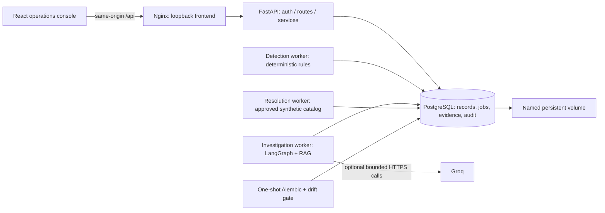
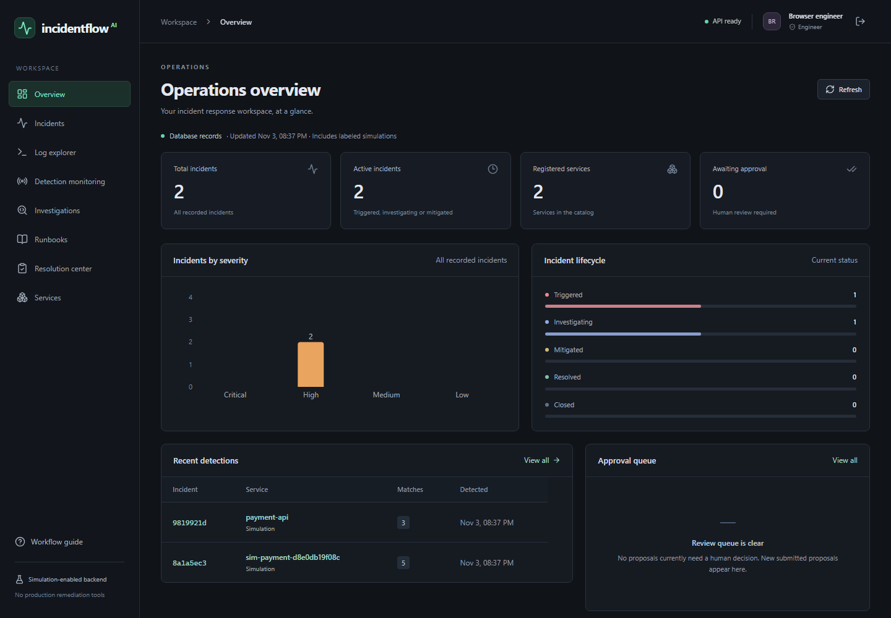
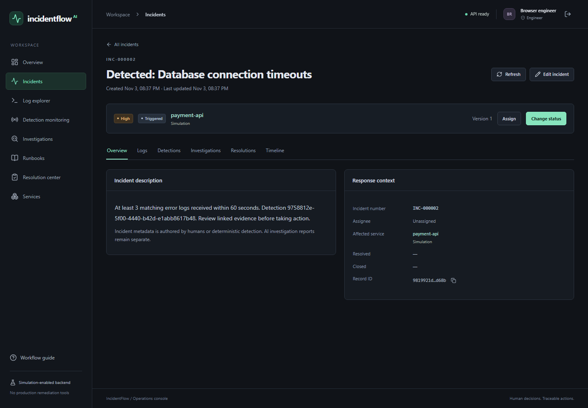
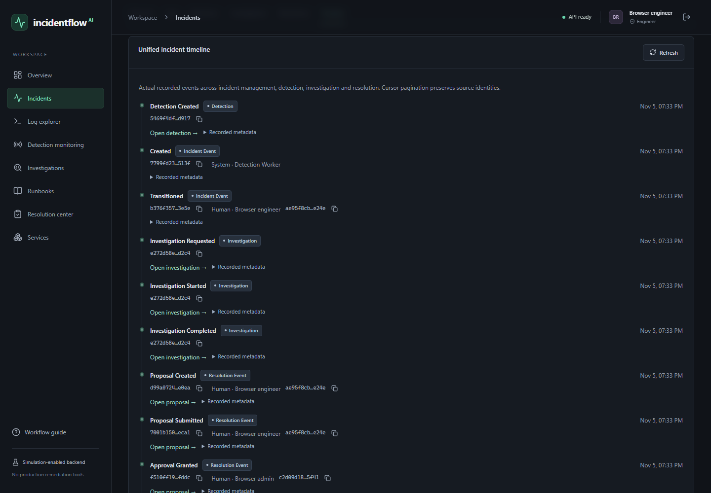
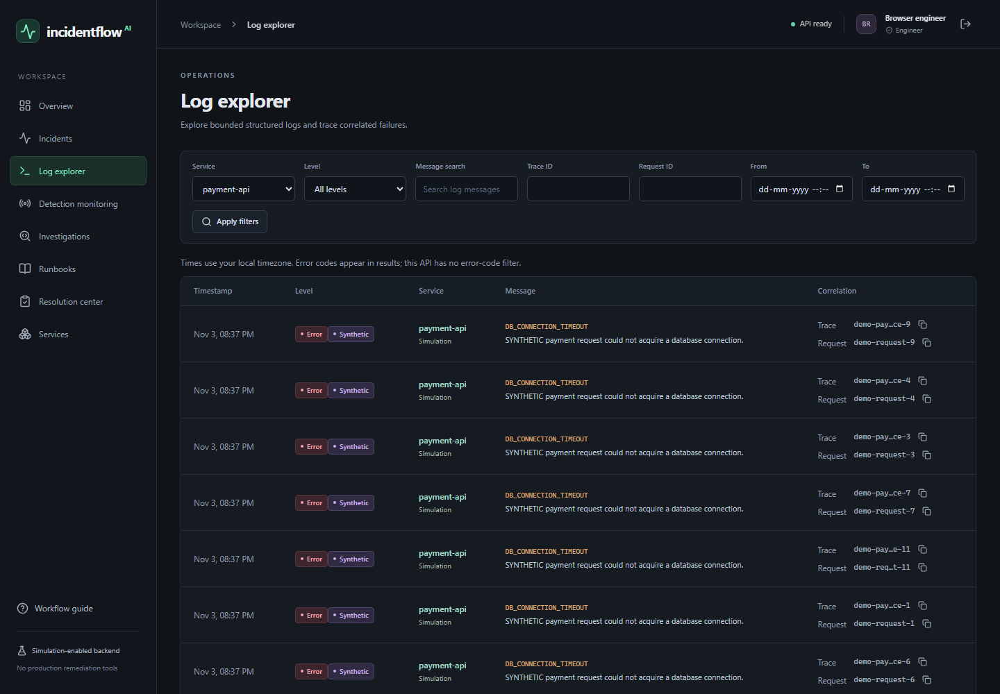
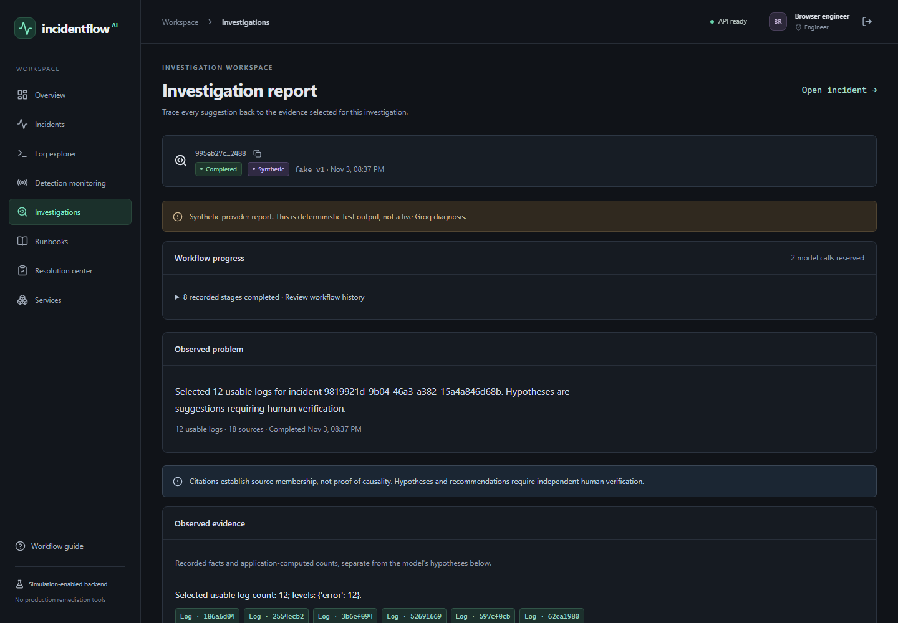
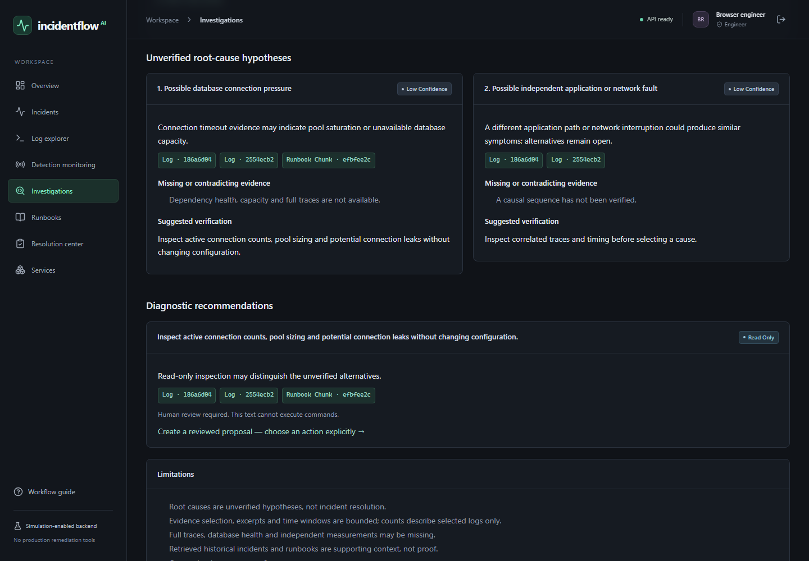
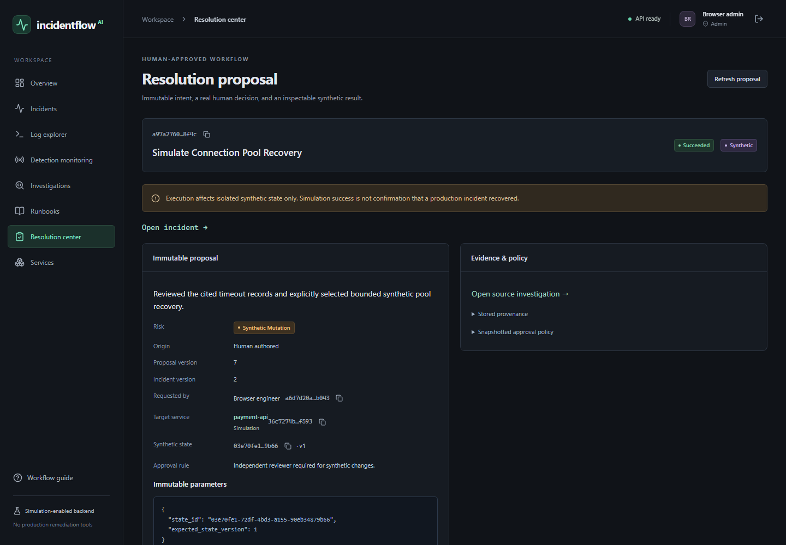
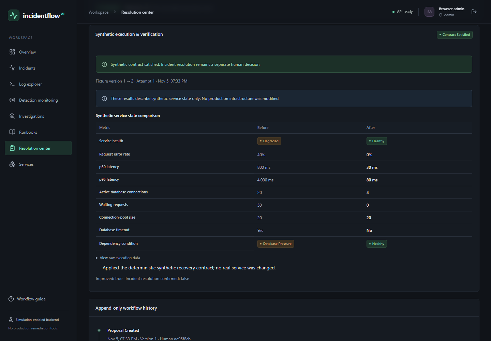

# IncidentFlow AI

An incident response workbench built with FastAPI, PostgreSQL and React. It turns structured logs into deterministic incident records, investigates bounded evidence with LangGraph, and makes human review part of every simulated resolution.

The project follows the full path from an incoming error to a traceable decision. It keeps observations, AI suggestions and approved actions separate so an operator can see what is known, what remains uncertain and who authorized a change.

## What it does

- **Incident management:** versioned edits, assignment, lifecycle transitions and append-only history, with admin/engineer/viewer permissions.
- **Log ingestion and detection:** scoped producer credentials, bounded structured logs, receipt-time rolling windows, deduplication and durable PostgreSQL jobs. Detection is rule-based, not AI.
- **Evidence-grounded investigations:** eight persisted LangGraph stages, PostgreSQL full-text retrieval over runbooks/history, optional Groq reasoning, source citations and explicit uncertainty.
- **Human-approved resolution:** immutable proposals, allowlisted actions, expiring approval and a different human reviewer for synthetic state changes. Execution changes only isolated synthetic fixtures.
- **Operations console:** real database aggregates, server-side filters/pagination, readable service labels, copyable IDs, traceable evidence, safe job diagnostics and a unified timeline.
- **Reproducible local deployment:** Nginx, API, three independent workers, PostgreSQL persistence, migration gates, health checks and automated verification.

## Architecture



The API owns authentication, authorization and request transactions. Workers claim persisted jobs with leases and fencing tokens. The browser displays authoritative backend records; it does not invent metrics, approve work or execute generated text. See [the architecture](docs/architecture.md) and [deployment boundaries](docs/phase6_deployment.md).

### Detection pipeline

A scoped machine credential accepts structured logs for one service. Unique events create durable jobs. The detection worker evaluates receipt-time windows against stored rule versions, records threshold witnesses and creates or correlates an incident atomically. Replaying a batch does not create duplicate logs or incidents. Historical rule evidence stays inspectable.

### Investigation and RAG

The graph persists context, log collection, knowledge retrieval, deterministic analysis, hypotheses, recommendations, validation and a final report. RAG uses **PostgreSQL full-text search**, not an embeddings service. Only the hypothesis and recommendation stages call the selected provider.

Every generated item must cite supplied, nonquarantined evidence. Pydantic validation, redaction, injection screening and output guards remain mandatory. Citation membership does not prove semantic correctness: hypotheses need independent verification. Completed checkpoints are reused, while durable call/token/time budgets and error-aware retries bound failures. [Groq debugging and the prior successful bounded live run](docs/groq_investigation_debugging.md) document what was actually verified.

### Human-approved synthetic resolution

A human chooses an allowlisted action and reviews the target, evidence and immutable proposal. Every action requires approval; synthetic mutations require a different engineer/admin reviewer. A separate worker revalidates approval and context, commits synthetic effects and records deterministic verification. **Simulation success never automatically resolves the incident or modifies production infrastructure.**

## Technology

| Area | Implementation |
| --- | --- |
| Backend | Python 3.12, FastAPI, Pydantic v2, async SQLAlchemy, asyncpg |
| Storage | PostgreSQL 17, Alembic migrations 0001-0004, PostgreSQL-backed durable jobs |
| Investigation | LangGraph, Groq SDK, deterministic fake adapter, PostgreSQL full-text RAG |
| Frontend | React 19, strict TypeScript, Vite, React Router, TanStack Query, Tailwind CSS, Recharts, Lucide |
| Deployment | Docker Compose, reusable non-root Python image, unprivileged Nginx 1.30.6 |
| Verification | pytest, Ruff, Vitest/Testing Library, Playwright Chromium, OpenAPI contract checking, GitHub Actions |

Python and npm dependency graphs are committed in `uv.lock` and `frontend/package-lock.json`. The frontend build uses Node 22.23.4; use a version supported by `frontend/package.json` for host development.

## Quick start: Docker and PowerShell

Start Docker Desktop with Linux containers. Run from this repository's root. Keep an existing private `.env`; **do not overwrite it or remove an existing Groq key**. On a fresh checkout only, generate independent local secrets:

```powershell
uv run --locked python scripts/init_env.py
```

The default Groq provider can remain unconfigured: normal incident/log/detection functionality still starts. For a fully local AI demonstration, explicitly select these two values in the private `.env`, keeping `ENVIRONMENT=development`:

```dotenv
INVESTIGATION_LLM_PROVIDER=fake
INVESTIGATION_LLM_MODEL=fake-v1
```

Production settings reject the fake adapter. To start the complete application:

```powershell
docker compose config --quiet
docker compose up --build -d --wait --wait-timeout 180
Start-Process http://127.0.0.1:8080
```

Only the frontend publishes a loopback host port, configurable with `FRONTEND_PORT`. The API and PostgreSQL use Docker service names internally; your host `DATABASE_URL` is preserved and not reused inside containers. Images use version-neutral local tags `incidentflow-backend:local` and `incidentflow-frontend:local`.

There is no default account or automatic registration. Existing accounts remain valid. [Provision an account explicitly](docs/docker_operations.md#complete-application), then sign in. Use a genuinely separate engineer/admin account for independent approval. Tokens stay in browser memory; refresh requires signing in again.

```powershell
docker compose ps
Invoke-RestMethod http://127.0.0.1:8080/api/v1/ready
docker compose logs --tail 100 detection-worker investigation-worker resolution-worker
docker compose restart detection-worker
# Normal shutdown retains accounts, reports and history:
docker compose down
```

The named `incidentflow_postgres_data` volume is retained. Never use `down -v` for normal shutdown. [Operations documentation](docs/docker_operations.md) covers provisioning, safe migrations, native backups, separate-target restoration and the optional host Python/Vite workflow.

## Demonstrate the complete workflow

1. With the fake provider selected, ingest the labeled database-failure scenario using the existing [HTTP-only demo](docs/log_ingestion.md). For Docker, set `SIM_API_URL=http://127.0.0.1:8080` in that demo terminal.
2. Open the detected incident, inspect its logs/detection witnesses and transition it to investigating with a human reason.
3. Start an investigation. Read the observations, unverified alternatives, missing evidence and source citations.
4. Initialize the service's isolated synthetic scenario as an admin. Create an allowlisted recovery proposal from the incident, selecting evidence and writing a human explanation.
5. Submit it, have a distinct authorized human review it, then inspect the synthetic before/after state, verification and incident timeline. Resolve the incident separately only if a human decides the evidence warrants it.

The [operator guide](docs/dashboard_user_guide.md) explains each step. Automated browser fixtures repeat this workflow against isolated databases with generated credentials; they never require a real Groq key. A reproducible screenshot command is documented [with the screenshots](docs/screenshots/README.md).

## Dashboard preview

Actual browser captures from isolated synthetic fixtures, all at 1440 x 1000. These show real API/database/worker results using the explicitly labeled fake provider. No private accounts, credentials or production telemetry appear.



<details>
<summary>Incident, logs, investigation and approval screenshots</summary>









</details>

## Tests and CI

```powershell
uv sync --locked
docker compose --profile test up -d --wait postgres-test
uv run --locked pytest -q
uv run --locked ruff check backend scripts
uv run --locked ruff format --check backend scripts
uv run --locked python scripts/check_release.py
Push-Location frontend
try {
    npm ci
    npm run typecheck
    npm run lint
    npm test
    npm run build
    npm run api:check
    npx playwright install chromium
    npm run test:e2e
} finally { Pop-Location }
docker compose build api frontend
uv run --locked python scripts/verify_containers.py
```

Backend/browser fixtures enforce the dedicated local test database and own migrated schemas. Container acceptance uses a separate generated Compose project/volume. It checks proxy authentication, all browser workflows, worker crash recovery, restart/persistence, native backup/restore, absent-Groq behavior, production fake rejection and image secret scans. It never resets the development volume.

The four GitHub Actions jobs cover backend quality/tests, frontend quality/contracts, browser integration and container acceptance. Actions are pinned, permissions are read-only, and no images are published or production infrastructure deployed. **Local verification does not establish that GitHub-hosted runs passed.** Actual final counts and verification limits are in [the finalization record](docs/phase7_finalization.md).

## Security and limitations

- Detection is deterministic. Model conclusions are suggestions, not proven diagnoses.
- Groq is optional, external and potentially chargeable; automated checks use fake inference or mocked SDK HTTP. Crashes can repeat an ambiguous remote charge within the saved budget.
- All resolution execution is synthetic, allowlisted and human-approved. There are no unrestricted model tools, shell commands or production remediation.
- This is a loopback Compose deployment, not managed cloud hosting. Public exposure needs HTTPS/trusted ingress, identity/account policy, monitoring, encrypted off-host backups and stronger abuse controls.
- SQL role separation, a token revocation/refresh service, log retention/partitioning and account-aware distributed rate limiting are not implemented.
- Secret screening and citation guards are conservative heuristics, not proof against every secret encoding, prompt injection or semantic error.

[Deployment security](docs/security_deployment.md) explains implemented controls and remaining responsibilities. Secrets are runtime-only; `.env`, caches, virtual environments, dependencies and backups are excluded from publication/build contexts.

## Source map and documentation

```text
backend/app/     API, services, repositories, models, investigations, workers, operations
backend/alembic/ Four preserved schema migrations
backend/tests/   API, PostgreSQL, concurrency, recovery, safety and release checks
frontend/src/    Typed feature workspaces and shared UI
frontend/e2e/    Real workflows, accessibility smoke checks and optional screenshots
deploy/         Multi-stage Dockerfiles and Nginx configuration
scripts/        Environment setup, browser/container harnesses and release audit
docs/           Architecture, operator guides, screenshots and interview preparation
.github/        Four-job verification workflow
```

- [Architecture](docs/architecture.md) | [Frontend architecture](docs/frontend_architecture.md)
- [Dashboard guide](docs/dashboard_user_guide.md) | [Ingestion and demos](docs/log_ingestion.md)
- [Investigations and RAG](docs/ai_investigation.md) | [Prompt/evidence safeguards](docs/investigation_prompts_and_safety.md)
- [Resolution and approval](docs/resolution_workflows.md) | [Approval security](docs/approval_security.md)
- [Docker operations](docs/docker_operations.md) | [CI](docs/ci_cd.md) | [Deployment security](docs/security_deployment.md)
- [Interview preparation](docs/interview_preparation.md) | [Finalization and publication checklist](docs/phase7_finalization.md)

Earlier phase guides retain their design decisions and historical validation records. Development used Codex assistance; the interview guide emphasizes understanding and modifying the actual implementation.

## License

[MIT](LICENSE), selected by the project owner. Dependencies retain their own licenses.
