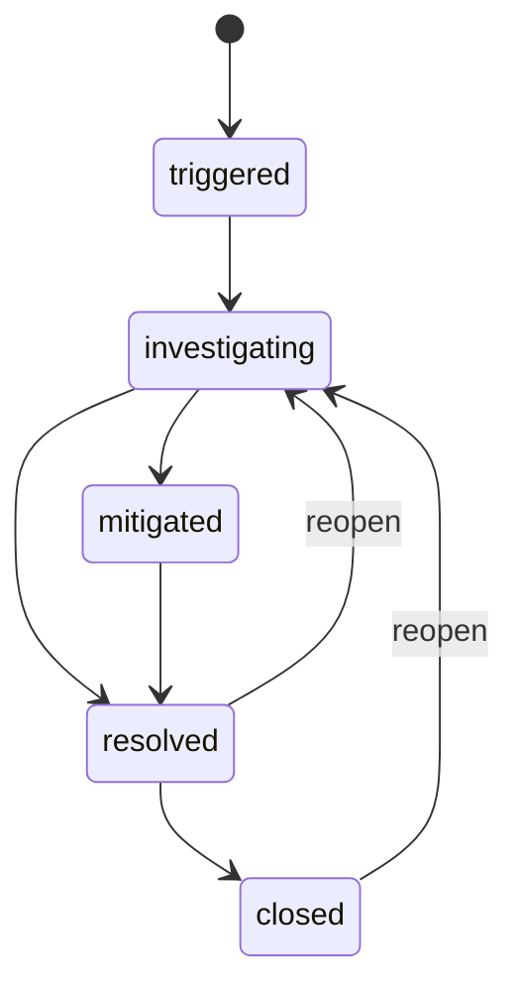

# API reference

Phase 5 adds authenticated read models and API no-store headers. Existing writes, roles, versions, migrations and workers are preserved. New GET paths below are relative to `/api/v1`:

| Path | Response and bounds |
| --- | --- |
| `/dashboard/overview` | SQL-grouped incident/severity/status/service/proposal counts; at most eight recent detections/investigations/pending approvals and twelve actual activity records |
| `/dashboard/investigations` | `Page[InvestigationRead]`; limit 1–100, offset 0–100000, optional incident_id/status |
| `/dashboard/resolution-proposals` | `Page[ProposalRead]`; same bounded filters |
| `/directory/users` | Bounded eligible admin/engineer IDs, display names and roles; no email/password/hash fields |
| `/incidents/{id}/detections` | Bounded occurrences scoped to exactly this incident; missing incident 404 |

All human roles may read these models; anonymous requests receive 401. Counts describe stored records, including simulations. READ COMMITTED aggregates are not an immutable analytics snapshot. Normally processed `/api/` responses include `Cache-Control: no-store` and `Pragma: no-cache`; the browser also requests no-store and keeps a bounded memory cache. See [frontend architecture](frontend_architecture.md) for generated contracts, filters, errors and invalidation.

Base URL locally: `http://127.0.0.1:8000/api/v1`. Interactive schemas: `/docs`; machine-readable specification: `/openapi.json`.

## Authentication and permissions

`POST /auth/token` accepts `application/x-www-form-urlencoded`: `username=<email>&password=<password>`. It returns `access_token`, `token_type: bearer`, and `expires_in` in seconds. Use `Authorization: Bearer <access_token>` on protected requests. `GET /auth/me` returns the UUID, email, display name, role, and timestamps. Use the bootstrap CLI to provision local users; there is no registration endpoint.

| Operation | Admin | Engineer | Viewer | Anonymous |
| --- | --- | --- | --- | --- |
| GET health/ready, docs/OpenAPI | Yes | Yes | Yes | Yes |
| POST auth/token with valid credentials | Yes | Yes | Yes | Yes |
| GET auth/me, services, incidents, events | Yes | Yes | Yes | No |
| POST/PATCH services | Yes | No | No | No |
| POST/PATCH incidents, PUT assignee, POST transitions | Yes | Yes | No | No |
| Modify/delete events, delete incidents/services | No endpoint | No endpoint | No endpoint | No endpoint |

All state-changing payloads use JSON except the login form. Extra JSON fields are rejected. Mutation requests have bounded string sizes; timestamps in filters must have explicit timezone offsets.

Phase 2 adds machine authentication only for `/logs/ingest`: `X-Ingestion-Key` must identify an unrevoked, unexpired credential scoped to the envelope's service. Human JWT permissions are unchanged. All human roles can read logs/rules/detections/evidence. Only admins can manage rules/keys or inspect/retry detection jobs. A human JWT alone cannot ingest, and a machine key alone cannot access human JWT endpoints.

Phase 3 retains JWT roles: admins/engineers start/cancel investigations and append human resolution notes; only admins create/replace/upload/reindex runbooks. All human roles read investigation status/report/evidence/steps, runbooks and similar-incident results. No endpoint accepts a client-selected provider key, system actor, model tool, SQL query or executable recommendation.

## Endpoints

| Method | Path | Success | Purpose |
| --- | --- | --- | --- |
| GET | /health | 200 | Process liveness; does not require database |
| GET | /ready | 200 / 503 | Database connectivity and migration revision |
| POST | /auth/token | 200 | Short-lived JWT |
| GET | /auth/me | 200 | Current database user and role |
| POST | /services | 201 | Create catalog service; Location header |
| GET | /services | 200 | Name-sorted paginated catalog |
| GET | /services/{service_id} | 200 | Retrieve by UUID |
| PATCH | /services/{service_id} | 200 | Change provided catalog fields |
| POST | /incidents | 201 | Create triggered incident and first event; Location header |
| GET | /incidents | 200 | Filtered, sorted page |
| GET | /incidents/{incident_id} | 200 | Retrieve incident and current version |
| PATCH | /incidents/{incident_id} | 200 | Edit title, description, severity, service |
| PUT | /incidents/{incident_id}/assignee | 200 | Assign or explicitly unassign |
| POST | /incidents/{incident_id}/transitions | 200 | Transition or reopen, with a reason |
| GET | /incidents/{incident_id}/events | 200 | Append-only, version-ordered event page |
| POST | /logs/ingest | 202 | Atomic bounded batch + durable jobs; scoped machine key |
| GET | /logs | 200 | Filtered, full-text-searchable source-time log page |
| GET | /logs/{log_id} | 200 | Retrieve one log |
| POST | /ingestion-credentials | 201 | Admin issues scoped key, plaintext returned once |
| GET | /ingestion-credentials | 200 | Admin metadata-only page, optional service filter |
| GET | /ingestion-credentials/{id} | 200 | Admin metadata only |
| POST | /ingestion-credentials/{id}/revoke | 200 | Admin idempotent revocation |
| POST | /detection-rules | 201 | Admin creates a rule |
| GET | /detection-rules | 200 | Rule page; service/enabled filters |
| GET | /detection-rules/{id} | 200 | Rule with current version |
| PATCH | /detection-rules/{id} | 200 | Admin edits/activates/deactivates with expected_version |
| GET | /detections | 200 | Occurrence page; service/rule filters |
| GET | /detections/{id} | 200 | Trigger snapshot, window, incident and detection key |
| GET | /detections/{id}/logs | 200 | Paginated incident evidence |
| GET | /detection-jobs | 200 | Admin job page; service/status filters |
| GET | /detection-jobs/{id} | 200 | Admin attempts/lease-expiry/safe failure state |
| POST | /detection-jobs/{id}/retry | 200 | Admin requeues a failed job, retaining total attempt count |

Service create example:

```json
{"name":"checkout","description":"Checkout API","environment":"production"}
```

Incident create example (replace IDs with returned UUIDs):

```json
{
  "title": "Checkout HTTP errors",
  "description": "HTTP 503 rate rose after deployment",
  "severity": "high",
  "service_id": "00000000-0000-0000-0000-000000000001",
  "assignee_id": null
}
```

The response includes `id`, `incident_number`, all business fields, `status: triggered`, `version: 1`, and creation/update/resolution/closing timestamps. A missing assignee defaults to null. Assigned users must be engineers or admins.

Example PATCH:

```json
{"expected_version":1,"title":"Checkout outage confirmed","severity":"critical"}
```

`expected_version` is mandatory on PATCH, assignment, and transitions. PATCH accepts at least one non-null incident field. Status and assignee cannot be changed through PATCH. Metadata edits are permitted in every lifecycle state and still generate events. A request identical to current state is rejected with `409 no_change`. Service PATCH similarly requires at least one supplied non-null field, but has no version requirement.

Assignment and unassignment:

```json
{"expected_version":2,"assignee_id":"00000000-0000-0000-0000-000000000002"}
```

```json
{"expected_version":3,"assignee_id":null}
```

The `assignee_id` field is required even when null. Repeating an already-current assignment returns `409 no_change`.

## Lifecycle and reopen



Example transition:

```json
{"expected_version":1,"status":"investigating","reason":"On-call engineer began triage"}
```

`reason` must contain 1–2000 nonblank characters. A resolved/closed incident can reopen only to investigating, using this same endpoint and a reason. That operation records `reopened` and clears both resolution timestamps. Normal transitions record `transitioned`. Transition responses return the incremented version, which must be used for the next mutation. Invalid jumps and self-transitions return `409 invalid_transition`. On a version conflict, retrieve the incident and review the current state before retrying.

## Listing and history

All list responses use:

```json
{"items":[],"total":0,"limit":20,"offset":0}
```

`limit` defaults to 20 and accepts 1–100; `offset` defaults to 0 and accepts 0–100000. Event and service listing support those parameters too. Incident filters combine using AND:

| Parameter | Values / behavior |
| --- | --- |
| status | triggered, investigating, mitigated, resolved, closed |
| severity | critical, high, medium, low |
| service_id | UUID |
| assignee_id | UUID |
| unassigned | true to select only null assignees; incompatible with assignee_id |
| created_from | Inclusive creation timestamp lower bound, timezone required |
| created_to | Inclusive creation timestamp upper bound, timezone required |
| sort_by | created_at (default), updated_at, severity, incident_number |
| sort_order | desc (default), asc |

Default ordering is newest creation first with UUID as a deterministic tie breaker. Severity ascending is low → medium → high → critical. Incident number sorting is numeric. Date bounds filter creation time, not resolution time. Reversed bounds, unknown query fields, invalid UUIDs/enums, and unsupported sort values return 422. Count and page are separate queries under READ COMMITTED, so concurrent creations can move totals/pages.

Example:

```text
GET /api/v1/incidents?status=investigating&severity=critical&unassigned=true&sort_by=created_at&sort_order=desc&limit=20&offset=0
```

Events expose `id`, `incident_id`, `event_type`, `actor_id`/`system_actor`, `occurred_at`, `incident_version`, and structured `details`. Creation records a snapshot; update records field changes; assignment records from/to IDs; transitions record from/to statuses and reason. Event pages are ordered by ascending incident version.

## Error contract

```json
{"error":{"code":"version_conflict","message":"Incident changed; retrieve it and retry","details":[]}}
```

| Status | Typical meaning |
| --- | --- |
| 401 | Missing, invalid, expired token, deleted user, or incorrect login; WWW-Authenticate: Bearer |
| 403 | Authenticated role lacks permission |
| 404 | Incident, service, or assignee does not exist |
| 405 | Unsupported method, including history mutation/delete APIs |
| 409 | version_conflict, invalid_transition, no_change, or constraint_conflict |
| 409 | Phase 2 also: source_event_conflict, rule_limit, active_detection, job_not_failed |
| 413 | Ingestion raw body exceeds configured limit, including chunked requests |
| 415 | Compressed/nonidentity ingestion content encoding is unsupported |
| 422 | Invalid request shape/value, invalid filters, or viewer assignee |
| 500 | Unexpected failure; transaction rolled back and error details hidden |
| 503 | Readiness dependency unavailable or migration revision incorrect |

Validation details contain `location`, `type`, and a generic message; input values and exception context are excluded. All application errors use this envelope. Successful responses serialize only explicit read schemas. The application never returns password hashes or JWT signing secrets.

Ingestion 401 responses use `WWW-Authenticate: ApiKey`. Other authentication responses retain `Bearer`. Machine scope mismatch is 403. Bad source-time tolerance is `422 timestamp_out_of_range`; malformed/unsafe records are 422. Batch rejection is atomic. Credential issue/revoke and rule changes use human admin JWTs; no endpoint accepts a caller-selected system actor. Rule service IDs are immutable. Detection rules have controlled activation/deactivation instead of hard deletion.

See [log ingestion](log_ingestion.md) for exact body limits, normalized fields, credential rotation, query parameters and a complete PowerShell demo. See [detection rules](detection_rules.md) for the receipt-time `(t-W,t]` window, lazy correlation reservations, cooldown, snapshot count semantics, retries and operator lifecycle interactions. These documents describe actual behavior rather than implied event-time or exactly-once guarantees.

## Phase 3 endpoints

| Method/path | Success / behavior |
| --- | --- |
| GET `/investigation-capabilities` | 200; provider/model/configured/synthetic without secrets |
| POST `/incidents/{id}/investigations` | 202; `{}` or stable client_request_id UUID, Location header |
| GET `/incidents/{id}/investigations` | 200; bounded limit/offset page |
| GET `/investigations/{id}` | 200; lifecycle, stage, actor, times, budgets/usage, error code |
| GET `/investigations/{id}/report` | 200 completed/inconclusive structured report; otherwise 409 |
| GET `/investigations/{id}/evidence` | 200; bounded page of source references/redacted excerpts/provenance |
| GET `/investigations/{id}/steps` | 200; bounded page of attempt/stage metadata |
| POST `/investigations/{id}/cancel` | 200, idempotent if cancelled; other terminal state 409 |
| POST `/runbooks` | 201; title/content/format, optional service ID/tags |
| POST `/runbooks/upload` | 201; multipart file/title/optional service_id; UTF-8 md/txt only |
| GET `/runbooks`, `/runbooks/{id}` | 200; bounded metadata page/current document |
| PATCH `/runbooks/{id}` | 200; expected_version plus non-null title/content/tags/format changes |
| POST `/runbooks/{id}/reindex` | 200; expected_version; new preserved document/chunk version |
| POST `/runbooks/search` | 200; query, optional service_id, limit 1–20; ranked chunk hits |
| GET `/runbooks/{id}/versions/{version}` | 200; stored source version |
| GET `/runbook-chunks/{id}` | 200; bounded text/offset/hash/version provenance |
| POST `/incidents/{id}/resolution-notes` | 201; human content, resolved/closed incident required |
| GET `/incidents/{id}/resolution-notes` | 200; page |
| POST `/incidents/{id}/similar` | 200; bounded query/optional service_id/limit; excludes self |

Investigation creation has race-safe active-work caps; duplicate active requests return 409 and exhausted admission capacity returns `429 investigation_limit`. Missing hosted configuration returns 503 without affecting existing phase APIs. Invalid source IDs/UUIDs, bad documents and unsupported file encodings return safe validation errors. Runbook total body limit is 262144 bytes; document content is additionally limited to 64000 characters/131072 bytes. No arbitrary URL import exists.

Reports contain deterministic summary/observations, multiple uncertain hypotheses, cited read-only diagnostic actions, explicit limitations and provider/evidence metadata. They never confirm resolution. See [investigation operations](ai_investigation.md), [RAG architecture](rag_architecture.md), and [prompt/safety boundaries](investigation_prompts_and_safety.md) for exact contracts, source selection, budget semantics, cancellation and reproducible PowerShell demos.

## Phase 4: approved synthetic resolution

All routes require a human JWT under `/api/v1`. All roles read; engineers/admins create/review, only proposer/admin submit/cancel, and only admins initialize/reset scenarios. Synthetic mutations require a different reviewer, including when the proposer is an admin. Every action requires explicit human approval. There is no direct execute or approved-payload edit endpoint.

| Method/path | Response |
| --- | --- |
| GET `/action-catalog`, `/action-catalog/{action_id}` | 200; definition, risk, approval metadata and JSON schemas |
| POST/GET `/services/{id}/synthetic-state` | 200; admin setup/reset with scenario/expected_version; authenticated read |
| POST `/incidents/{id}/resolution-proposals` | 201 + Location; immutable proposal or exact idempotent replay |
| GET `/incidents/{id}/resolution-proposals` | 200; limit/offset/status page |
| GET `/resolution-proposals/{id}` | 200; current lifecycle, versions and provenance |
| POST `/resolution-proposals/{id}/submit` | 200; expected_version; draft → pending_approval |
| POST `/resolution-proposals/{id}/approve`, `/reject` | 200; expected_version/reason; reviewed outcome or persisted expired status |
| POST `/resolution-proposals/{id}/cancel` | 200; expected_version; eligible proposal cancelled |
| GET `/resolution-proposals/{id}/approval` | 200; immutable decision/snapshot; 404 if absent |
| GET `/resolution-proposals/{id}/execution` | 200; job/attempt/error status; 404 if absent |
| GET `/resolution-proposals/{id}/result` | 200; result/verification; 409 if unavailable |
| GET `/resolution-proposals/{id}/events` | 200; bounded page in proposal-version order |
| GET `/incidents/{id}/timeline` | 200; source-preserving keyset page across all four phases |

Proposal creation requires explicit client UUID, expected incident version, catalog ID, typed state ID/version, explanation and origin. Investigation-linked proposals also require valid evidence. A report-origin selection includes a real recommendation index and can only select read-only actions; mutations must be human authored. Replay with altered content returns 409. Expected-version/state conflicts return 409, invalid references/parameters 422, authorization violations 403 and the twenty-active-proposals requester cap 429. A late/stale review commits expiry and returns its terminal status with 200, creating no approval/job.

See [workflow operations and JSON request example](resolution_workflows.md) for exact schemas, all PowerShell commands, lifecycle, expiration/cancellation semantics and complete demo; see [approval security](approval_security.md) for the authorization matrix. Structured catalog schemas and Pydantic responses are available in the actual OpenAPI document for future Phase 5 forms and timeline views.
