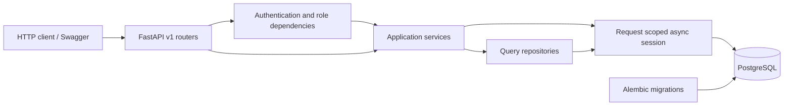
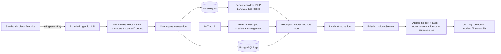
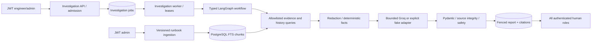
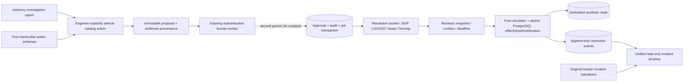

# Architecture

The final release adds focused UI readability/accessibility work, real synthetic-fixture screenshots and publication checks. Backend algorithms and public contracts remain unchanged. Current image tags are `incidentflow-backend:local` and `incidentflow-frontend:local`; existing data and migrations are preserved. See [finalization](phase7_finalization.md) and [the source-based interview guide](interview_preparation.md).

Phase 6 packages the same application into a reusable non-root backend image, separate API/worker containers, persistent PostgreSQL and an unprivileged Nginx React frontend. A single transactional migration/drift gate precedes startup; each critical process verifies revision 0004. The default host exposes only a loopback frontend port. Durable claims, approval boundaries, evidence validation and the Groq retry fixes remain unchanged. See [deployment diagrams and runtime boundaries](phase6_deployment.md), [operations](docker_operations.md), and [security](security_deployment.md). Historical phase descriptions below describe the retained application internals.

Phase 5 adds the local React/TypeScript operations console in `frontend/`. Browser sessions use memory-only bearer tokens, React Router protects routes, TanStack Query owns bounded server data, and generated OpenAPI types reflect actual backend schemas. Authenticated aggregate/activity/directory reads avoid downloading the database to render a dashboard. Existing writes and workers retain their authority. See [frontend architecture](frontend_architecture.md).

Phase 4 adds human-approved, simulation-only resolution workflows. Proposal payloads and approval snapshots are immutable; all actions need explicit human approval, and synthetic changes require a second user. A separate PostgreSQL worker commits synthetic effects, verification, execution records and audit transitions atomically. No LLM tool or production executor is added. See [Phase 4 implementation](phase4_implementation.md) and [workflow operations](resolution_workflows.md). Historical phase descriptions below explain the retained foundations.

Phase 3 adds a separate investigation worker and an eight-node LangGraph workflow over bounded, redacted evidence. Its short PostgreSQL transactions store leases, stage checkpoints, source references and reports; remote Groq calls happen after sessions close. Incident/detection services retain their existing authority. See [Phase 3 guide](phase3_implementation.md) for current details; earlier phase descriptions below describe the retained foundation.

Phase 2 extends the Phase 1 boundaries below with structured log ingestion and a separate PostgreSQL-backed detection worker. The incident API and its transaction ownership remain the foundation. Current details are in [the Phase 2 guide](phase2_implementation.md).

## Boundaries

IncidentFlow AI is a single FastAPI process backed by PostgreSQL. Async SQLAlchemy 2.x uses asyncpg, Pydantic v2 validates boundaries, Alembic owns schema evolution, and uv owns the locked Python environment. There are no queues, distributed services, generic repository frameworks, or AI dependencies in Phase 1.



Routers parse HTTP inputs, invoke services, choose response schemas/statuses, and set resource locations. Authorization dependencies verify JWTs and fetch the current database role. Services enforce lifecycle rules, reference validity, assignment eligibility, and no-op rejection. Repositories encapsulate lookups and listing queries. Services add tracked ORM objects to the request session; a separate write repository that only forwarded `add()`/`flush()` would add no useful boundary.

Models declare relationships with `lazy="raise"`. Response schemas contain scalar IDs instead of triggering hidden lazy loads or N+1 queries. An engine and session factory belong to each application instance; no session is stored globally. Startup validates settings; database migrations are an explicit deployment step. Shutdown disposes the engine.

## Request and transaction ownership

`api.dependencies.get_session` creates one `AsyncSession` inside `session.begin()`. FastAPI caches that dependency within a request, so authentication and the service share its transaction. `Depends(..., scope="function")` finishes the transaction before emitting the response. A response validation error, database constraint failure, or domain exception unwinds the context and rolls back. Services never independently commit.

For an incident mutation, `IncidentService.record` flushes the incident first, obtains its incremented version, inserts a matching event, flushes it, and refreshes the incident. Flush sends SQL; it does **not** commit. The later request-level commit makes both writes visible together. If the audit insert fails, the incident flush also rolls back. Tests demonstrate this using a real rejecting PostgreSQL trigger.

## Concurrency

Every incident mutation after creation requires `expected_version`. The service compares it with the version read from PostgreSQL. SQLAlchemy also maps `Incident.version` as `version_id_col`, resulting in updates equivalent to:

```sql
UPDATE incidents
SET title = :title, version = :next_version
WHERE id = :id AND version = :previous_version;
```

At PostgreSQL's default READ COMMITTED isolation, a competing update waits for the first writer. If that writer commits a new version, the second update affects zero rows and SQLAlchemy raises `StaleDataError`. The transaction rolls back and the API returns `409 version_conflict`. The client must fetch the current incident, review it, and submit its intended change with the new version. Automatic retries could overwrite another operator's intent and are deliberately absent.

This strategy applies to metadata edits, assignment, transitions, and reopen operations. It does not cover arbitrary bulk SQL issued outside the application; no bulk incident mutation API exists. Service catalog edits use ordinary database updates without an optimistic version field because Phase 1 requires concurrency protection for incidents.

## Security and errors

Passwords use Argon2id through pwdlib's recommended hasher. Hashing and verification run in a worker thread to keep expensive CPU/memory work off the async event loop. Unknown email login verifies a dummy hash, returning the same generic `401` as a bad password. Emails are normalized to lowercase and unique in PostgreSQL. Bootstrap obtains credentials only from environment variables and never changes existing users.

JWTs use HS256 with a mandatory, high-entropy operator-provided secret. Validation pins the algorithm, issuer, audience, expiration, issued-at claim, subject UUID, and `type=access`. Roles come from the database on every authenticated request, so a database role change affects existing tokens immediately. Token lifetime defaults to 15 minutes and cannot exceed 30. Token responses prohibit caching.

The authorization matrix in README and `docs/api.md` is exercised for each role and mutation. Viewers cannot change incident state. A target assignee must be an admin or engineer. There are no API routes for editing/deleting audit events, service/incident deletion, public registration, or role changes.

Errors use one JSON envelope. Request validation strips input values and exception context; database errors use generic constraint messages. Engine parameter logging is disabled and parameters are hidden. Unexpected exceptions are caught by HTTP middleware before Starlette can re-raise them into Uvicorn traceback logging; only the exception class is logged. Health errors expose no database URL. Do not enable SQL parameter, body, authorization header, or debug traceback logging when operating the application.

Public liveness checks process responsiveness. Public readiness checks PostgreSQL and the migration revision with a three-second timeout, returning `503` if unavailable, missing, or outdated. It does not prove that every table has survived manual modification.

## Persistence choices and future boundaries

PostgreSQL sequences allocate human-readable incident numbers independently of UUID identity; rollbacks can leave gaps. VARCHAR enums plus CHECK constraints retain strong database validation without the migration complexity of PostgreSQL native enums. JSONB holds audit metadata, while core fields remain relational and indexed. A unique event index pairs each incident version with exactly one successful application mutation. A trigger rejects event row updates/deletes, including accidental direct ORM operations. A database owner can still change triggers or truncate tables; the audit trail is not a cryptographic tamper-proof store.

The Compose roles own their local databases for convenience. A production deployment should use a migration owner and a more restricted runtime role. No production deployment is claimed. Phase 2 now uses the original system-actor constraint: `IncidentService.create` accepts an authenticated `User` or a trusted internal `SystemActor`. HTTP schemas cannot select system identity. Future phases can add their own routers, models, migrations, and services without embedding investigation or remediation in HTTP handlers.

## Test isolation and portability

The Compose test dependency has its own database user, port, and disposable tmpfs. Integration setup validates the target URL before connecting and creates a random schema with a schema-only search path. It applies the real Alembic revision in that schema and uses independent sessions and committed transactions. Cleanup drops only that generated schema. No SQLite substitute or transaction mocks mask PostgreSQL behavior.

Explicit IPv4 URLs avoid a measured Windows `localhost` IPv6 fallback delay against Compose's IPv4-only ports. Code and commands otherwise use pathlib, standard environment variables, and platform-independent Python/uv operations. PowerShell commands in README do not require virtualenv activation; Linux users can use the same uv/Docker commands and `PYTHONPATH=backend uv run python -m app.bootstrap --role admin` with environment-provided bootstrap credentials.

## Phase 2: observability-to-incident pipeline



`models/observability.py` adds six tables without changing the original four. `0002_log_ingestion_and_detection.py` is an additive migration; original revision 0001 is unchanged. Readiness now expects 0002. HTTPX moved from development-only to runtime dependencies because the simulator is a shipped CLI; no queue framework was added.

`services/log_ingestion.py` assigns one database wall-clock receipt timestamp per batch after taking a service row lock. It uses PostgreSQL conflict-safe inserts and hashes to distinguish identical replay from source-ID reuse. Log and unique job insertion commit together. `core/payload_limit.py` bounds the incoming raw body before decoding; Pydantic schemas bound fields and metadata. `services/ingestion_credentials.py` stores only high-entropy key digests and coordinates revoke/ingest with row locks.

`workers/detection_worker.py` owns independent short claim and processing transactions. Claiming excludes later unfinished positions for a busy service, uses SKIP LOCKED, commits an expiring fencing token, and supports bounded retry/recovery. Rule locks and a partial unique current-occurrence index prevent duplicate detector incidents. A processing transaction uses the existing incident service and commits all effects together, including job completion. No in-memory map is authoritative and no sleep occurs with a session open.

`services/incident_automation.py` constructs trusted system context and evidence associations; it never inserts incidents directly. `services/detection.py` handles exact level/code filters, receipt-time rolling windows and post-resolution cooldown gates. Initial threshold witnesses are capped at 1000 per rule; subsequent jobs add their own evidence. Adding evidence does not change incident version/status. Operator decisions remain authoritative; terminal incidents are never silently reopened.

`simulations/scenarios.py` builds labeled seeded data from JSON fixtures and submits actual HTTP requests. `simulations/demo.py` orchestrates the full workflow through public APIs, verifies job/incident/evidence/audit counts and identical replay, and revokes its temporary machine credentials. It leaves synthetic resources for review.

One in-flight job per service favors repeatability over hot-stream throughput; other services can run concurrently. Source-time late deliveries count when received. Historical backfills, rate limiting, retention/partitioning and AI investigation are outside this phase. See [exact rule and retry semantics](detection_rules.md) for the boundaries of these guarantees.

## Phase 3 boundaries



`InvestigationService` creates work transactionally, with a schema-scoped advisory admission lock, one active investigation per incident, five per requester and twenty globally. Viewers cannot start/cancel work. Workers claim with SKIP LOCKED and fencing tokens; cancellation invalidates the token, while remote waits hold no session. Checkpoints allow retries to resume after completed stages. Call/token/duration reservations are durable and not refunded after ambiguous hosted failures.

`EvidenceRepository` selects original threshold witnesses, linked and additional contextual logs, incident/service/audit/detection facts with real source FKs. `KnowledgeRepository` uses current/as-of runbook versions, resolved/closed incidents, resolution notes and detection-code matches. No model-selected tools, arbitrary SQL, external embeddings or URL fetching are used. Deterministic facts become observations; model text is limited to uncertain hypotheses and read-only suggestions.

`investigation/safety.py` redacts known secrets and likely credentials, bounds excerpts and quarantines known injection text. Graph tracing is disabled. Reports/citations, evidence and checkpoints commit under the current claim; stale owners cannot overwrite results. Investigations never update the incident model or its immutable events. Production deployment controls and future approval-gated remediation are separate concerns.

## Phase 4 resolution boundary



`services/resolution.py` owns admission, provenance, submission, human decisions, cancellation and events. `repositories/resolution.py` owns scalar/locked lookups. `resolution/catalog.py` exposes reviewed schemas; `resolution/simulator.py` is a pure deterministic computation with no infrastructure tools. `workers/resolution_worker.py` handles claims/retries/expiry and the local execution transaction. Routes translate typed requests using existing sessions/JWT roles. API reads never manufacture execution events.

Approval queueing is atomic; there is no externally visible intermediate approved state. Every transition advances proposal version and inserts a matching event. A result is unique per proposal/job. The synthetic state, verification and terminal records commit together, avoiding an external side-effect ambiguity. This guarantee is deliberately limited to the existing database; there is no production executor. The Phase 3 remote-call transaction boundary remains unchanged.
