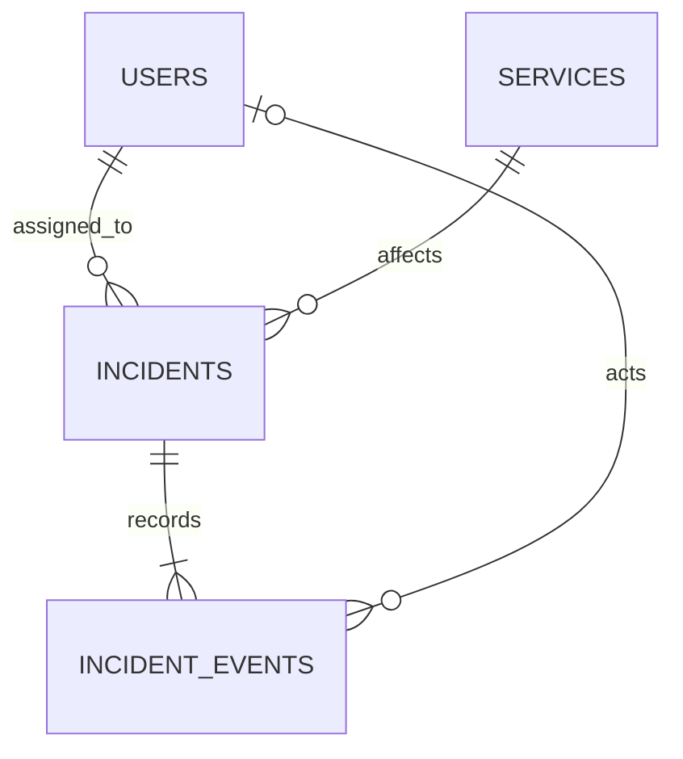
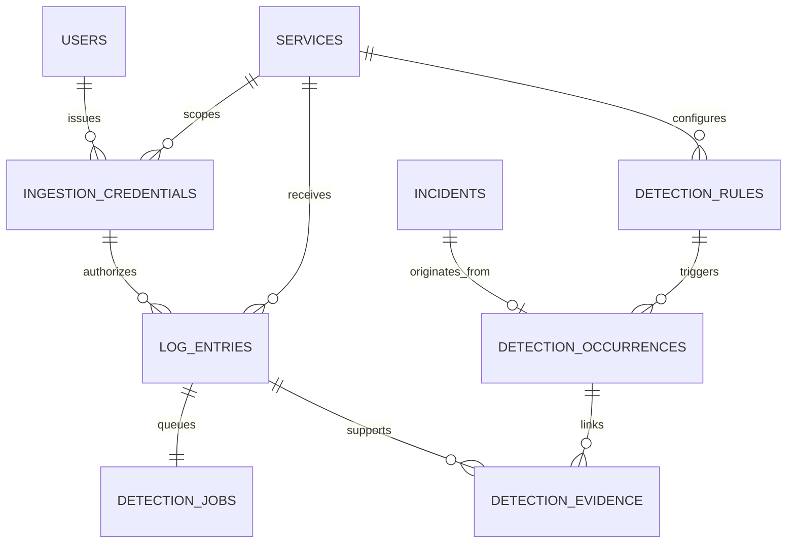

# Data model

The initial revision is `0001` in `backend/alembic/versions/0001_initial_incident_management_schema.py`. It creates the sequence, four tables, indexes, enum/check constraints, foreign keys, and the event append-only trigger. Downgrade removes those objects in dependency order. All timestamps are PostgreSQL `timestamp with time zone`; API values include a timezone.

Current head is **0004**. Revisions 0001, 0002 and 0003 remain unchanged. Phase 2 adds six tables below; Phase 3 adds ten investigation/knowledge tables; Phase 4 adds seven resolution/synthetic-state tables. Populated upgrade validation preserves all existing phase data.

## Users

| Column | Storage / rule |
| --- | --- |
| id | UUID primary key, generated in Python |
| email | VARCHAR(320), non-null, unique, lowercase CHECK |
| password_hash | VARCHAR(512), non-null Argon2id encoded hash |
| display_name | VARCHAR(120), non-null, nonblank CHECK |
| role | VARCHAR enum CHECK: admin, engineer, viewer |
| created_at / updated_at | Timezone timestamps, server creation defaults, ORM update expression |

Bootstrap validates email format and lowercase normalization. A database uniqueness constraint makes racing duplicate creation safe. Responses never serialize the password hash. No public user creation, role editing, password reset, or deletion interface exists in Phase 1.

## Services

| Column | Storage / rule |
| --- | --- |
| id | UUID primary key |
| name | VARCHAR(100), unique, lowercase/nonblank CHECK |
| description | TEXT, non-null; empty description permitted |
| environment | VARCHAR(50), non-null/nonblank |
| created_at / updated_at | Timezone timestamps |

The API additionally requires a lowercase slug (`checkout`, `payments-api`, `worker.v2`). A service name is globally unique, including across environments. To represent two deployments independently, choose distinct names such as `checkout-prod` and `checkout-staging`. This is an explicit Phase 1 catalog choice.

## Incidents

| Column | Storage / rule |
| --- | --- |
| id | UUID primary key; public resource identity |
| number | BIGINT, unique, `incident_number_seq` default |
| title / description | VARCHAR(200) / TEXT, required; title nonblank CHECK |
| severity | critical, high, medium, low CHECK |
| status | triggered, investigating, mitigated, resolved, closed CHECK |
| service_id | Required service UUID FK, ON DELETE RESTRICT |
| assignee_id | Optional user UUID FK, ON DELETE RESTRICT |
| created_at / updated_at | Timezone timestamps |
| resolved_at / closed_at | Nullable timezone timestamps |
| version | Positive integer, SQLAlchemy optimistic version column |

`incident_number` is an API property derived from `number`, formatted `INC-000001`, with six digits as the minimum width. It remains readable beyond 999999. The sequence is safe for concurrent inserts, but is not gapless and does not restart each year. Public lookup uses UUID, while listing supports numeric incident-number sorting.

Database checks enforce that `resolved_at` exists exactly when status is resolved/closed, and `closed_at` exists exactly when status is closed. The service enforces the transition graph; checks alone do not encode transition history. Reopen clears both timestamps while preserving previous resolution details in audit events. The version starts at 1 and increments once for every accepted mutation. No-op changes fail without a version increment or event.

Indexes support service/assignee foreign keys, `(created_at, id)` listing, `(status, created_at)`, and `(severity, created_at)`. The unique number constraint also creates an index. Severity sorting uses an explicit rank, because alphabetical order is not operational priority. Composite index tuning and keyset pagination can follow measured workload requirements.

## Incident events

| Column | Storage / rule |
| --- | --- |
| id | UUID primary key |
| incident_id | Required incident FK, ON DELETE RESTRICT |
| event_type | created, updated, assigned, transitioned, reopened CHECK |
| actor_id | Optional user FK, ON DELETE RESTRICT |
| system_actor | Optional VARCHAR(120) explicit system identity |
| occurred_at | Server timestamp, non-null |
| incident_version | Positive integer; unique together with incident_id |
| metadata | JSONB, non-null; exposed as `details` in Python/API |

Exactly one actor representation is required: either a user ID or a nonblank system actor. Human HTTP actions use user actors; automated Phase 2 creation uses `system_actor=detection_worker`. Metadata contains the creation snapshot, changed fields with from/to values, assignment from/to IDs, or transition from/to status and reason. Automated creation additionally records an `automation` context containing rule/detection identity, configuration and receipt-window evidence. History is ordered by `incident_version`, which is reliable even if transaction timestamps tie. Its unique composite index also supports that ordering. Additional indexes cover actor lookup and `(incident_id, occurred_at, id)` history access.

The API supports only event retrieval. PostgreSQL's `incident_events_append_only` trigger rejects UPDATE and DELETE; it does not prohibit INSERT or database-owner maintenance. Each accepted application mutation records one event in the same transaction, with the matching version. The database uniqueness constraint prevents duplicate events for one version; existence of an event for every incident version is an application transaction invariant verified by tests, not a deferred database constraint.

## Phase 2 relationships

## Ingestion credentials

UUID identity, service FK, human name, issuing user FK, creation/expiry/revocation timestamps, and a 64-character SHA-256 `secret_hash`. Plaintext keys are never stored. Expiry must follow creation. Indexed by issuing user and `(service_id, created_at)`. Revocation preserves the row so historical logs retain their credential provenance. Metadata APIs omit both the hash and plaintext token.

## Log entries

UUID identity, unique `(service_id, source_event_id)`, credential/service RESTRICT foreign keys, level CHECK enum, VARCHAR(4000) message, source `timestamp`, server `ingested_at`, optional trace/request/error identifiers, JSONB `metadata`, and a canonical content hash. Metadata must be a JSON object. Detailed bounds and credential screening occur in Pydantic before insertion. Public endpoints cannot mutate or delete logs; privileged database writes are outside the ingestion contract.

Indexes: `(service_id, level, ingested_at, id)` and `(service_id, error_code, ingested_at)` for detection; `(timestamp, id)` and `(ingested_at, id)` for browsing/receipt access; trace, request, credential foreign-key lookup; functional GIN `to_tsvector('simple'::regconfig, message)` for bounded plain-text search. The GIN index requires no extension.

## Detection rules

UUID identity, service FK, service/name uniqueness, enabled flag, exact log level, optional normalized error code, threshold (1–1000), window seconds (5–3600), resulting incident severity, cooldown seconds (0–86400), creation/update timestamps, positive ORM optimistic version, `effective_from`, and nullable `eligible_after`. `(service_id, enabled)` supports rule lookup. The service serializes creation to enforce at most 25 rules per service. Rule service identity cannot be changed through PATCH.

`effective_from` separates configuration epochs and avoids implicit backfills. `eligible_after` persists the post-terminal cooldown boundary. Updating that state can increment the rule's version; it does not change the incident's version. Current-occurrence lookup uses the index on the occurrence table, avoiding a circular rule/occurrence foreign key.

## Detection occurrences

UUID identity, rule/service FKs, unique incident FK, `is_current` correlation reservation, original rule version and JSONB snapshot, initial window start/end, matching witness count (1–1000), creation and optional retirement timestamps. CHECK requires ordered window bounds. A **partial unique rule index WHERE is_current** enforces one current reservation. Rule/service plus creation/UUID indexes support history queries. `detection_key` is an API property combining service UUID and rule UUID.

The recorded witness count is a threshold lower bound, not a continuously updated full-window aggregate. Source-of-truth incident status remains in `incidents`. A terminal incident's current reservation is retired lazily on the next matching job; the flag does not independently assert that an incident is active.

## Detection evidence

Composite primary key `(occurrence_id, log_id)`, both RESTRICT foreign keys, plus an index on `log_id`. One log can support several detections and one detection can contain many logs. Conflict-safe inserts make evidence correlation repeatable. Incident-associated log queries use EXISTS through occurrences to avoid duplicate rows.

## Detection jobs

UUID identity; identity-generated unique BIGINT position; unique log FK; service FK; status CHECK enum pending/processing/completed/failed; attempts, total attempts, requeues, maximum attempts; availability, creation, completion and lease-expiry timestamps; UUID fencing token; sanitized error code. Constraints enforce attempts within the configured maximum, maximum 1–10, consistent processing lease fields, consistent terminal completion time and nonnegative retry history.

Indexes support `(service_id, position)` predecessor checks and `(status, available_at, position)` ready work. The worker's row locks, committed token and per-service predecessor predicate coordinate claims; no process-local lock is needed. Raw errors, submitted bodies and credential material are not fields in this table.

## Upgrade and downgrade

0002 creates new parent tables before dependents. Downgrade removes Phase 2 indexes/tables in dependency order and leaves the four Phase 1 tables plus their trigger/sequence intact. Downgrade intentionally discards Phase 2 data and is tested only in disposable schemas. The migration suite verifies both an empty base→head path and a populated 0001→0002→0001→0002 round trip. No application startup calls automatic table creation.

## Phase 3 knowledge tables

- `runbooks`: UUID, current title, optional fixed service FK, bounded tags, current version, timestamps.
- `runbook_versions`: UUID, document FK, positive version (unique per document), title/service/tags/format snapshot, stored redacted content and hash, author FK and timestamp. Content bytes are checked in PostgreSQL; old versions are not updated through public APIs.
- `runbook_chunks`: UUID, version FK, unique ordinal, content/search text, half-open character offsets and hash. CHECK bounds text to 1800 characters and validates offsets; GIN indexes lexical search.
- `resolution_notes`: UUID, incident/author FKs, bounded human note, timestamp and FTS index. Public insertion requires a resolved/closed incident and does not alter its lifecycle or audit.

## Phase 3 investigation tables

- `investigations`: UUID, incident/requester FKs, actor-scoped unique client request UUID, lifecycle enum, provider/model, stage, bounded JSONB checkpoint/policy, reserved call/input/output budgets, actual token usage, start/completion times, cancellation actor FK and safe error code. A partial unique index permits one queued/running investigation per incident. Terminal statuses require completion time.
- `investigation_jobs`: UUID, unique investigation FK, pending/processing/completed/failed/cancelled enum, bounded attempts/budget, availability, token/lease expiry, safe error and completion time. CHECK constraints require consistent processing leases and terminal timestamps; ready/status indexes support claims.
- `investigation_steps`: UUID, investigation FK, attempt/stage uniqueness, running/completed/failed status, bounded JSONB metadata and creation time. Metadata records start/completion/failure times and counts, never raw prompts or errors.
- `investigation_evidence`: UUID, unique investigation/reference pair, source type, exactly one typed source FK, redacted label/excerpt, role, bounded provenance JSONB, quarantine flag and timestamp. Source FKs point to an incident/service/event/log/detection/chunk/note. CHECK requires source type and `type:UUID` reference to agree with that FK.
- `investigation_reports`: investigation PK/FK, bounded structured JSONB report, timestamp. One report per investigation; application validation and fenced commit prevent stale replacement.
- `investigation_citations`: report/reference composite PK, report FK and composite FK to that investigation's evidence reference. A source cannot be referenced merely because an unrelated investigation contains it. The report JSON and citation relation are validated together by the application.

Investigation evidence stores bounded excerpts once; checkpoints retain references, context snapshots, aggregates and typed reasoning results rather than repeatedly copying full raw logs. Reports are distinct from incident resolution. Database owners bypassing the application could still modify JSON payloads directly; application validation and relational citation integrity are not cryptographic tamper evidence.

## Migration 0003

`0003_investigations_and_runbooks.py` creates these ten tables and their indexes/constraints plus a functional GIN index on existing incident title/description for historical search. It changes no existing row content. The initial migrations remain byte-for-byte unchanged. Downgrade drops Phase 3 dependents before parents and removes the new incident index, preserving original phase tables/rows. Destructive downgrade checks run only in isolated test schemas; a real downgrade discards investigation/runbook data and requires operator planning.

## Phase 4 tables and revision 0004

`0004_resolution_workflows.py` adds seven tables without changing prior rows or migrations:

| Table | Persistent contract |
| --- | --- |
| `synthetic_service_states` | Unique service FK, explicitly synthetic bounded JSON snapshot, positive optimistic version, initializer actor and timestamps; no real configuration fields are overwritten |
| `resolution_proposals` | Incident/report/service/state/requester FKs, versions, allowlisted action/fingerprint, bounded parameters/provenance/policy, human explanation/origin/risk, canonical payload hash, actor-scoped unique client UUID, lifecycle/version/deadline/error/timestamps |
| `resolution_evidence` | Proposal/reference PK, report FK and composite FK to the investigation's evidence; insertion guard verifies proposal ownership and usable source |
| `resolution_approvals` | One immutable human decision per proposal, actor FK, decision, approved payload hash/snapshot, bounded reason and timestamp; unique proposal/ID pair supports job FK |
| `resolution_jobs` | One job per proposal, matching approval composite FK, indexed status/availability, attempts/max, fencing token/lease, safe error and completion timestamp |
| `resolution_executions` | One receipt per proposal/job, attempt, before/after state versions, explicitly synthetic structured result and verification JSON, timestamp |
| `resolution_events` | Proposal/actor FKs or explicit worker identity, event type, unique positive proposal version, correlation UUID, wall-clock timestamp, bounded safe details; indexed history |

Proposal protected fields are immutable by trigger, and established deadlines cannot be extended. Approval/job/evidence insertion triggers reinforce authorization/provenance. UPDATE, DELETE and TRUNCATE guards protect events, approvals, executions and evidence. Schema constraints enforce FK integrity, enums, positive versions, JSON bounds, actor representation, synthetic markers, idempotency and job lease shape.

Downgrade removes Phase 4 functions/triggers and tables in dependency order, preserving Phase 1–3 records. It discards Phase 4 data and is exercised only in disposable schemas. Empty upgrade, populated upgrade with all twenty old tables unchanged, round-trip preservation and Alembic drift are validated. Trigger semantics require explicit tests because Alembic autogenerate does not validate procedural function bodies.
