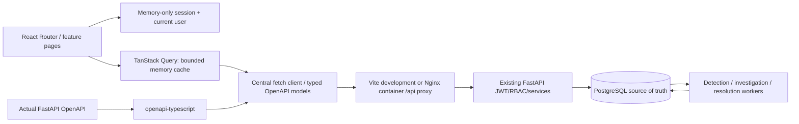

# Frontend architecture

## Boundaries and package layout

The `frontend/` workspace is a React 19 + strict TypeScript application built by Vite. It uses React Router, TanStack Query, Tailwind CSS, Lucide and Recharts. npm's committed lockfile pins the installed package graph. Phase 6 adds a locked Node build stage and unprivileged Nginx runtime; authentication, API calls and feature code are unchanged. There is no extra global state manager, mock production data store, WebSocket client or service worker.

`src/app/App.tsx` contains protected route composition, lazy page imports and a rendering error boundary. It does not contain the application business workflows. Feature directories own their forms and pages. Shared modules provide layout, dialogs, fields, tables, badges, pagination, resource links, formatting, authorization affordances, the API client and query hooks.

## Routes and responsibilities

| Route | Implemented responsibility |
| --- | --- |
| `/login` | OAuth form login, current-user retrieval, invalid/expired-session states |
| `/` | Database aggregate counts, severity chart, lifecycle distribution, bounded recent activity and approvals |
| `/incidents` | Server-paged listing, supported filters/sorting, authorized creation |
| `/incidents/:id` | Overview, logs, detection occurrences, investigations, proposals and cursor timeline; versioned edits/assignment/transitions |
| `/logs`, `/logs/:id` | Bounded structured exploration, filters, expandable/detail source views |
| `/detections`, `/detections/:id` | Deterministic rules, admin configuration, occurrences, snapshots/evidence, admin job status |
| `/investigations`, `/investigations/:id` | Global activity, progress, reports, hypotheses, citations, retrieval provenance and cancellation |
| `/runbooks`, `/runbooks/:id` | Listing/search, source text, immutable versions, admin create/update/reindex |
| `/services`, `/services/:id` | Registered services, admin create/edit and synthetic scenario setup/reset |
| `/resolutions`, `/resolutions/:id` | Catalog, proposal activity, immutable intent, review, job/result/verification/history |
| `/guide` | Operator workflow and explicit safety boundaries |

Incident tabs use query parameters. Timeline pagination is independent from tab selection. Unknown routes show a not-found view. A protected deep link is preserved only if it matches a known internal path; external, protocol-relative and backslash redirects are rejected.

## Authentication and session lifetime

Login POSTs `application/x-www-form-urlencoded` through URLSearchParams to `/auth/token`, with email as username. It then retrieves `/auth/me` before admitting the user to protected routes. Role/display name come from that actual response, not from an unverified token payload.

The token remains in a module-private variable and user state in React memory. Nothing is persisted to localStorage/sessionStorage, cookies, URLs, generated bundles or logs. Refreshing or opening a new tab requires signing in again. No refresh-token endpoint is assumed. The issued expiry schedules session invalidation, and an authenticated 401 also clears the session. A stale old response cannot clear a newly established session because requests capture a session revision.

Logout cancels active cached reads, clears the query cache/user/token and unmounts protected pages. It does not undo an already accepted server mutation or cancel an approved workflow. Password inputs are cleared after failed login/success; plaintext passwords are not retained by the application. Browser password-manager behavior is user controlled.

Role-aware buttons improve usability; FastAPI remains the authorization authority on every request. A server-side role change may leave an old UI affordance until reauthentication, but cannot authorize a forbidden operation. There is no browser account-provisioning or role-management endpoint.

## API types and transport

`scripts/export_openapi.py` constructs the actual app schema using dummy configuration, without reading private `.env` values or connecting to PostgreSQL. `npm run api:generate` writes `src/types/openapi.ts`; `src/types/models.ts` aliases real component schemas and pagination/query types. `npm run api:check` regenerates to an ignored temporary file and compares the tracked output. This is compile-time contract checking; Pydantic still validates requests/responses at runtime.

`src/lib/api/client.ts` centralizes API base URL, bearer headers, query encoding, JSON/form bodies, request abort signals, no-store requests and error envelopes. The default is `/api/v1`; Vite proxies `/api` to 127.0.0.1:8000. Public `VITE_API_BASE_URL` configuration may select a relative prefix or credential-free HTTPS URL. It is never a place for provider/database/JWT secrets. Browser requests omit cookies and reject redirects.

Errors distinguish network failure, 401, 403, 404, 409, 422, 429 and 503. Safe backend messages, codes and validation locations remain visible. Unknown network outcomes on writes require checking the current resource, rather than assuming the write failed. Raw server HTML is never injected into error panels.

## Query caching, invalidation and polling

Read keys contain API path, filters and an optional workflow revision. Ordinary reads are fresh for 15 seconds, retained in memory for five minutes and revalidated on focus when stale. Safe GET reads retry at most once for network/eligible server errors; authorization/validation/conflict/rate-limit/provider-unavailable failures are not retried. Mutations have retry disabled at both query and transport layers.

Successful writes invalidate API query prefixes, refreshing active lists, details, counts and timelines. A 409 invalidates reads so the latest server record is available; an open edit/review form retains its reviewed version and does not automatically overwrite another writer. The user closes/reopens after comparing fresh data.

Investigation/proposal status polls every two seconds while active; readiness polls every fifteen seconds. Background interval fetching is disabled, and query unmount cancels in-flight reads through AbortSignal. Terminal resources stop interval polling. Linked evidence/steps and resolution job/events use status/version query revisions to take a final fresh snapshot when fast work completes. They cannot remain stuck on an earlier empty response merely because status polling stopped. Stale views may still refresh on focus/mount.

## Forms and concurrency

Incident edits, assignment and transitions submit exact expected versions. The lifecycle choices reflect the existing transition graph, including explicit reopen. Rule edits and runbook replacement/reindex use their own actual version contracts. The frontend does not invent an incident delete endpoint.

Proposal creation generates one UUID per form attempt, snapshots the incident version and reads the live synthetic state UUID/version. Action parameters contain only those typed fields. Catalog selection is explicit; recommendation text is never parsed into tools. Linked sources must be chosen from usable investigation evidence. Read-only recommendation linking is explicit, while recovery remains human authored.

If proposal creation loses its network response, the form freezes the attempted payload and offers only an explicit identical retry, with the same UUID. It does not automatically replay writes. Submission/review/cancellation use expected proposal versions. A review dialog captures the reviewed version at opening and requires a reason. A server response marking expiry is shown as expired, never announced as a successful approval.

## Read models and aggregation limits

Phase 5 adds `api/v1/dashboard.py`, its router registration and API no-store middleware headers. It introduces SQL-grouped counts, bounded global investigation/proposal pages, a minimal eligible-user directory and incident-scoped detection pages. No migrations, backend dependencies, worker behavior or existing write schemas changed. Migrations 0001–0004 and `uv.lock` remain unchanged.

Overview totals include every stored record, including simulations. Active means triggered/investigating/mitigated. Severity bars use grouped counts; lifecycle bar widths are status count divided by total incidents, with zero handled explicitly. Registered services are catalog records, not measured production health. Pending approvals count stored pending rows; worker/validation expiry semantics still apply. Recent arrays are bounded independently from totals. The activity feed includes actual incident/resolution events, detection creation and investigation requests; the incident timeline supplies its full recorded cross-phase milestones.

SQL reads use READ COMMITTED; multiple aggregates are not a frozen analytics snapshot. Collections use server limit/offset, usually twenty per page. Service/assignee selectors load at most one hundred options per page and preserve selections across pages. Investigation evidence/steps use bounded one-hundred-item snapshots; runbook version selection shows at most one hundred recent versions. Search returns bounded lexical excerpts and ranking scores, not calibrated probabilities or a complete semantic corpus.

## Untrusted content, accessibility and responsive behavior

Logs, report text, runbooks, JSON and errors render as React text. No dangerouslySetInnerHTML, executable Markdown, arbitrary SQL/command input or model-controlled callable exists. Markdown source syntax is preserved as text rather than converted into HTML. Synthetic provider reports and synthetic state/results are labeled separately from real stored incident observations.

Native modal dialogs provide keyboard containment/Escape handling; the component explicitly restores focus to its still-connected trigger. Inputs have labels and constraints, tables have headers/named scroll regions, charts have text alternatives, and navigation exposes a skip link. Focus indicators and reduced-motion CSS are explicit. Small screens use a modal navigation menu and horizontally scrollable tables, without whole-page overflow.

## Testing boundaries

Vitest/RTL tests mock API responses for isolated transport, auth, forms, filters, permissions, polling, citations, safe rendering, conflicts, idempotency and cursor behavior. They do not substitute for browser/backend verification.

`npm run test:e2e` starts the Python fixture harness and Vite on loopback ports, runs Chromium against the actual proxy/API and dedicated PostgreSQL test schema, then tears them down. Three worker implementations run concurrently inside the fixture-server process using real durable tables/claims. Production developer startup still uses separate worker processes. Users are temporary, credentials stay in parent-owned pipes/process memory, and log ingestion/detection/runbook setup use real APIs. The harness validates the exact dedicated test DB identity and never truncates development/public tables. Normal exit removes only its generated schema.

There is no hosted Groq call in automated tests. Chromium desktop/mobile viewports are verified both with the original real-API harness and the complete Compose/Nginx stack; other browser engines and public hosting are not claimed. Nginx serves deep links, immutable fingerprinted assets, no-store HTML/API responses and restrictive security headers, replacing untrusted forwarding headers. Uvicorn ignores proxy headers. See [Phase 6 deployment](phase6_deployment.md) for actual images, network boundaries and limitations.

## Final UI refinements and verification

Phase 7 retains the routing, authentication, query and mutation architecture. `RecordDetails.tsx` supplies exact-value copy controls with a manual fallback and semantic timestamps. `ResourceLinks.tsx` reuses fresh service-page data as initial detail data with its actual update time, allowing normal staleness/invalidation rather than uncontrolled polling. Bounded directory reads supply person names with honest UUID fallback. No friendly service name is guessed from a generated identifier.

Form control names and hint descriptions are separated. Reports keep application observations distinct from uncertain hypotheses; six-source citation groups disclose additional references, while workflow diagnostics show only allowlisted metadata. Native dialogs, keyboard focus, safe text rendering, human approval and expected-version writes remain authoritative.

The independent portfolio Playwright scenario seeds a separate synthetic service in the existing isolated fixture, runs the full approval workflow and optionally writes seven real screenshots. It checks Chromium accessible control names, modal Escape/focus, reduced-motion operation and narrow/720px reflow. This is targeted smoke coverage; native zoom, assistive technologies, contrast needs and other browsers still require manual review. See [the finalization record](phase7_finalization.md).
