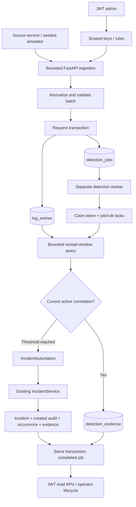

# Phase 2 implementation guide

## 1. Starting point: preserve the foundation

Phase 2 extends the existing repository. Before changes, the original 136 tests passed against the dedicated PostgreSQL dependency in 75.38 seconds. The existing architecture was already suitable: strict Pydantic boundaries, thin routers, query repositories, business services, one request transaction, mapped incident versions and an append-only event trigger.

The original `0001` migration was not edited. The original API and unit test files are unchanged. The only adaptation inside an existing test is changing the migration round-trip assertion from head `0001` to new head `0002`; its downgrade/upgrade/schema-check assertions remain intact. New tests live under `backend/tests/phase2`. The existing isolated-schema test fixture still owns database safety and migrations.

No replacement application, frontend, AI dependency, Redis, Celery or automatic remediation was introduced. HTTPX moved from a development-only dependency to a runtime dependency so the shipped simulator can call HTTP APIs even without test tooling installed. `uv.lock` records the change without an unrelated dependency upgrade.

## 2. Why application logs exist

An incident says a production problem exists; logs explain what individual requests experienced. A payment service may report database connection timeouts, an order API may report HTTP 500 responses, and a catalog service may report unusually slow requests. The individual records help an engineer distinguish a failed dependency from an application bug and connect events sharing a trace/request ID.

Storing logs alone is insufficient for this phase. The system must turn repeated, qualifying records into an actionable incident while preserving evidence and avoiding one alert for every error. Phase 2 provides that deterministic pipeline. It does not infer root cause or execute repairs.

## 3. Structured logging and normalization

Structured logging gives each record named fields instead of asking the backend to parse arbitrary free-form lines. `LogInput` requires a stable source event ID, level, nonblank message and timezone-aware source timestamp. It accepts optional trace ID, request ID, error code and a bounded JSON object. The batch supplies the authorized service identity once.

For example, `error_code=DB_CONNECTION_TIMEOUT` is a dependable filter. Searching message prose for “database maybe timed out” is less reliable because wording changes. The latency scenario likewise emits an explicit `LATENCY_BREACH` warning with a numeric measurement and a documented producer threshold. The detection engine counts those events; it does not pretend to compute a percentile from metric samples.

Input normalization strips ordinary text boundaries, lowercases levels, uppercases error codes and converts source timestamps to UTC. A source UUID or slug is retained rather than replaced, because transport retries need the same identity. Flexible metadata stays JSONB; fields used in relations, filters and detection have typed relational columns.

The ingestion contract limits batch size, total raw bytes, message length, metadata bytes/depth/nodes and source-time tolerance. It rejects known credential fields/token patterns, NUL characters and invalid JSON/text. These are pre-storage boundaries, not a promise that arbitrary user-written prose can be classified perfectly for secrets. Producers must avoid sending sensitive business content or unrecognizable secret strings. See [the exact limits](log_ingestion.md).

## 4. How source services authenticate

Human users keep Phase 1's JWT authentication and role checks. A producer instead supplies `X-Ingestion-Key`. An admin creates a key for one existing service; the plaintext appears once in a noncacheable creation response. It includes a public lookup UUID and a cryptographically random 256-bit secret. PostgreSQL stores only the full-token SHA-256 digest, expiry, revocation and issuance metadata. Verification uses a constant-time digest comparison.

Hashing a random 256-bit token differs from hashing a human password. A password has low, user-chosen entropy and needs an expensive password hash such as Argon2id. A machine token already has enough random entropy to make guessing infeasible, so a fast cryptographic digest is appropriate and avoids making every log batch perform expensive Argon2 work.

The body service ID must equal the key's service ID. A key for payments cannot write order logs, and an admin JWT alone cannot ingest. Machine keys do not authorize log browsing, incident edits, rule management or other human endpoints. Admin-only key APIs list metadata, create replacements and revoke credentials; they never retrieve stored plaintext. Rotation issues a new key, switches the producer, then revokes the old key.

Authentication takes a SHARE lock on the credential for the request transaction. Revocation takes an UPDATE lock. An already-authorized ingestion may finish before revocation commits, while subsequent authentication sees the revoked state. This defines the race instead of making a vague “instant revocation” claim.

## 5. Ingestion, idempotency and atomic queueing

The source event ID identifies one event within a service. Two services may legitimately use the same source ID. The database enforces uniqueness on `(service_id, source_event_id)`; the public API cannot overwrite an accepted event.

`LogService.ingest` takes a service row lock before assigning a PostgreSQL wall-clock receipt time. It validates the entire batch, computes a canonical hash for each normalized record, collapses identical IDs within the batch, and rejects conflicting duplicates. A PostgreSQL insert with `ON CONFLICT DO NOTHING` handles already-delivered IDs safely. Reading their stored hashes distinguishes an identical replay from a source ID accidentally reused for new content.

If 10 logs are sent twice, the first response says accepted 10/duplicates 0, and the second says accepted 0/duplicates 10. If one source ID returns with a changed timestamp/message/metadata, the response is 409 and no new rows from that submission commit. Credential rotation does not change event identity because the content hash excludes the ingestion credential and receipt timestamp.

Each new log also receives one unique detection job in the same request transaction. A failed queue insert rolls back the log. A committed batch survives an API restart because both records already exist in PostgreSQL; there is no in-memory callback that can disappear. An identical replay does not create another job or reset a failed job's attempts. Admin retry is an explicit separate operation.

The service row lock makes receipt timestamps and committed job positions consistent within one source service. This serializes that service's ingestion transactions and costs throughput, but gives the worker a repeatable stream. Independent services can ingest concurrently. Responses are 202 because accepting work is distinct from completing detection.

## 6. Database storage and querying

Migration `0002_log_ingestion_and_detection.py` adds:

| Table | Purpose |
| --- | --- |
| `ingestion_credentials` | Scoped hashed machine keys, issuer, expiry and revocation |
| `log_entries` | Immutable-by-public-contract structured records and content hashes |
| `detection_rules` | Exact filters, threshold/window/severity/cooldown and versioned eligibility state |
| `detection_occurrences` | Durable rule-to-incident correlation, initial trigger snapshot and reservation |
| `detection_evidence` | Many-to-many occurrence/log links with conflict-safe uniqueness |
| `detection_jobs` | Ordered durable work, leases, retry counters and sanitized failure state |

Foreign keys use RESTRICT so public relationships cannot be silently orphaned. Unique constraints protect source identity, one job per log, one incident per occurrence and one evidence association. A partial unique index reserves one current occurrence per rule. CHECK constraints enforce enum values, numeric bounds, receipt-window order and consistent job lease/finish state.

Receipt-time service/level/error indexes support detection queries. Source-time and trace/request indexes support investigations. Message search uses a functional PostgreSQL GIN index on `to_tsvector('simple', message)` and `plainto_tsquery`, without installing a database extension. Search is bounded, parameterized token search; it is not SQL interpolation, regex search or arbitrary substring matching.

All human roles may query bounded pages of logs, rules, detections and evidence. Only admins manage rule/credential state and inspect/retry jobs. Incident-associated log filters use EXISTS instead of a multiplying join, so a log supporting several detections appears once. Database-side limits/offsets prevent loading the whole dataset into Python. There is no automatic retention/deletion/partitioning policy in this phase.

## 7. Rolling-window detection, with numbers

The engine evaluates exact log level and optional exact error code for the target service. A threshold is a count of **unique accepted source events**. Source-ID uniqueness ensures repeated network delivery cannot increase that count.

Detection uses stored **ingestion time**, not source time. For a matching log received at time t with configured window W, matching receipts in **(t-W, t]** qualify. The lower edge is exclusive and the upper edge inclusive. Configuration and post-terminal boundaries may shorten the eligible interval further.

For a 60-second window and threshold 5, receipts at seconds 1, 10, 20, 30 and 59 trigger at second 59. At second 61, the record at second 1 is exactly 60 seconds old and does not count. Five records received together in one committed batch count together at that receipt time. A batch of four remains below threshold. A rule explicitly configured with threshold 1 permits a single qualifying record.

The source clock remains useful evidence but does not choose this window. A 23-hour-old source event delivered now counts now; a permitted slightly future source timestamp also counts now. Thus out-of-order source clocks and late arrivals have a simple, predictable policy without retroactive window revisions. A delayed producer flush can look like a current error burst; this is the main cost of receipt-time semantics.

Worker lag does not move the window. If jobs from 12:00 are processed at 12:10, they still use stored 12:00 receipt anchors. Rules have an `effective_from` boundary: creation, meaningful configuration changes and reactivation exclude older receipts. There is no implicit historical backfill. Admin updates require the current rule version and criteria changes are blocked while its current incident is active.

The database returns at most the configured threshold of witness UUIDs. An occurrence saying `matching_count=5` means **at least five** qualifying records proved the trigger; it is not a claim that only five errors occurred. Initial evidence is bounded at 1000 records per rule, while later matching jobs add their own records. Every service has at most 25 rules, so work has explicit configuration bounds and query timeouts.

## 8. Deduplication and correlation

The key is service UUID plus rule UUID. It is stable across process restarts and credential rotation. No process-local dictionary decides whether an incident already exists. A PostgreSQL occurrence row and partial unique current-rule index hold that reservation.

While the correlated incident is triggered, investigating or mitigated, additional matching logs attach to it. The worker does not create another incident for each error, change its assignee, increment its version or append fake incident-update events merely because evidence grew. Evidence inserts use their composite unique key and ON CONFLICT to remain repeatable.

The occurrence stores the initial rule configuration/version, receipt-window start/end, threshold witness count, incident ID and creation/retirement times. These fields, the immutable created event's automation context and associated logs explain why the rule fired even if the admin later renames it. Current flag means “owns this correlation reservation”; lifecycle truth remains in the Phase 1 incident status.

An operator resolves or closes an incident through the original versioned transition API. On the next matching job the engine retires that reservation, calculates terminal time plus cooldown, and requires a fresh threshold strictly after that boundary before creating a new incident. During-cooldown and older queued receipts do not contribute to the next occurrence. Cooldown zero allows fresh post-resolution logs immediately. It never silently reopens the terminal incident.

Manual reopening remains possible and audited. If the incident still owns the reservation, correlation resumes to it. Reopening a historical incident after a newer occurrence owns the key does not steal that key or merge cases. This preserves operator lifecycle control while making the automation's own behavior explicit.

## 9. Durable jobs and row locking

The worker is launched separately with `python -m app.workers.detection_worker`. It does not depend on FastAPI BackgroundTasks. Each process builds its own engine/session factory and opens short-lived sessions; no global session is shared across tasks.

A claim query finds a due pending job or expired processing lease and uses `FOR UPDATE SKIP LOCKED`. It excludes a job when an earlier unfinished position exists for the same service. Consequently one service evaluates in committed order while different services can progress on different workers. A retry delay pauses that service's later jobs, a deliberate repeatability trade-off.

The claim transaction increments attempt counters, sets processing status, stores a new UUID fencing token and lease expiry, then commits. Processing uses another transaction and rechecks/locks that token. If an abandoned claim was reclaimed, the old owner's token no longer matches and it exits without effects.

The processing transaction locks eligible rule rows in UUID order. These rule locks coordinate trigger decisions across workers. A partial unique index independently prevents two current reservations. The engine also locks the correlated incident while reading lifecycle state so it coordinates with human updates without changing the incident itself. The original optimistic incident version remains authoritative for human mutations.

An overall asyncio timeout and a PostgreSQL statement timeout bound an attempt. Claim/failure transactions have overall timeouts too. None of the idle polling or retry waiting holds a session/transaction open. Ctrl+C/SIGTERM sets a stop flag; the worker finishes its current bounded operation, stops claiming and disposes its engine. A hard kill follows the crash-recovery path instead.

## 10. Failures, retries, abandoned leases and failed jobs

Successful processing commits all effects and job completion together. If any incident/audit/occurrence/evidence SQL or COMMIT fails, the processing transaction rolls back. A fresh fenced transaction records a safe code and schedules another attempt. Raw exception text, SQL parameters, credentials and source bodies never enter job errors or worker logs; logs include only job UUID, a stable code and exception class.

Backoff defaults to 2, 4, 8 and 16 seconds before the fifth/final attempt, capped at 60 seconds. Maximum attempts is captured on each job and limited to 1–10. At the limit it becomes failed with a completion timestamp. An expired final lease becomes failed with `lease_expired`, allowing the service to advance while retaining explicit failed-work visibility.

If a worker crashes after claiming, its processing row and token survive. Its connection releases any open row locks. After lease expiry another worker can claim it, increment attempts and replace the token. A still-live worker holding the job row lock cannot be stolen from merely because its lease timestamp passed; SKIP LOCKED skips that row.

If effects already committed before a crash, completion committed in the same transaction. There is no separate nontransactional acknowledgment gap. An ambiguous database commit outcome is rechecked through persisted token/status. Delivery is described as **at-least-once claims/attempts with transactional, idempotent effects**, not exactly-once code execution. Bounded exhausted work requires explicit operator attention.

Admins can GET `/detection-jobs?status=failed`, inspect a job, fix its cause and POST `/{id}/retry`. Retry resets the current attempt budget, preserves `total_attempts`, increments `requeues` and makes it pending now. It cannot requeue a completed/processing/pending job. A duplicate log submission also cannot silently reset that budget.

`--once` attempts at most the configured batch size and exits. It does not sleep until retries become due or assert that the whole queue is empty. A processing error is logged and persisted; operators should read durable job status. The continuously running worker polls when no ready work exists and continues immediately when it did useful work.

## 11. Reusing Phase 1 incident guarantees

`IncidentAutomation.trigger` never constructs and inserts an Incident directly. It calls the existing `IncidentService.create` with an `IncidentCreate` schema and trusted `SystemActor("detection_worker")`.

The minimal Phase 1 extension lets `create`/`record` accept either a User or that validated internal actor. Human endpoints still pass their authenticated User. No public schema accepts `system_actor`, `actor_id` or an automation context from clients. The service still validates the service/assignee, creates triggered status, obtains the sequence-backed incident number, uses version 1, and inserts the matching immutable created event.

For automation the event has null actor ID and explicit system actor, satisfying the original exactly-one-actor CHECK. Its metadata includes a trusted automation context with occurrence/rule IDs, rule version/configuration, receipt boundaries and witness count. Then the same worker transaction inserts the occurrence, links evidence and marks the job completed. Failure anywhere rolls back everything. Existing manual assignment, transitions, reopening, audit events and conflict behavior continue through the same services.

## 12. Full data flow



```mermaid
sequenceDiagram
    participant P as Producer
    participant A as FastAPI
    participant D as PostgreSQL
    participant W as Worker
    participant I as IncidentService
    participant H as Engineer
    P->>A: POST batch with scoped key
    A->>D: BEGIN; credential SHARE lock; service lock
    A->>D: Insert unique logs + jobs
    A->>D: COMMIT
    A-->>P: 202 accepted/duplicate IDs
    W->>D: BEGIN; SKIP LOCKED claim; lease/token; COMMIT
    W->>D: BEGIN; recheck token; lock job and rules
    W->>D: Query threshold witnesses in stored receipt window
    W->>I: create(IncidentCreate, SystemActor)
    I->>D: Flush triggered incident + immutable system event
    W->>D: Insert occurrence + evidence; complete job; COMMIT
    H->>A: GET incident, evidence, audit
    A-->>H: Numbered incident + why it triggered
    P->>A: Replay identical batch
    A->>D: Conflict-safe check; no new rows/jobs
    A-->>P: 202 accepted=0, duplicates=N
    Note over W,D: Any processing failure rolls back effects, then records bounded retry
```

## 13. Important new modules

| Module | Actual responsibility |
| --- | --- |
| `core/actors.py` | Frozen, validated internal system actor identity |
| `core/log_validation.py` | Recursive metadata byte/depth/node bounds and credential screening |
| `core/payload_limit.py` | Raw ingestion body bound, encoding/nesting guard, safe early errors |
| `core/config.py` | Existing settings plus typed ingestion/worker limits and lease-timeout relationship |
| `db/clock.py` | PostgreSQL wall-clock helper instead of transaction-start/host time |
| `models/observability.py` | Six new entities, indexes, enum/check/unique/FK constraints |
| `schemas/logs.py` | Batch/log/query/response schemas and normalization |
| `schemas/detection.py` | Rule, credential, occurrence, job and bounded-filter schemas |
| `repositories/logs.py` | Database-side filtering, evidence EXISTS and full-text paging |
| `repositories/detection.py` | Rule/current occurrence/witness queries, bounded pages and claim selection |
| `services/ingestion_credentials.py` | Issue/authenticate/revoke scoped hashed credentials |
| `services/log_ingestion.py` | Receipt serialization, source-ID conflict checks and atomic log/job persistence |
| `services/detection_rules.py` | Admin rule validation, limits, version/activation/current-incident guards |
| `services/detection.py` | Matching, rolling receipt windows, current correlation and cooldown |
| `services/incident_automation.py` | Existing service invocation, trusted audit context, evidence links |
| `services/detection_queries.py` | Read models/pages and controlled failed-job requeue |
| `api/observability_dependencies.py` | Machine-key dependency and request-scoped service wiring |
| `api/v1/logs.py` | Ingest/read HTTP translation, documented example |
| `api/v1/ingestion_credentials.py` | Admin key APIs and noncacheable once-only token response |
| `api/v1/detection_rules.py` | Rule create/read/update/activation HTTP translation |
| `api/v1/detections.py` | Read occurrence/evidence HTTP translation |
| `api/v1/detection_jobs.py` | Admin failure visibility and retry HTTP translation |
| `workers/detection_worker.py` | Claims, leases, fenced effects, failures, polling, shutdown and CLI |
| `simulations/fixtures/scenarios.json` | Explicit five scenario configurations |
| `simulations/scenarios.py` | Seeded payload construction and scoped HTTP ingestion CLI |
| `simulations/demo.py` | Full HTTP-only provisioning/processing/evidence/replay verification |
| `tests/phase2/` | API, concurrency, crash, atomicity, migration, simulator and configuration checks |

The routers remain thin. Persistent queries live in repositories or small service operations following the original direct-session write convention. There is no generic domain framework, in-memory detection cache or alternate transaction manager.

## 14. What the tests prove

New integration tests still use the original dedicated PostgreSQL role/database on 127.0.0.1:55433. Each test gets its own random migrated schema. They do not truncate public tables, connect to the normal development database, or replace PostgreSQL concurrency with mocks.

Ingestion tests exercise real HTTP boundaries: single/batch delivery, normalization, malformed and oversized/chunked requests, metadata/secret validation, timestamp tolerance, machine authentication, expiration/revocation/rotation, service isolation, replay/content conflict and concurrent delivery. A real rejecting queue trigger proves log/job atomicity. Query tests cover source-time bounds, full-text search, tracing and pagination.

Detection tests check below/at-threshold behavior, disabled and nonmatching filters, exact rolling-window edges, late/out-of-order source clocks, 50 errors producing one incident, independent services, association queries, rule versions/limits/activation and post-resolution/closure/cooldown gates. Stored receipt timestamps are arranged in disposable schemas for microsecond window-edge tests after ingesting through the actual API; SQL still executes the real window query.

Worker tests use independent sessions and real row locks. One test holds a job row lock while another worker claims a different service, demonstrating SKIP LOCKED. Others run competing workers, reject audit/occurrence/evidence inserts and verify rollback/retry, verify bounded exhausted-job visibility and explicit retry, recover an expired claim and reject its stale owner, and use a separate Python process that claims then calls `os._exit(17)` to prove committed abandoned work survives a real crash.

Migration tests apply head from an empty schema and downgrade/upgrade around populated Phase 1 data, preserving the original incidents/events. Database constraints and the partial unique current-rule index are tested directly. Simulator tests use all five fixture scenarios through the real API and worker service boundary, with replay verification. The Phase 1 manual/auth/lifecycle/version/rollback suite remains part of every full regression run.

## 15. Decisions, alternatives and limitations

1. **PostgreSQL queue instead of another broker.** It makes ingestion/work atomic and uses existing infrastructure. It is intentionally smaller than a general distributed task system.
2. **Receipt-time detection.** Replays and source clock disorder are straightforward; delayed producer flushes can look like current bursts. Event-time watermarking/backfill evaluation is not implemented.
3. **One in-flight job per service.** It keeps evaluation ordered and permits concurrency across services. A hot service or retry backoff limits that stream's throughput. No load-capacity claim has been measured.
4. **Threshold witnesses instead of full aggregates.** Trigger proof is bounded and explicit. The initial count is a lower bound, while the evidence relation grows with later logs.
5. **Rule identity as the grouping dimension.** It is durable and simple. Arbitrary grouping by deployment, host, trace or metadata is not supported.
6. **New incidents after terminal state.** Fresh post-cooldown thresholds create a new case. Automatic reopening/closing/assignment would interfere with operator control and is absent.
7. **Activation epochs without backfill.** Config changes do not reinterpret old data. An explicit future backfill workflow would need its own bounded jobs and lifecycle policy.
8. **Random-token SHA-256 hashes.** Appropriate for high-entropy machine secrets; human passwords retain Argon2id. Rotation/revocation are explicit admin actions.
9. **Conservative metadata screening.** Known credential keys/patterns are rejected; it cannot discover every arbitrary secret. Producers still own content hygiene. No request-body logging is enabled.
10. **Retained state.** No automatic log/job retention, partitioning, archive export or rule deletion exists. Operational retention should be designed before sustained real traffic.
11. **Bounded retries and visible failure.** Work is not silently discarded or retried forever. Exhausted jobs require admin review and can block their own evaluation until explicitly retried.
12. **Local production-inspired implementation.** TLS ingress, distributed rate limiting, production DB privileges/backups, monitoring and deployment packaging remain deployment responsibilities.

## 16. Interview questions with explained answers

### 1. Why use structured fields rather than only a message string?

Stable fields such as level, service ID and error code allow indexes, exact validation and deterministic matching. A service can change prose without breaking a rule keyed to DB_CONNECTION_TIMEOUT. Message text remains useful for humans and bounded full-text search.

### 2. Why separate machine ingestion keys from human JWTs?

A producer needs permission to submit records for one service, not a human role that can browse or change incidents. Dedicated scoped keys provide limited access, independent rotation and immediate persisted revocation while preserving existing human authorization.

### 3. Why store a hash of a machine key?

The API needs to verify a presented key, not recover it. A stored digest avoids keeping the usable secret in the database. Issuance returns plaintext only once; a lost key must be replaced and revoked rather than retrieved.

### 4. Why SHA-256 for ingestion keys but Argon2id for passwords?

Generated keys have 256 bits of randomness, making exhaustive guessing infeasible. Human passwords have much less entropy and need slow memory-hard hashing. Applying expensive password verification to every machine batch would add cost without addressing the same threat.

### 5. What is the idempotency key and why include service ID?

It is `(service_id, source_event_id)`. A retry of one service's event maps to the same database row, while another service can independently use the same source ID. A database unique constraint makes that identity reliable under concurrent submissions.

### 6. Why compare a content hash after an idempotency conflict?

Ignoring every duplicate ID could silently discard a different event whose producer accidentally reused an ID. The canonical hash distinguishes a transport retry from conflicting content. Conflicts reject the entire batch instead of overwriting evidence.

### 7. Why must a log and its job commit together?

Otherwise a crash between storing the log and queueing its work would leave accepted data permanently unevaluated. A single PostgreSQL transaction makes both durable or neither durable. The queue-insert failure test demonstrates this invariant.

### 8. Why return 202 instead of claiming detection is done?

The HTTP request validates and commits records/work, while a separate worker evaluates them later. The response accurately reports acceptance. Job endpoints expose actual completion/failure, and the demo waits for that persisted state before checking incidents.

### 9. What is the difference between source time and ingestion time?

Source time is what the producer reports happened; ingestion time is when PostgreSQL accepted the batch. This engine counts receipt windows and uses source time for investigation queries. A late source record therefore contributes at delivery time.

### 10. Why make the lower rolling-window boundary exclusive?

The documented `(t-W,t]` interval removes ambiguity for exact-edge events. At t=61 seconds with a 60-second window, an event at second 1 is excluded. Tests arrange microsecond receipt differences and execute the actual PostgreSQL filter.

### 11. Does a trigger count of five mean there were exactly five errors?

No. The query deliberately retrieves only enough witness IDs to prove the threshold. `matching_count=5` means at least five. Additional matching logs attach as evidence without changing the historical threshold proof.

### 12. How does a batch of 50 errors avoid 50 incidents?

The first qualifying evaluation creates a current occurrence keyed by service/rule and an incident through IncidentService. Later jobs find that durable reservation and attach evidence. Rule locks and a partial unique index protect the same behavior across worker processes.

### 13. Why use `FOR UPDATE SKIP LOCKED`?

Workers need to claim available queue rows without waiting for another worker's row lock. SKIP LOCKED lets another service's job proceed. It is suitable for queue claims, while ordinary investigation pages use normal consistent query ordering rather than skipping records.

### 14. Why preserve per-service job order?

Concurrent workers evaluating a newer anchor before an older one could choose different initial trigger windows. The predecessor predicate and serialized service receipts preserve an ordered stream. The cost is limited concurrency within one hot service.

### 15. What does the lease token add beyond a processing flag?

A processing flag alone cannot identify which worker still owns abandoned work after recovery. A fresh UUID token fences each claim. Once reclaimed, the old token fails the processing recheck, so the old worker cannot commit effects or failure state for the new owner.

### 16. What happens if a worker dies after claim commit?

The processing row survives with its lease and attempt count. The database releases connection locks when the process dies. After expiry another worker reclaims it with a new token; an actual subprocess-crash integration test verifies that path.

### 17. What happens if a worker dies after committing an incident?

Incident, audit, occurrence, evidence and completed job commit in one transaction. If that commit succeeded, the job is already terminal and will not be reclaimed. If it rolled back, none of those effects is durable and the lease can recover the work.

### 18. Why avoid saying the worker executes exactly once?

Claims and attempts can repeat after crashes or ambiguous outcomes. Database transactions and uniqueness make effects repeatable and deduplicated, but do not prevent the Python function from executing again. The delivery contract is explicit about retries and bounded failure.

### 19. Why use exponential backoff and a maximum attempt count?

Immediate repeated failures can overload a broken dependency and hide a persistent defect. Backoff spaces attempts; a maximum budget exposes terminal failed work for operator review. Explicit retry preserves lifetime attempt/requeue history instead of silently retrying forever.

### 20. Why use the original IncidentService for automation?

It already enforces valid service references, triggered creation, number allocation, versioning and atomic audit writes. Direct inserts would create a second path likely to drift from those guarantees. A trusted actor extension reuses the same behavior for humans and automation.

### 21. How is the automatic actor recorded securely?

Internal code constructs a validated SystemActor. IncidentEvent stores a null user ID and `detection_worker`, satisfying the original exactly-one-actor constraint. Public input models reject actor-selection fields, so callers cannot impersonate that system identity.

### 22. Why not reopen a resolved incident automatically when errors recur?

Resolution is an operator decision and Phase 1 requires explicit audited reopen transitions. This engine retires the correlation, waits for a fresh post-cooldown threshold and creates a new triggered incident. Historical lifecycle and audit remain unchanged.

### 23. Why retain a rule snapshot in each occurrence?

An admin may later rename, disable or reconfigure the rule. The original snapshot, version, window and witness count explain the incident using the configuration that actually triggered it. Current rule state alone would not preserve that explanation.

### 24. Why reset eligibility when a rule is changed or reactivated?

Otherwise an admin could unexpectedly trigger incidents from old queued receipts under new criteria. The effective-from boundary makes changes prospective. An intentional historical backfill would require an explicit, separately designed workflow.

### 25. Why use a many-to-many evidence table?

One log can satisfy multiple rules, while one incident needs several records of evidence. The association table models that naturally and gives each occurrence/log pair a unique key. EXISTS-based incident filters then avoid returning duplicate log rows.

### 26. Why test with PostgreSQL rather than mocking the repository?

The important guarantees involve JSONB, unique conflicts, partial indexes, row locks, SKIP LOCKED, deferred failures and transaction commits. Mocks cannot prove those behaviors. Isolated migrated schemas exercise the deployed database design without touching normal development tables.

### 27. How are worker errors kept useful without exposing secrets?

Jobs store stable codes and counters; logs include job UUID and exception class. They omit exception text and SQL values, which can contain submitted data. An operator can identify failed work and retry it after fixing the cause without leaking its contents through error logs.

### 28. How is a graceful stop different from a crash?

A stop signal prevents new claims after the current bounded operation finishes and disposes the engine. A forced kill cannot run cleanup, so the committed lease remains and another worker recovers it. The design supports both instead of assuming shutdown hooks always execute.

### 29. What does the latency scenario actually detect?

It counts explicit warning events named LATENCY_BREACH. The simulator emits measurements above its documented 1000 ms producer threshold. It does not calculate a service-wide p95 or pretend that a count threshold is a metrics time-series engine.

### 30. How does this prepare for Phase 3 AI investigation?

A future investigator can consume a real incident with stable identity, service, immutable audit history, trigger explanation, trace/request IDs and linked evidence. It will not need to fabricate telemetry or bypass lifecycle rules. This phase adds none of the LLM, graph, RAG or remediation execution code itself.

## 17. Commands and upstream references

Complete PowerShell startup and demonstration commands are in [README](../README.md) and [log ingestion](log_ingestion.md). The exact operational semantics and limits are in [detection rules](detection_rules.md); [API](api.md) and [data model](data_model.md) map endpoints and storage.

PostgreSQL documents [SKIP LOCKED for queue-like consumers](https://www.postgresql.org/docs/current/sql-select.html) and [INSERT conflict/RETURNING behavior](https://www.postgresql.org/docs/current/sql-insert.html). SQLAlchemy's [PostgreSQL dialect documentation](https://docs.sqlalchemy.org/en/20/dialects/postgresql.html) describes the conflict-safe insert builders used here. These references informed the implementation; the integration tests verify its actual behavior.

## 18. Actual validation record

Verified on **2 November 2026**, from the repository root on Windows PowerShell, Python 3.12.4, uv 0.11.28 and Docker Desktop's Linux PostgreSQL 17 dependency. Existing application/test credentials were not printed, replaced or committed. Temporary live-verification credentials were generated in memory through the documented bootstrap CLI.

| Check | Observed result |
| --- | --- |
| Baseline before Phase 2 | Original **136 tests passed in 75.38 seconds** |
| Final complete suite | **257 passed in 239.44 seconds**; no skipped/failed tests |
| Breakdown | Original 136 + new 121; overall 209 PostgreSQL integration and 48 unit checks |
| Dependency/lock installation | `uv sync --locked` passed; existing packages retained, project metadata updated to 0.2.0 |
| Ruff | `uv run ruff check .` and `uv run ruff format --check .` passed |
| Populated development upgrade | `alembic upgrade head` applied 0001→0002; row-JSON digests of all original four tables were identical before/after |
| Empty schema and rollback migrations | Isolated tests applied base→head, head→base→head, and populated 0002→0001→0002 with drift check |
| Schema drift | `alembic check`: **No new upgrade operations detected** |
| Original migration preservation | 0001 SHA-256 remains `bdab0784e6e827496142f2760f676b79c15b20a7deb1a557ffd8dab88f0dc29a` |
| Original tests preserved | API/unit files unchanged; migration test only adjusts expected head to 0002 |
| Live processes | Real Uvicorn API plus **two separate worker processes** used by the actual demo CLI |
| API schema/docs | Live `/docs` and `/openapi.json` returned 200; OpenAPI includes the dedicated API-key security scheme |
| Crash and concurrency | Real process crash, lease recovery/fencing, locked-row skip, competing workers and partial-unique protection passed |
| Atomicity and security | Queue/audit/occurrence/evidence failures rolled back, source replay remained unique, scoped/revoked/expired/forged keys and unsafe payloads were rejected |
| Final workspace checks | Generated database/JWT secrets occur only in ignored `.env`; relative documentation links resolve; test database has zero leftover fixture schemas |

The live command `uv run python -m app.simulations.demo --scenario all --seed 42 --timeout 60` produced:

| Scenario | New logs | Completed jobs | New incidents | Linked evidence | Replay new logs | Replay duplicates |
| --- | ---: | ---: | ---: | ---: | ---: | ---: |
| Database exhaustion | 10 | 10 | 1 | 10 | 0 | 10 |
| HTTP 500 spike | 12 | 12 | 1 | 12 | 0 | 12 |
| Latency breach | 8 | 8 | 1 | 8 | 0 | 8 |
| Normal operation | 24 | 24 | 0 | 0 | 0 | 24 |
| Duplicate delivery | 10 | 10 | 1 | 10 | 0 | 10 |

Each automatic incident had exactly one `created` event with system actor `detection_worker` and valid version 1. Existing Phase 1 verification incident INC-000001 remained intact; the four live detector incidents received INC-000002 through INC-000005. The demo revoked all five temporary ingestion credentials and retained clearly labeled synthetic services/rules/logs/evidence for inspection.

Both PostgreSQL containers remain running. The temporary live-verification API and worker processes were stopped after checking their results. Launch the API and worker using README commands; create/use your own administrator because generated verification passwords were not saved. All requested Phase 2 acceptance areas were exercised; no external dependency was left unavailable. Known deliberate limits are documented above. Phase 3 was not started.
