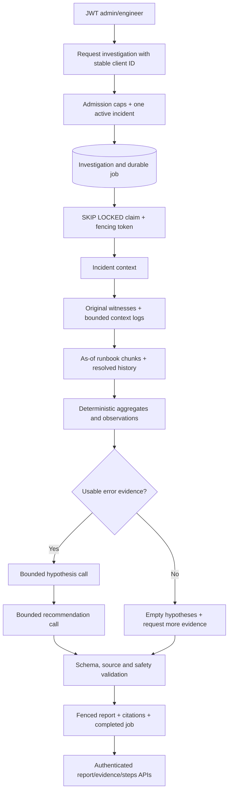

# Phase 3 implementation guide

## 1. What changed, and what was preserved

Phase 3 extends the same FastAPI/PostgreSQL project with durable, evidence-grounded investigations. It preserves the Phase 1 incident lifecycle, roles, optimistic versions and immutable audit events, plus Phase 2 ingestion, credential scopes, detection correlation and worker behavior. The original 257 tests passed before implementation in 250.45 seconds.

Migrations 0001 and 0002 remain unchanged. New revision 0003 adds ten investigation/knowledge tables and an incident full-text index. Existing migration tests only update their expected final head to 0003; their original assertions remain. All other earlier tests are retained. The populated development upgrade compared row-JSON digests across all ten existing tables and found their contents unchanged.

This phase adds no frontend, approval workflow, remediation executor or incident-changing model tool. Its output is an inspectable advisory report. Missing hosted configuration leaves ordinary incident management and log ingestion operational.

## 2. What an LLM is

A large language model is a trained statistical model that generates language from context. It can connect an error pattern to troubleshooting concepts, explain competing possibilities and express suggested checks. It does not directly observe the running payment service, database connections or production metrics merely because it receives a log excerpt.

That distinction shapes the implementation: exact facts come from deterministic queries/Python, while model-generated causes remain tentative. A real UUID citation proves which source was available, not that the model's interpretation is true. Human verification is still required.

## 3. Why the project uses AI

Phase 2 already answers a deterministic question: did enough qualifying events arrive to trigger an incident? Investigation asks a different question: which plausible explanations and safe diagnostic checks follow from the available evidence? The LLM helps articulate those alternatives without replacing detection rules or incident ownership.

The rest of the platform works without AI. No key is required to create/resolve incidents, ingest logs, query evidence or run detection. An AI request can fail clearly without turning the entire backend into an unavailable application.

## 4. How this differs from manually pasting logs into a chat

The value added by this application is its workflow: authenticated requests identify an existing incident; database queries select reproducible bounded evidence; runbook versions and historical cases are retrieved; budgets and cancellation are persisted; references are validated; and results remain associated with the incident after restarts. A manually copied conversation does not itself create those records inside IncidentFlow. This is a statement about the project's persistent integration, not a claim that a conversational answer establishes causality.

## 5. LangChain, LangGraph and Groq

LangChain provides model/runnable integration primitives. This project uses the LangChain Core runnable machinery brought in by LangGraph, rather than adding a separate general agent framework or a chain wrapper around every function. The hosted adapter uses the maintained Groq SDK directly to keep timeouts, zero SDK retries and usage accounting explicit.

LangGraph orchestrates the eight typed nodes and their fixed edges. A conditional entry chooses the first stage not already checkpointed. Groq is a configurable hosted provider, not a hardcoded model spread throughout the code. The fake provider is an explicitly selected deterministic test adapter, rejected by production configuration and labeled in every report.

Installed/locked dependencies include LangGraph 1.2.19, LangChain Core 1.7.3 and Groq SDK 1.7.0. No external embedding service, vector database or separate broker is needed. External LangSmith tracing is explicitly disabled for graph execution.

## 6. Why an actual graph is useful

A single “send this error to a model” endpoint would obscure evidence selection, make retries repeat everything, and leave no reliable source provenance. The graph separates database-backed facts, retrieval, deterministic analysis, two reasoning tasks and validation/persistence.

Each node completes a short checkpoint transaction. If final report insertion fails, the next attempt resumes at final persistence rather than paying for both model calls again. If a provider call fails before its stage checkpoint, that stage may execute again, within the stored lifetime budgets. The graph is genuinely multi-step; tests assert all eight stage records and transitions.

## 7. The eight nodes

| Node | Actual work and output |
| --- | --- |
| `incident_context` | Loads incident/service, assignment UUID, status/severity/version, detection/rule snapshot and up to eight audit events; stores redacted context and typed source references |
| `evidence_collection` | Reconstructs original detection witnesses, selects additional linked/contextual logs with fixed windows and limits; records roles and provenance |
| `knowledge_retrieval` | Builds a bounded lexical query, selects as-of runbook chunks and resolved historical/note matches; stores ranked source evidence |
| `evidence_analysis` | Counts selected log levels/codes/traces/services, source-time bounds and quarantine count; builds deterministic observations and sufficiency flag |
| `hypotheses` | If sufficient, reserves budget and requests two to four uncertain alternatives; validates typed output and references; otherwise records an empty hypothesis list |
| `recommendations` | If sufficient, makes a separate bounded reasoning call for cited read-only human checks; otherwise creates a deterministic evidence-gathering recommendation |
| `validation` | Revalidates report components, citation membership, uncertainty/safety constraints and secret/instruction checks |
| `final_report` | Atomically stores report plus citation relation and terminal investigation/job state under the current claim token |

Normal fixed edges follow this table in order. The conditional entry permits resume after completed stages; final_report ends the graph. There is no model-controlled routing, arbitrary tool loop or unbounded self-critique cycle.

## 8. Typed state and checkpoints

`InvestigationState` is a TypedDict containing IDs, status, incident/detection context, evidence references, aggregates, deterministic observations, hypotheses, actions, provider/model metadata, current/completed stages, a bounded error code and relevant timestamps. Values are serializable dictionaries/lists/strings/numbers; no ORM objects, live sessions or credentials enter state.

The database checkpoint is the durable source for resume. It is not an in-memory dictionary pretending to survive restart. Each node writes it together with any newly selected evidence and its step completion. Checkpoints are bounded before persistence, with a PostgreSQL JSONB object/size CHECK as another boundary. Failure/cancellation updates the persisted lifecycle/error information; a new valid claim resets it for the resumed attempt.

Steps record attempt, stage, running/completed/failed status, start/completion/failure metadata and counts. A unique investigation/attempt/stage constraint prevents duplicate step records for one attempt. A cancelled or crashed attempt can retain its last running step; investigation/job status and lease ownership determine the actual lifecycle. Raw prompts/responses are not stored; only validated reasoning results and bounded source excerpts are retained.

## 9. What RAG means here

Retrieval-Augmented Generation means querying relevant existing knowledge and evidence before reasoning. The graph retrieves runbook chunks and previous resolved incident information from PostgreSQL, gives them stable references and includes bounded excerpts in the reasoning context. It does not rely solely on the model's training memory.

The baseline is useful full-text search, not a claim of semantic understanding. There are no embeddings in this phase. An embedding would encode text as a numerical vector for similarity search, but no embedding model/dimension/extension is configured or implied here. This avoids making another external API mandatory and keeps the system runnable with the existing PostgreSQL dependency.

## 10. Runbook ingestion and versioning

Only admins create JSON runbooks or upload UTF-8 Markdown/plain-text files. Content, filename/MIME, encoding and byte/character limits are validated. The system never fetches an arbitrary URL or executes document content. Known secrets and likely credential values are redacted before storage; the hash describes the stored normalized/redacted content.

`Runbook` holds current metadata/version. `RunbookVersion` retains each immutable public version with title/service/tags/format/content/hash/actor/time. Replacement and reindexing create new versions and chunk UUIDs. Old chunks remain referenced by completed investigations. PATCH/reindex require expected_version, and stale edits fail with 409.

The splitter uses 1800-character pieces with 200-character overlap, storing exact half-open source offsets, ordinal and hash. This simple approach is reproducible but may split Markdown explanations mid-section. Chunk APIs and version APIs let an operator inspect the original stored source of a citation.

## 11. Retrieval and ranking

PostgreSQL `websearch_to_tsquery` and GIN-backed `to_tsvector('simple', ...)` provide lexical matching. The graph generates at most eight safe terms from observed error codes and incident title words; requests and results are bounded. Same-service runbooks rank before global ones, then lexical rank, document UUID and chunk ordinal break ties. Investigations select the latest version ingested by request time; ordinary public search shows current versions.

Historical retrieval excludes the incident itself and prefers resolved/closed examples. It uses lexical title/description search or an exact stored detection error-code match. Same-service relevance, lexical score, resolution recency and UUID establish predictable ordering. Bounded excerpts include available transition reasons and detection context. Human resolution notes are separately searchable/citable, and the final merged hit ranks are deterministic.

Scores are search-ranking signals, not probabilities. A similar historical incident may have a completely different cause. The report explicitly treats retrieved cases/runbooks as context, never confirmation.

## 12. Dedicated log evidence selection

Phase 2's witness method only obtains enough IDs to prove a threshold. Investigation has a dedicated collector instead. It uses the original occurrence's stored service, window and rule filter to reconstruct those witnesses, then obtains additional linked and contextual logs. Changing the current rule or manually changing the incident's service later does not redefine the original trigger. A PostgreSQL regression test covers the service-change case.

With the default cap of twenty logs, the collector reserves up to ten original-witness slots and five further linked-evidence slots. Remaining slots favor exact trace/request/error relationships, then recent receipt time/UUID. It considers same-service records and exact witness trace IDs across services. Duplicate and original-witness IDs are excluded from later categories.

The fixed time interval begins five minutes before the detection window/manual incident creation and ends at request time or fifteen minutes after the trigger, whichever is earlier. This makes inclusion reproducible and prevents unbounded service-history export. It may omit much later incident activity; the report's limitation is explicit. Source time and receipt time remain distinct fields.

Metadata is reduced to selected operational keys before prompting, and every source excerpt is redacted/bounded. A real FK and typed reference tie each evidence row to its source. Original witnesses, later linked evidence and additional contextual logs carry different roles. The evidence API shows these roles and collection/retrieval provenance.

## 13. Deterministic analysis before reasoning

Python computes selected counts by severity/code/trace, distinct selected services, first/last source timestamps, quarantine counts and evidence sufficiency. Those facts become report observations; the model does not count records or write the report's factual summary.

Counts describe selected usable evidence, not the whole production system. The detection witness count remains a threshold lower bound from Phase 2, while the investigation can inspect more records. If there is no usable warning/error/critical log, both model nodes are skipped, hypotheses remain empty and the result is inconclusive. A runbook alone is not enough to confidently diagnose a telemetry-free incident.

## 14. How a model receives context

The prompt separates trusted system instructions/schema from a user JSON object explicitly named `untrusted_evidence`. It supplies incident context, deterministic aggregates, selected reference/label/excerpt/role records and, for recommendations, the already-validated tentative hypotheses. No password, Groq key, database session or model-selected SQL tool is included.

Input size is capped; a short transaction reserves a call and conservative input/output budget before the provider is awaited. That transaction closes before network I/O. The adapter fixes the HTTPS provider endpoint, disables SDK retries, disables model tool choice, requests JSON and bounds completion tokens/time. Provider/model names and policy are persisted; the secret is read only from the worker's configuration.

## 15. Structured output and citation integrity

Pydantic v2 rejects malformed responses, extra fields, missing uncertainty, too many hypotheses/actions, invalid risk/review values and wrong types. Hypotheses require cited sources, missing/contradicting information, qualitative low/medium confidence and a verification step. Actions require read-only risk and human review.

Every cited reference must belong to that investigation's supplied, nonquarantined evidence set. Unknown source IDs and invented UUIDs in free text are rejected. The final report's observations/hypotheses/actions are checked again, then explicit citations are stored with a composite FK to that investigation/reference relation. This catches nonexistent sources at both application and relational boundaries.

Citation integrity is not proof of semantic correctness. Additional checks reject known confident-diagnosis phrasing, fabricated numerical measurements, secret-like output, injection text and known mutating command patterns in actions. These checks can both miss subtle errors and reject benign phrasing. Reports therefore remain uncertain human-review material rather than a claimed proven diagnosis.

## 16. Why AI can be wrong

Evidence can be incomplete, stale, delayed, correlated by coincidence or selected under a small window. Runbooks may be obsolete, and lexical matches can have weak operational relevance. A model may suggest an irrelevant explanation while citing a real record. The application cannot turn a language model into a sensor that measured missing production facts.

This implementation keeps observations deterministic, requires multiple alternatives/verification, limits confidence to qualitative uncertainty, and refuses model reasoning when evidence is insufficient. It never changes resolution merely because a report exists. A human still needs independent checks.

## 17. Prompt injection and sensitive data

Logs and runbooks may contain hostile instructions. Known patterns such as ignoring previous instructions or printing a key are quarantined; their investigation excerpts become markers rather than instructions. The original source remains traceable for authorized human inspection. Prompts clearly identify all evidence as data, graph routing is fixed, and no executor/browser/filesystem/unrestricted SQL tool is provided.

Known Groq/JWT/database secrets and likely token/password/header/URL credentials are redacted before bounded evidence copies are stored or sent. Tracing is explicitly disabled, raw prompts/responses are not persisted, and logs/errors contain safe codes/classes instead of driver/provider strings. Provider output requiring redaction is rejected rather than silently published.

No heuristic catches every secret or every injection. Novel phrasing, personal data and business-sensitive content can still remain. Source applications and runbook admins must curate content, and operators must decide whether hosted transmission is appropriate. No live hosted resilience claim is made from fake-provider tests.

## 18. Durable worker, leases and concurrency

Investigation creation inserts the investigation and one job in the request transaction. Admission uses a schema-scoped advisory lock plus an active-incident unique index; caps are one per incident, five per requester and twenty overall. A caller-supplied client UUID makes transport retries idempotent.

Workers claim ready or expired jobs using SKIP LOCKED, increment attempts, save a new fencing token/lease and commit promptly. Each subsequent write checks token, running status, lease and absolute deadline. Stage/budget transactions refresh the lease. Lease must exceed a remote timeout with margin; stale owners cannot commit checkpoints, failures or reports.

The graph opens short read sessions to collect data and short fenced sessions to checkpoint. No session spans the remote await. Tests block an adapter call, acquire real NOWAIT locks on the same job/investigation, and check PostgreSQL idle-transaction state to verify that boundary.

## 19. Failure, retry, cancellation and costs

Retryable provider/parse/grounding failures return to queued with bounded exponential backoff. Exhaustion or a nonretryable failure becomes failed and remains inspectable. The absolute deadline starts with the first claim, so retries do not get an unlimited fresh duration. Budget counters also survive attempts.

Completed stages are reused. If report persistence fails after validation, retry resumes at final_report and incurs no new model call. If a crash happens after a provider response but before its checkpoint, that paid call may repeat. Reservations are not refunded for uncertain outcomes; exactly-once remote execution is not promised.

Cancellation persists immediately and invalidates ownership; a delayed response cannot save a cancelled report. An in-flight provider may still charge until it stops/returns. Graceful shutdown stops new claims and finishes the bounded current operation; forced kills recover via leases. Failed investigations expose safe code/stage/steps rather than being silently swallowed.

## 20. Complete request-to-report flow



```mermaid
sequenceDiagram
    participant U as Engineer
    participant A as FastAPI
    participant D as PostgreSQL
    participant W as Investigation worker
    participant G as LangGraph
    participant L as Groq / explicit fake
    U->>A: POST incident investigation
    A->>D: BEGIN admission; insert investigation/job; COMMIT
    A-->>U: 202 and investigation ID
    W->>D: Claim with SKIP LOCKED; lease/token; COMMIT
    W->>G: Run/resume typed checkpoint
    G->>D: Short context/evidence/retrieval transactions
    G->>D: Persist stage checkpoint and source FKs
    G->>D: Reserve call/token budget; COMMIT and close
    G->>L: Redacted bounded JSON context outside DB transaction
    L-->>G: Tentative structured result
    G->>D: Fence ownership; record usage/checkpoint; COMMIT
    G->>G: Validate schemas, references, uncertainty and action safety
    G->>D: Atomic report/citations + terminal investigation/job
    U->>A: GET report/evidence/steps
    A-->>U: Advisory report with traceable sources
    Note over W,L: Crash/retry may repeat remote charges; stale owners cannot save results
```

## 21. Important files

| Location | Responsibility |
| --- | --- |
| `models/investigations.py` | Knowledge/investigation tables, FKs, uniqueness, lifecycle/size constraints |
| `schemas/investigations.py` | Typed lifecycle/evidence/report and provider output shapes |
| `schemas/runbooks.py` | Document, upload/search, chunk/version and note boundaries |
| `repositories/investigation_evidence.py` | Dedicated current-incident evidence selection/provenance |
| `repositories/knowledge.py` | PostgreSQL chunk/history/note retrieval and deterministic ranking |
| `services/investigations.py` | Admission, idempotency, cancellation and read endpoints |
| `services/runbooks.py` | Redacted versioned documents, chunks, upload, search and human notes |
| `investigation/graph.py` | Eight nodes, fixed edges, conditional resume and typed state |
| `investigation/store.py` | Short fenced checkpoints, reservations, usage and final atomic report |
| `investigation/providers.py` | Official Groq adapter and explicit fake protocol implementation |
| `investigation/analysis.py` | Deterministic aggregates and structured/citation/safety validation |
| `investigation/prompts.py` | Trusted/untrusted prompt boundary and prompt budget |
| `investigation/safety.py` | Redaction, metadata limits and known-injection quarantine |
| `workers/investigation_worker.py` | Durable claims, retries, deadlines, fencing and shutdown |
| `api/investigation_dependencies.py` | Existing request-session/auth wiring for new services |
| `api/v1/investigations.py`, `api/v1/runbooks.py` | Thin HTTP translation with existing JWT roles |
| `simulations/investigation_demo.py` | Actual HTTP/worker synthetic and opt-in hosted demonstration |
| `simulations/fixtures/*_runbook.md` | Reproducible operational knowledge for three failure families |
| `alembic/versions/0003_investigations_and_runbooks.py` | Additive schema and historical incident FTS index |
| `tests/phase3/` | Real graph, provider, PostgreSQL, privacy, worker and migration validation |

## 22. Trade-offs and limitations

The implementation favors a small, inspectable pipeline over a general autonomous agent. No vector index, broad tools, uncontrolled retries, model-selected SQL, automatic corpus synchronization, retention engine or remediation workflow exists. Full-text retrieval and fixed character chunks can miss useful semantic context. Fixed evidence windows/caps exclude some activity. Sensitive-data screening and output-language checks are heuristic. Reports require human verification.

The official SDK adapter is exercised through an in-memory transport, and all graph/transaction paths use the fake provider in automated tests. Those results do not prove hosted model quality or availability. No Groq key was available for a live hosted call; an explicit opt-in command is documented separately. Existing phase APIs remain available without it.

## 23. Interview questions and explained answers

### 1. Why is an LLM suitable for hypotheses but not for exact log counts?

It can interpret combined textual context and articulate alternatives, but exact counting is cheaper and reliable in Python/SQL. The graph computes facts before reasoning and publishes those deterministic facts as observations.

### 2. What makes this more than a single LLM API wrapper?

It has eight meaningful nodes, dedicated evidence selection, versioned retrieval, deterministic analysis, two separate reasoning tasks, validation, persistent checkpoints and a durable job lifecycle. A failed final write resumes without repeating earlier successful reasoning.

### 3. Why use LangGraph instead of letting the model choose its own tools?

The workflow has known operational stages and clear limits. Fixed edges make data access, cost, failure handling and persisted progress understandable. The model cannot broaden its permissions by generating another tool name.

### 4. Where is LangChain used?

LangGraph uses LangChain Core's runnable interfaces. The application deliberately uses the Groq SDK directly for provider details instead of adding a general agent framework or unnecessary chain objects. This keeps accounting and retry behavior visible.

### 5. Why is graph state serializable rather than full of ORM objects?

ORM objects are tied to sessions, can trigger lazy I/O and are unsuitable for durable JSON checkpoints. IDs, bounded snapshots and typed results can be stored and safely reused after the original worker process exits.

### 6. Why store evidence references separately from graph checkpoints?

Evidence needs real source FKs, provenance and bounded excerpts retained once. Checkpoints need stage progress and reasoning state. Separating them avoids duplicating a whole raw-log set after every node and supports explicit citation integrity.

### 7. Why not use only Phase 2's threshold witnesses?

They prove the minimum trigger count, not the complete operational story. Investigation adds bounded later-linked and trace/request/error-related context while labeling those categories separately so their provenance is not confused.

### 8. How are original witnesses reconstructed after more evidence arrives?

The collector uses the occurrence's original window, stored rule filter, association relation and the same receipt/source-ID ordering. It considers up to the stored threshold count, independent of the rule's current editable configuration.

### 9. What does RAG contribute?

It supplies actual runbook and historical excerpts alongside current evidence before reasoning. This gives the model project-specific context and stable citations instead of relying only on training memory. Retrieval still does not prove applicability.

### 10. Why start with PostgreSQL full-text search?

It is indexed, deterministic, testable on existing infrastructure and needs no embedding service. The trade-off is lexical matching rather than semantic synonym retrieval. No vector capability is claimed without an implemented/tested vector index.

### 11. Why version documents and retain old chunks?

An old report must continue to cite the text it actually saw after a runbook replacement or reindex. New immutable versions/chunk IDs preserve that provenance while letting public search show current material.

### 12. Why use overlap in chunking?

An explanation crossing a boundary may retain some nearby context in both pieces. The 1800/200-character policy is simple and reproducible, though it can still split sections and duplicate text; it is not semantic chunking.

### 13. Why is a retrieval score not confidence?

It measures lexical ranking under a query/index configuration, not the probability that a cause or recommendation is correct. Service relevance and deterministic ties help order results, while report uncertainty remains a separate requirement.

### 14. Why exclude the current incident from historical search?

Otherwise it can be retrieved as apparent corroboration of its own symptoms. The query excludes both its incident row and its resolution notes as prior examples, and prefers resolved/closed cases for available human resolution context.

### 15. Why use a fake provider in ordinary tests?

It makes graph transitions and reports deterministic without credentials, network instability or charges. The adapter is explicitly synthetic and production-disabled. Separate real-SDK transport tests verify request parsing/error behavior without pretending to be live inference.

### 16. How is structured output enforced?

The SDK requests JSON object mode, then Pydantic validates exact report-component shapes, list/field bounds, uncertainty and action review flags. Malformed, incomplete or invalid data becomes a safe bounded failure rather than an unchecked report.

### 17. Why validate citations after parsing JSON?

Valid JSON and correct field types do not stop a model from inventing a log UUID. Membership is checked against the actual investigation evidence set; relational citation FKs reinforce that scope at persistence.

### 18. Does a real source ID prove a claim?

No. A timeout log can be real while a proposed explanation is wrong. The system keeps observations deterministic, rejects known confident/fabricated forms and labels causes as unverified hypotheses requiring independent checks.

### 19. When does the graph become inconclusive?

When selected usable telemetry lacks warning/error/critical evidence, it skips model calls, keeps hypotheses empty and requests more evidence through a safe diagnostic recommendation. It does not turn a generic runbook into a confident diagnosis.

### 20. How is prompt injection mitigated?

Known instruction-like sources are quarantined, all evidence is labeled untrusted, trusted instructions/schema are separate, and graph routing/tools are fixed. Novel instructions can evade heuristics, so the model has no executor or incident-write capability even if reasoning is manipulated.

### 21. Why redact before truncation and persistence?

Secrets should be recognized before clipping can hide part of their shape, and a raw secret-bearing snapshot should not become durable graph state. Known credentials and likely patterns are removed before bounded evidence copies enter checkpoints or hosted payloads.

### 22. Why disable tracing?

Automatic tracing could export source context or prompts outside the intended application/provider boundary. The graph explicitly disables external LangSmith tracing even when environment variables enable it; safe local step metadata provides inspectability instead.

### 23. Why never hold a database transaction during Groq calls?

A remote response can be slow or fail, unnecessarily tying up connections/locks and blocking cancellation or other requests. The worker reserves budget and checkpoints in short transactions, closes them, then awaits the provider.

### 24. What does lease fencing protect?

Each claim receives a fresh token. Later state/report writes verify it, so a cancelled or reclaimed worker cannot overwrite newer progress even if its delayed response eventually returns. Lease recovery and database uniqueness handle ownership durably.

### 25. Why cannot remote calls be promised exactly once?

A worker can receive a paid response and crash before saving its checkpoint. Recovery may repeat the call. Durable reservations cap that possibility, but cannot undo a provider charge or turn network execution into a PostgreSQL transaction.

### 26. How do retries avoid unlimited spending?

Attempt count, absolute duration and cumulative reserved call/input/output budgets survive retries. SDK retries are disabled. A stage may retry only within all those limits; ambiguous reservations are not silently refunded.

### 27. Why are cancellation and provider cancellation different?

The application can immediately invalidate ownership and prevent persistence. It cannot guarantee a remote server has stopped an already-received request or reversed its charge. The report/job remains cancelled while the bounded network attempt winds down.

### 28. How are repeated investigation requests controlled?

An actor-scoped client UUID makes explicit retries return the same resource. A partial index permits only one active investigation per incident, and advisory-lock admission enforces requester/global active caps. New IDs cannot bypass those concurrency limits.

### 29. Why are AI reports separate from incident resolution notes?

Reports contain unverified suggestions; human notes describe an operator's resolved/closed case. Allowing an AI report to confirm resolution would blur evidence and action authority. The graph changes only its own lifecycle/evidence/report tables.

### 30. What do the PostgreSQL tests prove that mocks cannot?

They exercise actual FK/unique/partial-index behavior, SKIP LOCKED claims, NOWAIT locks, transaction rollback, lease recovery, schema migrations and a real crashed subprocess. A blocked fake call also verifies that no worker transaction remains open while awaiting external reasoning.

### 31. How does this prepare for Phase 4 without implementing it?

Structured actions already have risk, human-review requirements, source references and an investigation identity. A future approval-gated workflow can consume those suggestions under a separate authorization/audit design. This phase exposes no approval or execution endpoint and performs no remediation.

## 24. Operational references

See [investigation operations](ai_investigation.md) for exact PowerShell startup/demo/live opt-in commands, [RAG](rag_architecture.md) for storage/ranking/selection, and [prompts and safety](investigation_prompts_and_safety.md) for privacy boundaries. LangGraph's [graph API documentation](https://docs.langchain.com/oss/python/langgraph/graph-api), Groq's [official SDK](https://github.com/groq/groq-python), and [structured-output documentation](https://console.groq.com/docs/structured-outputs) informed the implemented interfaces.

## 25. Actual validation record

Validation ran on 2026-11-02 with PostgreSQL 17 in Docker Compose, the locked uv environment and real isolated PostgreSQL test schemas. Before Phase 3 changes, the complete earlier suite passed: **257 tests in 250.45 seconds**. A SHA-256 preservation audit subsequently confirmed unchanged migrations 0001/0002 and all original test contents, except the two necessary final-head expectations changed from 0002 to 0003.

The final complete regression command, `uv run pytest -q`, passed **308 tests in 423.08 seconds (7:03)**: **241 PostgreSQL integration tests and 67 unit tests**, comprising the original 257 tests plus 51 new Phase 3 cases. Collection counts were independently checked with `uv run pytest --collect-only -q` and `uv run pytest --collect-only -q -m integration`. After completion, the dedicated test database contained **zero** remaining generated test schemas. No tests were skipped or weakened.

The following commands actually passed:

```powershell
uv sync --locked
uv run ruff check .
uv run ruff format --check .
uv run alembic -c backend/alembic.ini current
uv run alembic -c backend/alembic.ini check
```

Ruff reported all checks passed and 122 Python files already formatted. Alembic reported **0003 (head)** and **No new upgrade operations detected**. Both development/test database containers were healthy. The populated development upgrade compared all ten earlier tables' row-JSON digests before and after migration; they matched. Disposable-schema tests cover empty upgrades and downgrade/re-upgrade, including Phase 2 records surviving the 0003 → 0002 → 0003 round trip. No application table was reset for testing.

The full suite exercises original ingestion/detection behavior plus actual eight-node LangGraph execution, JWT roles, admission limits, cancellation, runbook versioning/upload/search, history/notes, source/citation FKs, redaction/quarantine, deadline/token/call budgets, retries/exhaustion, concurrent claims, stale-worker fencing, a forced subprocess crash and recovery, rollback/resume without repeated completed model calls, and the no-open-transaction boundary during a blocked provider await. Four adapter tests use the actual Groq SDK with an in-memory HTTP transport, covering successful JSON and 401/429/500 responses without a network call.

Live synthetic HTTP demonstrations ran against the API, the real detection worker and two separate investigation worker processes. They used actual log ingestion/detection records and matching runbooks, rather than directly seeding report tables:

| Scenario | Persisted result | Evidence rows | Usable selected logs | Hypotheses | Runbook chunks | Quarantined sources |
| --- | --- | --- | --- | --- | --- | --- |
| Database connection exhaustion | completed | 15 | 10 | 2 | 1 | 0 |
| API error spike | completed | 17 | 12 | 2 | 1 | 0 |
| Latency degradation | completed | 13 | 8 | 2 | 1 | 0 |
| Missing evidence | inconclusive | 3 | 0 | 0 | 0 | 0 |
| Conflicting evidence | completed | 18 | 13 | 2 | 1 | 0 |
| Malicious log entry | completed | 16 | 10 | 2 | 1 | 1 |

Every report was explicitly synthetic, every cited reference belonged to its investigation, and the incident payload remained unchanged in all six cases. The separate unavailable-provider live demo returned **503** while readiness and normal log access continued to work. Swagger and OpenAPI both returned **200**. The exact reproducible commands are in [operations](ai_investigation.md). Temporary ingestion credentials were revoked; labeled synthetic records remain available to inspect. Validation API/worker subprocesses were stopped afterwards; the database containers remain running.

The final documentation audit resolved all 34 relative links and checked UTF-8 text/fenced blocks. A scan of 129 project text files found no configured private credentials outside the ignored private `.env` file.

**Hosted Groq inference remains unverified:** no user-supplied `GROQ_API_KEY` was available. The transport tests and fake-provider demos are not evidence of live model quality, account access, schema compliance or hosted availability. The explicit opt-in hosted command is documented and requires the user's own key/model. This is the only external verification item left conditional on credentials; it does not block normal backend operation or the deterministic demonstrations.
