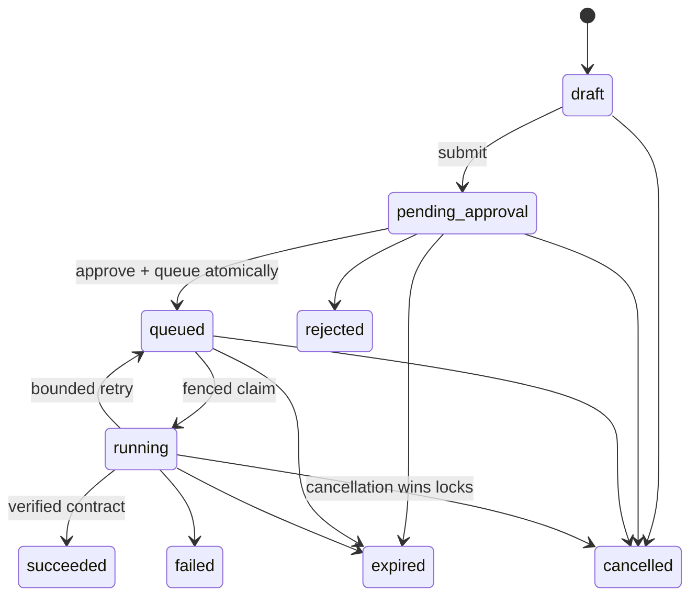
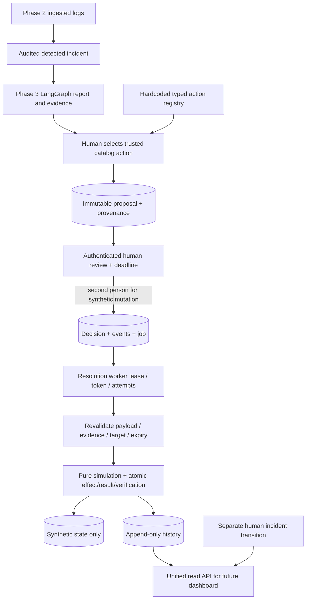

# Phase 4 implementation guide

## 1. Remediation and the scope of this phase

Incident remediation means taking action intended to improve a failing system, then checking the result. Investigation asks what might be wrong; remediation proposes a concrete change. A timeout hypothesis does not authorize changing database connections or prove that a restart would help.

This phase implements that decision workflow using isolated synthetic operational state. It adds no real server restart, cloud administrator, shell, script runner, arbitrary SQL executor, frontend or production deployment. A successful result means a deterministic simulation contract passed. It says nothing about an actual production service's health.

The project remains one FastAPI backend and PostgreSQL database. Existing incident management, detection and eight-node investigations are preserved. Before wiring Phase 4, all **308 existing tests passed in 461.27 seconds**. Migrations 0001–0003 remain unchanged. Only earlier tests' final migration-head expectations move to 0004; their assertions are retained.

## 2. Why approval is necessary

A suggested action can be inappropriate for the current target, stale by the time it runs or outside the proposer's authority. Human review creates an explicit decision about a specific action, target, parameters and evidence. It also identifies who accepted that proposal.

Every catalog action needs human approval. Read-only inspections may be self-approved by an engineer/admin. Synthetic mutations need a different engineer/admin; an admin cannot override that rule for their own proposal. Viewer and system/AI identities cannot approve. The backend service and database guards enforce this policy independently of any future UI.

## 3. AI suggestions never become tools

Phase 3's RecommendedAction still permits only read-only risk and requires human review. Its description is text, not code. Phase 4 never parses a recommendation into a callable or automatically changes a read-only suggestion into recovery.

A human may select a real recommendation and explicitly choose a read-only catalog action. That proposal stores the recommendation and report provenance. A synthetic recovery instead requires `origin=human`; the human can still cite the investigation as supporting context, but must explicitly author the proposal and obtain a second person's approval.

## 4. The allowlisted catalog

`resolution/catalog.py` defines a literal registry of five reviewed definitions: inspect service health, database connections and request latency; simulate service recovery and connection-pool recovery. Each declares its stable ID/version, description, risk, approval/separation rule, fixed five-second budget and parameter/result/verification schemas.

Parameters contain only a synthetic state UUID and expected positive version. The incident determines the authorized service; the caller cannot name an unrelated target, script, URL, command or import. Extra fields are rejected. `resolution/simulator.py` dispatches by fixed branches and performs pure bounded computation. There are no dynamically imported request-selected functions.

Catalog fingerprints hash the full public definition. A changed/removed definition invalidates an outstanding authorization instead of silently executing new semantics under an old approval.

## 5. Creating immutable proposals

`ResolutionService.create` checks the authenticated actor, actor-scoped client UUID, admission limit, current unresolved incident/version and matching synthetic target/version. It stores the action/parameters, explanation, origin, provenance, requester, policy and canonical payload hash. A proposal begins as draft, with version 1 and a creation event.

Payloads are immutable even while draft. This deliberately avoids edit/approval race complexity: a material change creates a new proposal and review. A database trigger rejects protected-field updates. There is no PATCH endpoint. Explanation and review text is bounded and redacted/quarantined before persistence.

An exact client-UUID replay returns the same resource, including after success. Reusing it with changed input returns 409. PostgreSQL uniqueness and a schema-scoped admission lock make concurrent request behavior deterministic. Each requester may have at most twenty active proposals.

## 6. Evidence and investigation provenance

Investigation-linked proposals require a completed/inconclusive report belonging to the incident and at least one usable evidence reference. Fabricated, foreign or quarantined references are rejected. Report-origin read-only selection also requires a real recommendation index and evidence intersecting that recommendation.

The proposal stores report hash/time, selected recommendation where applicable and sorted source references. A separate evidence relation has actual composite source FKs plus a proposal/investigation ownership trigger. The report itself is not modified. A human-only proposal without an investigation is allowed with no evidence references and no claimed AI provenance.

Execution rechecks report hash, investigation ownership/status and selected usable evidence. Source membership identifies what was reviewed; it does not establish that a diagnosis or proposed correction is causally correct.

## 7. Roles and approval policy

All authenticated human roles can inspect catalog/state/proposals/results/events/timeline. Engineers/admins create proposals and review according to risk. Only the proposer or an admin submits/cancels a proposal. Only admins initialize/reset synthetic scenarios. There is no direct execute endpoint or public ability to impersonate a worker.

Policy lives in trusted code and bounded settings, snapshotted per proposal. Defaults are 900 seconds for approval lifetime, 30 seconds for lease and three attempts. No dynamic policy editor, delegation or multi-person quorum is implemented. See [approval security](approval_security.md) for the full matrix.

## 8. State transitions and versions



Approval is stored as a decision plus an `approval_granted` event. Queueing commits in that same transaction, so there is no separately visible approved state waiting for an ambiguous second request. Each transition increments proposal version and inserts a unique versioned event. Expected versions and row locks reject competing/stale decisions.

Rejected, cancelled and expired proposals cannot be resubmitted or executed. Late/stale review returns a persisted expired proposal with HTTP 200 and no decision/job. Clients must inspect lifecycle status as well as HTTP status. Invalid ordinary transitions and stale versions return 409.

## 9. Expiration and stale context

The approval clock starts on submission and does not restart on approval or retry. It covers queue waiting and execution completion. The worker sweeps expired pending proposals and checks queued/running work again. An established deadline cannot be extended by direct ordinary updates.

Any incident version change invalidates execution, including benign assignment edits. Incident closure/resolution, changed service target, synthetic reset/version change, changed catalog definition, report alteration or loss of usable evidence also blocks it. This strict policy trades convenience for an easily explained review contract: approved context must still match.

While the worker is stopped, a pending row can display its old status until reviewed/swept. It still cannot execute after its deadline. Expiration is an eligibility rule, not merely a periodically updated label.

## 10. PostgreSQL workflow storage

Revision 0004 adds seven tables: synthetic service states, resolution proposals, evidence, approvals, jobs, executions and events. Scalar identities and FKs link them to existing users/services/incidents/reports/sources. JSONB stores bounded typed snapshots, not arbitrary execution instructions.

Unique requester/client UUIDs prevent duplicate proposals. One approval/job/result per proposal prevents duplicate decisions or receipts. A job's composite approval FK identifies its actual approved decision. Proposal versions, actor shape, lifecycle values, leases, JSON sizes and synthetic markers have database checks. Migration/trigger details are in [data model](data_model.md).

## 11. Approval and audit consistency

Review locks the proposal and validates actor, deadline, context and expected version. Approval insertion, immutable snapshot, approval event, queue event and job creation share the request transaction. If any insert fails, the whole request rolls back. A test installs a rejecting audit trigger and verifies no partial approval/job survives.

`record_event` flushes the changed proposal/version, adds the corresponding event and refreshes the response object. Resolution events remain separate from incident events. Database UPDATE/DELETE/TRUNCATE triggers protect events, decisions, execution receipts and evidence links. A database owner can change those protections; this is not cryptographic tamper resistance.

## 12. Worker claims and execution

`ResolutionWorker.claim_one` selects ready pending jobs or expired processing leases with FOR UPDATE SKIP LOCKED. It locks the proposal, validates approval and remaining lifetime, increments attempt, creates a fresh token/lease and records execution start. It commits before doing further work.

Execution opens a new bounded transaction in job → proposal → incident → state lock order. It checks token/status/lease, real human decision/current role, immutable snapshot/hash, current context and deadline. It computes a result through the pure simulator and atomically commits any synthetic change, unique result, verification, terminal states and events. No network/provider call happens in this transaction.

The action transaction has a five-second timeout, five-second statement timeout and two-second lock timeout. A late lease/deadline causes rollback. The separate Phase 3 graph continues to await remote models outside database transactions; these boundaries differ because Phase 4's entire effect is local PostgreSQL state.

## 13. Retries, crashes and idempotency

Execution exceptions roll back the transaction. A fresh fenced transaction records a safe error and schedules 2, 4… seconds backoff capped at 30, within the stored attempt/deadline bounds. A failed verification is terminal, with a structured result rather than blind retries.

Idempotency means repetition does not create an additional intended effect. A crashed claim is reclaimed only after lease expiry, with a new token. A process killed before execution commit leaves no partial effect. A process killed after commit leaves a terminal job and unique receipt, so another worker does not repeat it. Tests force real subprocess exits at both boundaries.

This atomic guarantee applies to synthetic effects in this database. A future external service could accept an action while its caller crashes before recording success; no exactly-once external promise is made. Existing Groq crash/charge limitations are unchanged.

## 14. Synthetic service state and verification

The dedicated state row stores service association, explicitly synthetic JSON, version, initializer and timestamps. Deterministic scenarios are database exhaustion, unhealthy service, latency degradation, healthy and dependency outage. Admin setup accepts only these names and expected version, not arbitrary replacement JSON. Reset increments version even when restoring identical values, invalidating old approvals.

Inspection results retain health/error rate/dependency, pool/queue/timeouts, request counts/p50/p95/endpoint/delay and observation time. Recovery uses the deterministic healthy fixture when permitted. An unavailable dependency remains a failed contract. Results preserve before/after snapshots and versions. Verification records contract satisfaction, improvement and `incident_resolution_confirmed=false`.

## 15. Incident lifecycle remains human controlled

A succeeded proposal changes only its own workflow and synthetic state. It does not update incident severity, assignee, status, version or audit events. Human incident transitions use the original endpoint with expected version and reason. The full demo first verifies incident equality, then deliberately has the engineer transition only its synthetic incident.

This separation keeps “simulation succeeded” from masquerading as “production recovered.” Confirmed resolution remains a separate operational judgment and record.

## 16. Unified incident timeline

`services/incident_timeline.py` unions real incident events, detection creation, persisted investigation request/start/completion and resolution events. It preserves source UUID/type and timestamps; it does not invent a tool call from recommendation text.

Ordering is timestamp, source type, source UUID and event type. Bounded keyset cursors bind to the incident and an upper time watermark. Later normal events do not continually shift an offset. This remains READ COMMITTED across requests, so a sufficiently late commit with an older timestamp can affect visibility; it is not a permanent database snapshot. Proposal/event collections separately retain bounded offset pagination.

## 17. Entire architecture and data flow



```mermaid
sequenceDiagram
    actor E as Engineer
    actor H as Second human
    participant A as FastAPI
    participant P as PostgreSQL
    participant W as Resolution worker
    E->>A: Create immutable proposal with source references/client UUID
    A->>P: Validate source/target; proposal + evidence + creation event
    E->>A: Submit with expected_version
    A->>P: Set pending/deadline + submission event
    H->>A: Approve exact proposal/version with reason
    A->>P: Lock; validate role/separation/context
    A->>P: Atomic decision/snapshot + approval/queue events + job
    W->>P: SKIP LOCKED claim; token/lease/attempt/start event; commit
    W->>P: New transaction; lock job/proposal/incident/state
    W->>W: Revalidate; pure deterministic simulator
    W->>P: Atomic synthetic effect/result/verification/status/events
    E->>A: Read result and unified timeline
    E->>A: Separately request original incident transition if appropriate
```

## 18. Important files

| File under backend | Responsibility |
| --- | --- |
| `app/models/resolution.py` | Seven tables, status enum, relational/size/version constraints |
| `app/schemas/resolution.py` | Strict proposal/review/scenario/catalog/result/page boundaries |
| `app/repositories/resolution.py` | Scalar and locked proposal/job/state queries |
| `app/services/resolution.py` | Admission, provenance, policy, human decisions, events, cancellation |
| `app/services/incident_timeline.py` | Four-source read-only timeline and keyset cursor |
| `app/resolution/catalog.py` | Fixed definitions, schemas and canonical hashing |
| `app/resolution/simulator.py` | Pure reproducible synthetic scenarios/actions |
| `app/workers/resolution_worker.py` | Expiry, claims, fencing, retries and atomic local execution |
| `app/api/v1/resolutions.py` | Existing JWT/session wiring and typed HTTP endpoints |
| `app/simulations/resolution_demo.py` | Complete HTTP-only demonstration with three humans |
| `alembic/versions/0004_resolution_workflows.py` | Additive tables/indexes and explicit protective triggers |
| `tests/phase4/` | Catalog, API, real concurrency/crash/rollback/security/migration checks |

Settings, router registration, readiness, application/project version and current docs were extended. No new runtime dependency was necessary. Phase 3 report schemas and the existing incident service remain unchanged.

## 19. Architecture decisions and limitations

One database makes synthetic effects and workflow records transactionally inseparable without adding a broker. Immutable drafts simplify review correctness but require a new proposal for edits. Conservative version invalidation can cause extra reviews. Fixed roles and policies are understandable but do not provide tenant/team ACLs, delegated approvals or quorums.

The simulator is intentionally limited; its numerical health/latency values are fixtures, not measurements of real infrastructure. There is no external executor, compensation/rollback planner, retention engine, frontend or production deployment. Setup/reset records retain current initializer/version rather than a separate setup ledger. Pattern redaction cannot recognize every sensitive value. Owner-level database access can bypass triggers. Exact cancellation/expiry/pagination limits are documented in [operations](resolution_workflows.md).

## 20. Interview questions with explained answers

### 1. How does investigation differ from remediation?

Investigation produces interpretations and possible checks from evidence. Remediation authorizes and carries out a defined operation. The system preserves separate reports/proposals/results so a generated hypothesis cannot itself grant authority.

### 2. Why require approval even for read-only inspection?

It provides a consistent reviewable workflow and explicit actor record for every execution. The policy permits self-review for these low-risk synthetic inspections while keeping a second person mandatory for mutations.

### 3. Why cannot an administrator self-approve a synthetic mutation?

Separation of duties protects the decision independently of broad administrative permissions. Allowing an override would collapse the two-person control precisely for the actor with the most authority.

### 4. How is an AI recommendation linked without making it executable?

The human explicitly selects a real recommendation index, usable sources and a read-only catalog ID. Text remains provenance; dispatch uses only a trusted identifier. Recovery requires a separate human-authored proposal.

### 5. Why use a hardcoded registry?

It makes the entire executable surface reviewable and prevents input from choosing imports/functions/tools. Typed parameters further restrict what each fixed action can receive.

### 6. Why make draft payloads immutable?

It avoids maintaining edit invalidation and approval race rules across many fields. The operator creates a new proposal for a material correction, producing a fresh identity, snapshot and review.

### 7. What does the payload hash prove?

It detects changes relative to the canonical snapshot the application reviewed. It is not a signature from an external trust authority; a privileged database owner could alter data/protections, so cryptographic tamper resistance is not claimed.

### 8. Why preserve the report hash and selected recommendation?

They identify which report content informed the human decision and allow later revalidation. A report UUID alone would not reveal that its JSON had been changed outside the normal API.

### 9. Why validate evidence membership separately from UUID syntax?

A valid UUID might belong to another investigation or be quarantined. Membership queries and composite FKs establish actual ownership; the insertion guard also ties it to this proposal's investigation.

### 10. Does valid evidence prove the proposed action is correct?

No. It establishes provenance, not causal entailment. Human review, explicit uncertainty and synthetic verification cannot establish unobserved production recovery.

### 11. Why is approval immediately queued?

Combining decision and job insertion removes a second enqueue request that might be lost or repeated. Both audit events and the job either commit together or disappear on rollback.

### 12. What prevents two simultaneous approvals?

The proposal lock serializes decisions, expected versions reject the stale reviewer and uniqueness permits only one decision/job. Real PostgreSQL tests verify one success and one conflict.

### 13. Why do expected versions and locks both matter?

Locks serialize concurrent operations, while expected versions ensure the human reviewed the version they intended. Waiting for a lock should not silently authorize a now-changed workflow.

### 14. Why must approval expire?

A valid decision about a stale target can be unsafe later. The stored deadline bounds review, queue delays, retries and completion, and cannot be renewed automatically by a worker retry.

### 15. Why return an expired proposal instead of raising after updating it?

An exception would unwind the request transaction and roll back the expiry/event. Returning its terminal state commits an inspectable outcome while creating no approval/job. The response contract explicitly documents this 200 outcome.

### 16. Why invalidate on any incident version change?

It gives a simple conservative contract: the approved context must still match. It can reject benign assignment edits, but avoids guessing which incident changes affect an action's safety.

### 17. How does SKIP LOCKED help multiple workers?

Workers skip a job currently locked by another claim transaction instead of all waiting for the same row. The committed lease then represents ownership after that short transaction ends.

### 18. Why is a lease insufficient without a fencing token?

An old process might wake after its lease was reclaimed. A new token identifies the current owner; every execution/failure path checks it so the delayed process cannot overwrite newer state.

### 19. What happens if a worker dies immediately after claiming?

Its committed job remains processing until lease expiry. Recovery claims it with another attempt/token, records recovery and executes only if the original approval/context are still valid.

### 20. What happens if it dies after execution commit?

The terminal job, unique execution receipt and effect already exist together. Another worker finds no eligible job, so the synthetic effect is not applied again. Tests force an actual process exit at this point.

### 21. Why is local simulation allowed inside a transaction?

Its entire effect is bounded computation plus writes to this database. Holding the necessary row locks makes the effect/result atomic. There is no slow external I/O; timeouts bound the transaction. Hosted reasoning remains outside transactions.

### 22. Why not promise exactly-once external execution?

A remote system can accept a request while the worker crashes before storing the response. PostgreSQL cannot roll that external operation back. This phase implements no such executor and confines its atomic guarantee to synthetic database state.

### 23. How are retries bounded?

The job stores attempts/max and next availability; exponential backoff is capped. The unchanged approval deadline also bounds total eligibility. Verification failure is terminal rather than treated as a transient transport exception.

### 24. How can two approved proposals avoid duplicate correction?

Both may refer to state version 1. The first transaction updates it to 2; the second locks and rereads that state, sees the version mismatch and expires. Its approval cannot silently authorize another target version.

### 25. What does cancellation guarantee?

If cancellation obtains ownership first, it invalidates the token and prevents an effect. If execution already commits under the locks, cancellation sees a terminal/stale proposal and fails. It does not claim to reverse a completed action.

### 26. Why make audit records append-only in the database?

It catches accidental direct ORM/SQL updates beyond API route restrictions. It still depends on operator privileges; the owner can change triggers, so stronger deployment role separation remains necessary outside this phase.

### 27. How do you test transaction atomicity?

A rejecting PostgreSQL trigger fails audit/result insertion after earlier writes have occurred in the transaction. Tests verify the proposal/approval/job or synthetic effect/result all rolled back, then retry under valid conditions.

### 28. What makes the unified timeline truthful?

It selects actual persisted events and milestone timestamps, preserving source identities. It never invents execution from an AI suggestion or incident resolution from synthetic success.

### 29. Why use keyset pagination for the timeline?

The last ordering tuple and upper time watermark avoid ordinary offset shifts as new events arrive. The documented READ COMMITTED limit remains: it is not an immutable cross-request snapshot of late commits.

### 30. Why does verification not resolve the incident?

It verifies only the simulator's contract against synthetic state. Resolving a production incident requires human operational judgment and the existing versioned/audited incident API; those authorities remain separate.

### 31. How does Phase 4 prepare for the dashboard?

Typed catalog schemas can drive forms, proposal versions support conflict handling, roles/policies describe available actions, and result/history/timeline APIs support detail views. The backend contracts exist without implementing a React UI or relying on frontend checks.

## 21. Commands and actual validation

Use [workflow operations](resolution_workflows.md) for exact PostgreSQL/migration/API/three-worker startup, private three-account credential setup and `python -m app.simulations.resolution_demo --timeout 120`. The demo requires no Groq key. [Approval security](approval_security.md) documents policy and operational limits.

On **2026-11-03**, the retained baseline passed 308 tests before Phase 4 wiring. Phase 4's initial 57 cases passed in 105.90 seconds, and the additional 21 security/recovery/migration cases passed in 61.52 seconds. These are real PostgreSQL integration/transaction tests plus deterministic unit checks, not SQLite or mocked database claims.

The final complete command, `uv run pytest -q --tb=short`, passed **386 tests in 696.43 seconds (11:36)**: **303 PostgreSQL integration tests and 83 unit tests**, comprising the original 308 plus **78 new Phase 4 cases**. No tests were skipped. Collection counts were independently checked using pytest's `--collect-only` and integration marker filters. The dedicated test database contained **zero** remaining generated test schemas after completion.

`uv sync --locked`, `uv run ruff check .` and `uv run ruff format --check .` passed; Ruff reported **145 files already formatted**. Alembic `current` returned **0004 (head)** and `check` returned **No new upgrade operations detected**. Both PostgreSQL 17 containers were healthy. SHA-256 preservation checks confirmed unchanged migrations 0001–0003 and every earlier test file's contents, apart from exactly three final-head expectation literals changed from 0003 to 0004. A scan of 152 project text files found no configured private credentials outside the ignored `.env`; all 52 relative documentation links and UTF-8/fenced blocks passed validation.

The populated application upgrade preserved row-JSON digests and counts for **all twenty Phase 1–3 tables** and reported no schema drift. New tests cover downgrade to 0003/re-upgrade with Phase 3 report/log preservation, while original migration tests retain empty/base upgrade/downgrade assertions. Readiness now requires 0004.

A live HTTP-only demo ran against a real API, detection worker, fake investigation worker and **two resolution-worker processes**, with three distinct bootstrapped human accounts. It passed source/provenance selection, second-person approval, viewer/self-approval denial, replay checks, recovery and verification. Synthetic state advanced **version 1 → 2**, exactly one execution receipt was returned, the worker left the incident payload unchanged, and the engineer subsequently resolved the synthetic incident explicitly. The combined timeline had **14 actual events** spanning all four source types. Swagger and OpenAPI both returned **200**.

The validation API/workers were stopped afterwards. Database containers and clearly labeled synthetic resources remain for inspection; temporary ingestion credentials were revoked by the reused Phase 2 demo. No actual infrastructure was changed. The fake provider was explicit, and this phase makes no new hosted Groq verification claim.
