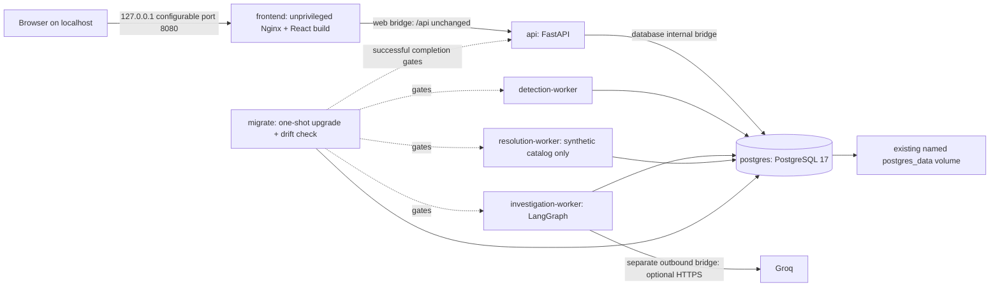

# Phase 6: containerization and operational verification

Phase 6 packages the existing Phases 1–5 application. It preserves migrations 0001–0004, the locked dependency graphs, APIs, dashboard sessions, Groq fixes, evidence safeguards and human-approved synthetic execution. No Phase 7 redesign, unrestricted agent tool or production remediation executor is included.

## Architecture



```mermaid
sequenceDiagram
    participant B as Browser
    participant N as Nginx
    participant A as FastAPI
    participant P as PostgreSQL
    participant W as Separate worker
    B->>N: Same-origin authenticated /api request
    N->>A: Bounded request; replaced forwarded headers
    A->>P: Authenticate, authorize, commit durable job
    P-->>A: Commit succeeds
    A-->>B: Accepted / versioned response, no-store
    W->>P: Claim with lease and fencing token
    W->>W: Bounded computation / optional model await outside DB transaction
    W->>P: Guarded checkpoint or atomic synthetic result
    B->>N: Poll existing status/report API
    N->>A: Proxy without response caching
    A-->>B: Real persisted status and human-review result
```

## Images, services and configuration

Phase 7 uses version-neutral `:local` image tags; this section reflects the current configuration. Historical validation dates/results below remain unchanged.

`deploy/backend.Dockerfile` uses a uv 0.11.28 build stage, Python 3.12 Bookworm dependencies installed by `uv sync --locked --no-dev --no-editable`, and a runtime stage with only the environment, application and Alembic files. Development tests, uv tooling, host environments and credentials are excluded. API, migration and all three worker services reuse `incidentflow-backend:local`. Runtime UID/GID is 10001.

`deploy/frontend.Dockerfile` uses Node 22.23.4 and `npm ci` against the existing lockfile, builds the unchanged React app, then copies only static output into `nginxinc/nginx-unprivileged:1.30.6-alpine` as `incidentflow-frontend:local`, UID/GID 101. The runtime uses the [current stable Nginx release](https://nginx.org/en/download.html), checked against [its security advisories](https://nginx.org/en/security_advisories.html) on the verification date. There are no public frontend secret variables or altered authentication logic. Docker tags pin the supported Python/Node/Nginx/PostgreSQL lines rather than `latest`; image changes still require rebuild, vulnerability review and acceptance testing.

Compose services are `postgres`, one-shot `migrate`, `api`, `detection-worker`, `investigation-worker`, `resolution-worker`, and `frontend`. The explicit `test` profile retains `postgres-test` and loopback 55433. The `postgres_data` key and default project `incidentflow` preserve `incidentflow_postgres_data`; there is no reset path. `compose.dev.yaml` optionally adds loopback 55432 for the old host workflow. The default application publishes only the frontend's loopback port.

The container launcher builds its internal `postgres:5432` URL from escaped `DB_USER`, `DB_PASSWORD` and `DB_NAME`; optional `CONTAINER_DATABASE_URL` overrides it. It intentionally ignores the host `DATABASE_URL` pointing at 127.0.0.1:55432. The private `.env` is neither replaced nor mounted. Existing retry/batch/budget settings are explicitly mapped at runtime. `CONTAINER_CORS_ORIGINS=[]` suits the same-origin proxy while the host's existing CORS setting remains available to Vite development. Groq credentials go only to API and the investigation worker. Missing credentials do not prevent normal application startup.

## Startup, readiness, recovery and resource limits

PostgreSQL must be healthy before the migration one-shot runs. A transaction advisory lock prevents simultaneous migration attempts. `upgrade head` and `check` run in the same transaction and exact revision 0004 is verified after commit. Failure exits nonzero and prevents dependent services from starting. API/workers verify revision on each container launch. Startup does not silently stamp, downgrade, create_all, truncate or drop application data.

API liveness is independent of PostgreSQL/provider health; readiness checks database/revision. Worker checks combine a fresh event-loop heartbeat with DB/revision verification, not an invented queue-success metric. Model and job errors remain in their existing status/step APIs. Containers use structured lifecycle logs and bounded log rotation. No monitoring service or worker listener was added.

Application filesystems are read-only with 32 MiB writable `/tmp`; services drop capabilities and prohibit privilege escalation. Backend services have 512 MiB/1 CPU/128 PID limits; Nginx 128 MiB/0.5 CPU/64 PIDs. PostgreSQL has its required writable named volume and 512 MiB/1 CPU/128 PID limits. These are local starting bounds, not production sizing guarantees.

Workers retain their existing module entry points and signal handling. SIGTERM stops new claims and allows bounded in-flight work to finish. Investigation shutdown allows 210 seconds by default; increase `INVESTIGATION_STOP_GRACE_PERIOD` when increasing its absolute-duration policy. Forced termination relies on persisted leases, fencing, checkpoint reuse and atomic effects. The five-second heartbeat continues during async waits and is removed with the process/tmpfs, so idle workers do not appear dead merely because no jobs arrive. Docker health does not itself trigger a restart. Approval expiry, model limits and cumulative budgets continue to apply after recovery.

Nginx serves SPA deep links, immutable successful fingerprinted assets and no-store HTML/API responses. It resolves Docker service DNS again after API replacement. It limits request sizes/timeouts/connections and login frequency, replaces untrusted forwarded headers, and does not retry non-idempotent backend requests. Uvicorn does not blindly trust incoming proxy headers. See [security decisions and limitations](security_deployment.md).

## Implementation map

| Files | Purpose |
| --- | --- |
| `.dockerignore`, `deploy/*` | Allowlisted build context, locked multi-stage builds, unprivileged serving and reverse proxy |
| `compose.yaml`, `compose.dev.yaml`, `.env.example`, `.gitignore` | Full stack, retained data/test profile, explicit host development access and runtime-only configuration |
| `backend/app/ops/*` | Safe configuration, migration/drift/revision gate, bootstrap launch, health checks and structured logs |
| `backend/app/main.py`, three worker entry modules | Lifecycle logs and asynchronous heartbeats; business worker methods remain intact |
| `backend/tests/phase6/test_operations.py` | URL/credential handling, heartbeat/log privacy, bootstrap, idempotent migration, drift and wrong-revision regression coverage |
| `scripts/verify_containers.py` | Real isolated six-service verification, existing browser workflows, crash/restart/persistence, backup/restore and image-layer secret scanning |
| `.github/workflows/ci.yml` | Four independent quality/browser/container jobs; pinned actions and no deployment credentials |
| README and deployment/architecture/AI guides | Actual commands, architecture, limitations and results |

## Validation scenarios and evidence

`scripts/verify_containers.py` generates an owned `incidentflow-verify-*` Compose project and private runtime environment. It starts from an empty named volume, provisions three explicit test users, and runs all five existing Chromium workflows through Nginx against real API/worker containers. These cover ingestion/detection, fake-provider investigation/citations, human separation of duties, synthetic execution, optimistic conflicts, viewer authorization, memory-only sessions, pagination, runbooks, deep links and responsive layouts.

It stops detection, queues one known job, starts a separate container executing the real durable claim implementation, kills that process after the claim commits, and verifies takeover at attempt two after lease expiry. This is a deterministic crash after claim, not a fabricated in-memory recovery; stale-owner fencing and crash-after-effects boundaries remain separately covered by PostgreSQL backend tests. It restarts workers, performs normal `down`/`up` and compares account/incident/report/audit counts, and restores a native pg_dump archive to a different database with matching counts. It verifies missing Groq isolation, production rejection of fake configuration, loopback-only port definitions, security/cache headers, non-root images and literal runtime/local secret absence in saved image layers. It never makes a hosted model request or deletes the development volume.

Local outcomes are recorded below. GitHub-hosted execution is a separate, unverified external condition until a real workflow run completes. [CI jobs](ci_cd.md) and [PowerShell commands including backup/restore](docker_operations.md) describe how to repeat the checks.

### Local verification record — 2026-11-03

- Backend full regression: **450 passed in 757.80 seconds**. The latest focused operations suite passed **9 tests in 6.35 seconds**, including a bootstrap regression added after the full run was collected; the counts overlap and are not summed.
- Ruff lint and format checks passed across **144 Python files**. Existing Groq debugging regressions remain in the passing backend suite.
- Latest backend unit selection: **130 passed, 321 integration cases deselected in 2.62 seconds**. This includes the final bootstrap and environment-isolation guards.
- Frontend: TypeScript, ESLint, **49 tests**, production build and OpenAPI contract check passed.
- Existing Playwright harness: **5 passed in 23.2 seconds** against the real API, workers and isolated PostgreSQL schema.
- Both Docker images built successfully. All six long-running Compose services became healthy and the migration one-shot exited 0.
- The same **five Chromium workflows also passed through container Nginx**, including login, detected incidents, fake-provider investigation/citations, distinct-user approval and synthetic execution.
- Final image verification was repeated successfully with **Nginx 1.30.6**, including API/HTML no-store and immutable asset headers, all five browser workflows, recovery/persistence, backup/restore and secret scans. The main stack was updated to that image and rechecked healthy; its backend reports **Python 3.12.16**.
- Isolated container acceptance passed worker claim-crash recovery (attempt two), independent worker restart, normal `down`/`up` persistence, native backup/restore into a separate database, absent-Groq normal API availability, production fake rejection, loopback-only port configuration, non-root images and literal secret scanning across saved image layers. No hosted call was made.
- The actual existing development volume was backed up privately to `.tools/incidentflow-before-phase6.dump`, then started under the new main stack. Counts remained **9 users, 13 incidents, 128 logs, 8 investigation reports and 7 resolution events**. Health/readiness/deep-link checks passed; there were no pending hosted jobs.
- Hash comparisons confirmed the private `.env`, uv.lock, package-lock.json and migrations 0001–0004 were unchanged. The original volume name remained `incidentflow_postgres_data`. Only frontend 127.0.0.1:8080 was published after stopping the explicit test service.
- GitHub workflow syntax/semantics passed local actionlint 1.7.7. **No GitHub-hosted workflow run, image publication, public TLS deployment or remote hosting was performed or claimed.**

Real container testing caught and corrected two deployment defects: operator exec commands must use the configuration launcher, and Docker Desktop frontend port publishing needs a normal web bridge rather than an `internal`-only bridge. The database network remains internal, and API/PostgreSQL still publish no host ports.

## Deployment and backend interview questions

1. **Why containerize an application that already runs locally?** Images package the supported runtime, locked dependencies and startup entry points together. Compose makes the API/worker/database/proxy topology repeatable; it does not replace application authorization or durable jobs.
2. **How do images differ from containers?** An image is a reusable filesystem/configuration artifact. A container is a running instance with its own process/network namespace and ephemeral writable state; PostgreSQL data therefore belongs in a named volume.
3. **Why use multi-stage builds?** Build tools are needed to compile React and install Python dependencies, not to serve requests. Copying only the runtime artifact reduces image contents and prevents the Node build toolchain or uv installer from becoming runtime dependencies.
4. **What makes dependency installation reproducible?** `uv sync --locked` refuses an inconsistent uv.lock, while `npm ci` installs package-lock.json exactly. Runtime image patch tags can still move, so fully immutable releases would additionally record/review image digests.
5. **Why does localhost fail as a database hostname inside an application container?** It names that container's own network namespace. The internal server is `postgres:5432`; the host's old 127.0.0.1:55432 URL is intentionally handled separately.
6. **Why build a URL with SQLAlchemy URL.create?** Passwords can contain `@`, `/`, `:` and percent characters. Structured construction escapes credentials correctly instead of interpolating a malformed URL or printing it during troubleshooting.
7. **Why keep the existing named volume?** Container recreation is routine, while user accounts, reports and append-only audit records must survive it. Renaming the volume can make existing data appear missing; deleting it would actually lose the data.
8. **How does startup avoid a migration race?** One service waits for database health, takes a PostgreSQL advisory transaction lock, upgrades, checks drift and verifies the expected head. API/workers depend on its successful exit and never independently migrate.
9. **Why check both a revision and drift?** The Alembic version can say 0004 even after manual table edits. Revision checks catch the wrong migration lineage/head; metadata comparison detects supported categories of physical schema difference, but does not prove every trigger/permission matches.
10. **Does depends_on solve database failures forever?** No. It orders initial startup. Connection pre-ping, readiness, retries and durable leases handle later failures; operators still need to inspect unhealthy services and restored database compatibility.
11. **What is readiness versus liveness?** Liveness indicates a serving process. Readiness indicates its required database/schema can support requests. Groq is optional and worker failures are separate, so they should not incorrectly make all incident-management availability fail.
12. **Why run each worker separately?** It gives each queue independent lifecycle, resource limits, health and logs. Durable PostgreSQL ownership prevents the API from needing a process-local background task to complete a user's request.
13. **What does a worker heartbeat prove?** A recent timestamp proves its event loop can schedule the heartbeat. Coupled database checks prove connectivity/revision; neither establishes queue progress or successful investigation output, which require job/status diagnostics.
14. **How does graceful shutdown differ from crash recovery?** SIGTERM asks the loop to stop claiming and finish bounded work. A forced kill cannot clean up; another process must recover the persisted lease and respect its new fencing token.
15. **Why are fences stronger than a lease timestamp alone?** A slow owner can resume after its lease expired. Every guarded write must match the current claim token, preventing it from overwriting a newer owner even if its remote request eventually succeeds.
16. **Why keep remote model awaits outside database transactions?** A slow or throttled model must not retain row locks or idle transactions. The graph reserves cost and commits, calls the provider, then uses short fenced transactions to account, validate and checkpoint.
17. **Are model calls exactly once?** No. A crash after a charged response but before checkpoint commit can require another call. Persisted cumulative reservations and explicit retries bound the exposure; valid checkpoints avoid unnecessarily repeating completed stages.
18. **Why use Nginx instead of Vite in the runtime?** Vite is the development tool; Nginx serves the compiled artifact and proxies same-origin API requests. This centralizes cache, request and header policy without changing browser token handling.
19. **Why overwrite X-Forwarded-For instead of appending blindly?** An untrusted client can supply its own value. The edge replaces it with the observed peer and clears other forwarded headers; the backend currently does not interpret forwarded identity at all.
20. **Why resolve the API hostname dynamically?** Compose can replace a container with a different IP while retaining its service name. Nginx uses Docker DNS periodically instead of retaining a stale startup address indefinitely.
21. **Why cache assets but not API/HTML responses?** Fingerprinted assets change names when their contents change and are public immutable artifacts. Authenticated records, tokens and HTML entry points need fresh no-store behavior to avoid sensitive/stale persistence.
22. **What does running non-root accomplish?** It reduces the process's filesystem and OS authority if compromised. Read-only roots, dropped capabilities and bounded writable tmpfs reinforce that boundary; none replaces correct application authorization.
23. **Are environment variables a secret manager?** No. They avoid baking values into images and fit the existing application, but Docker administrators can inspect them. A real external deployment needs controlled injection, auditing, rotation and operator access policy.
24. **Why not add Redis for rate limiting?** The current loopback package can use Nginx's built-in per-IP controls and existing request/job budgets without a new stateful service. Distributed/account-aware abuse protection remains a clearly documented production requirement rather than a decorative dependency.
25. **How does CI avoid testing against the development database?** Backend/browser fixtures enforce the dedicated test identity/port and create a random schema per run. Container acceptance uses a separate random Compose project/volume and never addresses the default development volume.
26. **Why test through the real proxy and browser?** Direct API tests do not catch SPA refresh, CSP, cookie/cache/header behavior or Docker port/network mistakes. The same existing workflows can expose those deployment defects without substituting mocked backend data.
27. **Why use pg_dump instead of copying a live volume?** Native tools produce a consistent logical archive and understand PostgreSQL state. Copying active database files without a correct physical-backup procedure can produce an unusable snapshot; restoration must be tested independently.
28. **How is a safe restore designed?** Create a unique separate target, fail if it exists, restore with error propagation, and compare revision, representative records and audit/report counts. Cutover is a separate operator decision; startup must never destructively restore over live data.
29. **Does passing CI mean production has been deployed?** No. These jobs build and test local isolated infrastructure; they have no registry or deployment credentials and publish nothing. A GitHub run must actually finish before its status can be claimed.
30. **What remains before an Internet-facing deployment?** HTTPS/trusted ingress, identity/account policy, monitored capacity, account-aware abuse controls, SQL role separation, tested encrypted backups, vulnerability updates and ownership of upgrades/rollback. Phase 6 provides repeatable artifacts and checks for future work without starting Phase 7's UI changes.
