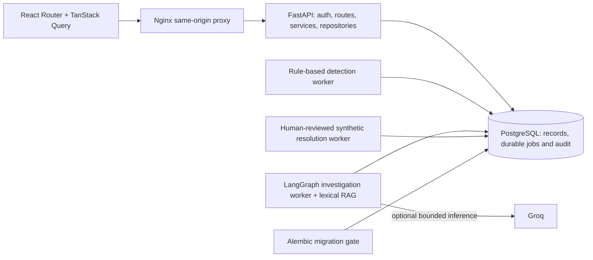

# Finalization and publication preparation

Phase 7 refines the existing console and completes portfolio/release materials. Backend algorithms, migrations 0001–0004, API contracts, durable jobs, Groq handling, evidence guards and synthetic approval boundaries remain intact. No new frontend/runtime dependency or hosted model call was required.

## User-visible changes

| Area | Before | Final behavior |
| --- | --- | --- |
| Service references | Detail reads even when a fresh service list was loaded | Actual registered names reuse page/detail caches; simulation labels come from the recorded environment |
| Identifiers | Full UUIDs dominate some headings; correlations use ambiguous prefixes | Compact prefix/suffix labels, exact accessible/title values, copy buttons and manual-selection fallback |
| Overview | Chart values require hover; sparse cards stretch to unrelated neighbors | Labeled counts, announced refresh state, meaningful empty queue and content-sized activity cards |
| Incidents | Assignee UUIDs and limited drill-down context | Bounded directory names with honest ID fallback, filtered service-incident links and lifecycle explanations |
| Logs | One ambiguous correlation value; metadata always expanded | Separate trace/request identities, wrapped messages, copyable IDs, semantic timestamps and optional metadata |
| Detections | Compact technical terminology only | Expandable threshold, receipt-time window, deduplication and cooldown definitions; deterministic processing stays explicit |
| Investigations | Long primary ID, all completed steps expanded, safe diagnostics undisplayed | Stored provider/model labels, compact identity, completed-history disclosure, safe failure diagnostics and grouped citations |
| Resolution | Author/target UUIDs and raw provenance dominate context | Real author/service labels, synthetic target/version, clear approval policy and optional provenance; authorization unchanged |
| Timeline | Source ID dominates context | Copyable source identities and explicit recorded human/system actors, preserving cursor ordering |
| Runbooks/services | Inconsistent service identity/navigation | Shared real labels, runbook association, copyable IDs and service-incident links; safe rendering preserved |
| Accessibility | Form help can become part of the control name | Separate names/descriptions, focus restoration, status announcements, reduced-motion charts and reflow checks |

`ResourceLinks.tsx`, `RecordDetails.tsx` and existing `ui.tsx` keep affordances shared. A service detail read can be seeded from a cached page with its actual update time; TanStack Query still controls staleness/invalidation. Names are never guessed by stripping generated suffixes. Directory reads remain bounded to the existing 100-record page, so unavailable/out-of-page people retain an honest UUID fallback.

Citation chips show six references and disclose additional sources explicitly. Selection still uses the exact full reference and opens the stored excerpt/provenance. The UI allowlists safe failure fields instead of rendering raw/unknown diagnostic payloads. Older records without details say their exact cause cannot be reconstructed.

## Architecture and source map



The [README source map](../README.md#source-map-and-documentation), [architecture](architecture.md), [frontend architecture](frontend_architecture.md) and [interview guide](interview_preparation.md) explain the implementation. Shipped technologies are Python/FastAPI/Pydantic/SQLAlchemy/asyncpg, PostgreSQL/Alembic, LangGraph/Groq, React/TypeScript/Vite/React Router/TanStack Query/Tailwind/Recharts/Lucide, Docker/Nginx and GitHub Actions. No Redis, vector database, embeddings service, Kubernetes or production remediation executor is claimed.

Seven [real screenshots](screenshots/README.md) show isolated synthetic fixtures at 1440 × 1000: overview, incident, logs, investigation summary, hypotheses, proposal and verification. They contain generated test personas and safe source identities, never login fields, producer tokens or private accounts. Capture is opt-in; ordinary checks leave approved images untouched.

## Verification scope

The full backend run passed **459 tests in 753.72 seconds**. Frontend quality passed TypeScript, ESLint, **58 tests**, production build and unchanged OpenAPI contract comparison. All **six Playwright workflows passed in 33.0 seconds**, preserving the original five and adding an independent portfolio scenario with accessible control names, modal Escape/focus and 720px/390px reflow. After adding the final two Git-index safety cases, the complete unit selection passed **140 tests (321 deselected)**, including all **10 publication-audit cases**. Overlapping test runs are not summed. Ruff lint and format checks passed across **147 files**; local actionlint and the **244-file** source/link/secret audit passed. The staged audit correctly refused the inherited home-directory Git root; project-local staging remains a manual step.

Both neutral-tag images built. The isolated Compose verifier passed **six Chromium workflows through Nginx**, claim-crash recovery, normal shutdown/startup persistence, native PostgreSQL backup/restore to a separate database, missing-Groq availability, production fake rejection, non-root images and saved-layer literal secret scans. These checks never access the development volume or call hosted inference. Local actionlint passed; no GitHub-hosted run is claimed.

The main stack was recreated successfully and all six services are healthy. Whole-row content hashes and counts matched before/after for **9 users, 13 incidents, 128 logs, 8 investigation reports and 7 resolution events**. The private `.env`, dependency lockfiles, all four migrations and every investigation backend source file also retained their original hashes. HTTP health/readiness and SPA deep links returned 200; anonymous incident access returned 401. The exact migration head and drift recheck passed without new operations. The named `incidentflow_postgres_data` volume was retained; no data reset occurred.

Final tags are `incidentflow-backend:local` and `incidentflow-frontend:local`. The verifier reads image names from resolved service configuration, avoiding stale hardcoded names. Dockerfiles, Nginx 1.30.6 and runtime boundaries remain; the project/volume name is unchanged. Historical phase records retain their original dates/scope.

## PowerShell operations

```powershell
Set-Location C:\Users\manee\Desktop\incidentflow
docker compose config --quiet
docker compose up --build -d --wait --wait-timeout 180
Start-Process http://127.0.0.1:8080
docker compose ps
Invoke-RestMethod http://127.0.0.1:8080/api/v1/ready
docker compose logs --tail 100 api detection-worker investigation-worker resolution-worker
```

Keep the private `.env`; only fresh checkouts generate it. Use an existing account or [explicit provisioning](docker_operations.md#complete-application), with a different engineer/admin reviewer for synthetic changes. The fake adapter requires development configuration; missing Groq credentials do not stop normal APIs.

Normal shutdown preserves named data: `docker compose down`. Do not add `-v`.

```powershell
docker compose --profile test up -d --wait postgres-test
uv sync --locked
uv run --locked pytest -q
uv run --locked ruff check backend scripts
uv run --locked ruff format --check backend scripts
uv run --locked python scripts/check_release.py
Push-Location frontend
try {
    npm ci
    npm run typecheck
    npm run lint
    npm test
    npm run build
    npm run api:check
    npx playwright install chromium
    npm run test:e2e
} finally { Pop-Location }
docker compose build api frontend
uv run --locked python scripts/verify_containers.py
```

The migration service runs upgrade, drift checking and exact head verification. Recheck with `docker compose run --rm migrate`, or revision-only `docker compose exec -T api python -m app.ops.launch check`. Follow the [maintenance/backup guide](docker_operations.md); never reset or stamp populated data to conceal drift.

## Publication audit and Git root safety

This workspace inherited a Git repository rooted at `C:/Users/manee`, not at the project directory. **Do not broadly stage against that home-directory repository.** No project repository was initialized, staged, committed, created on GitHub or pushed automatically.

The release audit checks publication paths, known literal runtime secrets, credential patterns, local Markdown links and an empty secret template. Staged mode rejects an ancestor root and reads exact Git index blobs, including already tracked paths, rather than silently checking different working-tree content. It never prints matching secret values or changes the index. It cannot prove the absence of every unknown/encoded secret or validate external URLs/Markdown anchors.

After review, run these commands yourself from the project directory. Explicit paths avoid sweeping unrelated files into the initial snapshot:

```powershell
Set-Location C:\Users\manee\Desktop\incidentflow
$projectRoot = (Resolve-Path .).Path
git init -b main
$gitRoot = (Resolve-Path (git rev-parse --show-toplevel)).Path
if ($gitRoot -ne $projectRoot) { throw 'Wrong Git root. Stop before staging.' }
git check-ignore .env .venv .tools frontend/node_modules frontend/dist
git add -- .gitignore .dockerignore .env.example LICENSE README.md pyproject.toml uv.lock compose.yaml compose.dev.yaml .github backend deploy frontend scripts docs
uv run --locked python scripts/check_release.py --staged
if ($LASTEXITCODE -ne 0) { throw 'Audit failed. Inspect locally; do not publish.' }
git diff --cached --check
if ($LASTEXITCODE -ne 0) { throw 'Review staged formatting errors.' }
git diff --cached --stat
git status --short
# Review the full staged diff locally before committing.
git commit -m 'Finalize IncidentFlow operations console and release validation'
```

MIT was added after the owner selected it. Review the collective copyright notice, third-party licenses, screenshots and remote/audience. Create/select the GitHub repository yourself; only then choose whether to publish:

```powershell
$repositoryUrl = Read-Host 'Reviewed GitHub repository URL (no embedded credentials)'
git remote add origin $repositoryUrl
# Optional manual publication after review:
git push -u origin main
```

Use normal credential/SSH authentication, not a token embedded in the URL. Check actual hosted workflow results after pushing; do not add a passing-CI badge before those runs succeed.

## Manual verification and remaining limits

- Rehearse with explicitly provisioned roles and explain the actual implementation, including Codex assistance.
- Review every screenshot at full size, rights, copyright notice, staged paths and repository audience before publication.
- Check native browser zoom, screen-reader behavior, contrast needs and browser engines beyond Chromium. Automated accessibility smoke checks are not WCAG certification.
- Verify hosted GitHub runs after an intentional push. No public TLS deployment or new live Groq/container inference was performed.
- Keep operational limitations visible: local loopback hosting, shared SQL owner credentials, no token revocation service, no account-aware distributed limiter and no log-retention/partition policy. Public deployment needs trusted HTTPS ingress, account policy, monitoring, vulnerability updates and tested encrypted off-host backups.
- Citation integrity does not prove causality; synthetic verification does not prove production recovery. No arbitrary model tool, automatic approval or production remediation was added.

The application has no known blocker from these checks. Repository initialization, rights review, remote selection and hosted execution remain deliberate owner steps.

## Targeted UI refinement, November 5, 2026

This subsequent frontend-only polish replaces expanded before/after JSON with nine recorded synthetic metrics, explicit units and missing-value handling. The complete original result remains under **View raw execution data**. Unified timeline entries use less vertical space while retaining source identities, actors, links, timestamps, metadata and cursor ordering. Approval/execution logic and backend/API contracts are unchanged. The [operator guide](dashboard_user_guide.md) and [real screenshot gallery](screenshots/README.md) describe the final presentation.

TypeScript, ESLint, the production build and OpenAPI comparison passed. All **69 frontend tests passed**, including **11 new focused tests**. The full Chromium rerun passed **6 workflows in 33.3 seconds**; the final screenshot workflow also passed independently. One existing mobile-navigation width assertion failed in the first full run, then passed in isolation and in the complete rerun. Its transient cause was not established; no unrelated application or test behavior was changed to conceal it.

The frontend image was rebuilt and recreated through Compose at `http://127.0.0.1:8080`. A read-only browser session using an existing viewer checked the actual saved recovery proposal: all nine metric pairs matched the saved execution API response, the raw payload remained exact, narrow layouts fit, and the existing incident timeline paginated correctly. No execution or approval was repeated and no Groq call was made. The verification screenshot was refreshed and a timeline capture added using isolated synthetic fixtures.

All **28 existing public tables** retained identical content hashes and counts, including 9 users, 13 incidents, 128 logs, 9 investigations, 8 reports, 1 proposal, 1 execution and 7 resolution events. All 142 protected files, including backend Python sources/tests, private environment and dependency locks, retained their original hashes. Backend tests were not rerun for this frontend-only change. The database volume was retained, the temporary test database was stopped, and all six application services remain healthy. No Git initialization, staging, commit or publication was performed.
