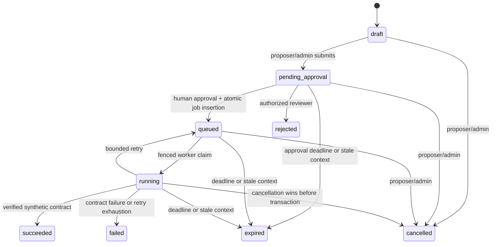

# Resolution workflow operations

Phase 4 executes only deterministic actions against a dedicated synthetic-state table in the existing PostgreSQL database. No action contacts infrastructure, invokes a shell, accepts a script, fetches a URL or executes model-supplied SQL. Existing Phase 3 recommendations remain read-only advisory text. A human selects a catalog identifier explicitly.

## Startup in PowerShell

Run every terminal from `C:\Users\manee\Desktop\incidentflow`. Keep the private existing `.env`; use the README's generator only for a fresh checkout.

Setup:

```powershell
Set-Location C:\Users\manee\Desktop\incidentflow
uv sync --locked
docker compose -f compose.yaml -f compose.dev.yaml up -d --wait postgres
docker compose --profile test up -d --wait postgres-test
uv run alembic -c backend/alembic.ini upgrade head
```

API terminal:

```powershell
$env:INVESTIGATION_LLM_PROVIDER = 'fake'
$env:INVESTIGATION_LLM_MODEL = 'fake-v1'
uv run uvicorn app.main:create_app --factory --app-dir backend --host 127.0.0.1 --port 8000
```

Detection terminal:

```powershell
$env:PYTHONPATH = 'backend'
uv run python -m app.workers.detection_worker
```

Investigation terminal:

```powershell
$env:PYTHONPATH = 'backend'
$env:INVESTIGATION_LLM_PROVIDER = 'fake'
$env:INVESTIGATION_LLM_MODEL = 'fake-v1'
uv run python -m app.workers.investigation_worker
```

Resolution terminal:

```powershell
$env:PYTHONPATH = 'backend'
uv run python -m app.workers.resolution_worker
```

The resolution worker does not need a Groq key or provider configuration. Multiple instances are supported. `--once` attempts one bounded batch and exits; it does not wait through retry backoffs. Ctrl+C stops new claims and finishes the bounded current operation. A forced kill is recovered through the persisted lease.

## Complete deterministic demo

Provision three distinct accounts with admin, engineer and viewer roles using [README bootstrap](../README.md). There are no default passwords or public account-creation APIs. In a fifth repository-root terminal, provide those accounts privately:

```powershell
$env:PYTHONPATH = 'backend'
foreach ($demoRole in @('ADMIN', 'ENGINEER', 'VIEWER')) {
    Set-Item -Path "Env:DEMO_${demoRole}_EMAIL" -Value (Read-Host "$demoRole email")
    $demoPassword = [System.Net.NetworkCredential]::new('', (Read-Host "$demoRole password" -AsSecureString)).Password
    Set-Item -Path "Env:DEMO_${demoRole}_PASSWORD" -Value $demoPassword
    Remove-Variable demoPassword
}
try {
    uv run python -m app.simulations.resolution_demo --timeout 120
} finally {
    foreach ($demoRole in @('ADMIN', 'ENGINEER', 'VIEWER')) {
        Remove-Item -Path "Env:DEMO_${demoRole}_EMAIL", "Env:DEMO_${demoRole}_PASSWORD" -ErrorAction SilentlyContinue
    }
}
```

The CLI authenticates all three accounts and verifies their roles and distinct identities. It checks the API is configured for the fake investigation provider before creating work. It then uses only HTTP APIs to:

1. Reuse the Phase 2 seeded database failure: create labeled service/rule, ingest logs, wait for one detected incident, verify duplicate delivery and revoke the temporary ingestion key.
2. Initialize synthetic database exhaustion and create a matching runbook.
3. Request a Phase 3 investigation and retrieve its synthetic report.
4. Have the engineer explicitly author `simulate_connection_pool_recovery`, with valid report evidence references and an idempotency UUID.
5. Submit the immutable draft; verify viewers cannot approve or submit and the proposer cannot approve a synthetic mutation.
6. Have the separate admin approve; atomically queue the job. A replayed approval returns 409.
7. Wait for the dedicated worker's committed result and synthetic verification. Replayed proposal creation returns the same proposal/result identity.
8. Compare the incident payload with its pre-execution value to prove the worker did not change incident state.
9. Have the engineer explicitly transition the synthetic incident to investigating and then resolved through the original Phase 1 API.
10. Print the complete paginated timeline with source UUIDs/timestamps and a final assertion summary.

The demo creates labeled synthetic resources and retains them for inspection. It prints IDs, synthetic observations, event records and verification flags, never passwords/tokens. A successful synthetic recovery is not evidence of real production recovery. This demo deliberately resolves only its own synthetic incident, via the human API.

## Action catalog

`GET /api/v1/action-catalog` returns five definitions with stable identifiers, version, description, risk, approval/separation requirements, parameter/result/verification JSON schemas and a five-second execution budget.

| Action | Effect |
| --- | --- |
| `inspect_service_health` | Read health, error rate, dependency condition and observation time |
| `inspect_database_connections` | Read pool capacity, active connections, waiting requests and timeout indicator |
| `inspect_request_latency` | Read synthetic request count, p50/p95, endpoint and dependency delay |
| `simulate_service_recovery` | Apply the deterministic healthy fixture when the synthetic dependency permits recovery |
| `simulate_connection_pool_recovery` | Apply the deterministic healthy fixture to correct synthetic pressure; verify the contract |

All results retain complete bounded before/after synthetic snapshots. Recovery against the `dependency_outage` fixture fails verification and does not report success. Successful recovery changes state only when values differ; a healthy replay has no second state change. No catalog identifier is derived from free-form model text.

## Proposal request and APIs

All endpoints require existing human bearer authentication. Machine ingestion keys confer no workflow authority. Paths below are relative to `/api/v1`.

| Method/path | Contract |
| --- | --- |
| GET `/action-catalog`, `/action-catalog/{action_id}` | Typed catalog; all human roles |
| POST `/services/{id}/synthetic-state` | Admin initialization/reset; scenario and `expected_version` (0 for creation) |
| GET `/services/{id}/synthetic-state` | Typed snapshot/version; all human roles |
| POST `/incidents/{id}/resolution-proposals` | Engineer/admin create or exact replay; 201 and Location |
| GET `/incidents/{id}/resolution-proposals` | Bounded limit/offset, optional status filter, stable created-at/UUID ordering |
| GET `/resolution-proposals/{id}` | Current workflow state and immutable payload/provenance |
| POST `/resolution-proposals/{id}/submit` | Proposer/admin, draft only, expected version |
| POST `/resolution-proposals/{id}/approve` | Engineer/admin, expected version and reason; second user for mutations |
| POST `/resolution-proposals/{id}/reject` | Same review authorization; no job created |
| POST `/resolution-proposals/{id}/cancel` | Proposer/admin; expected version; eligible nonterminal states |
| GET `/resolution-proposals/{id}/approval` | Immutable human decision/snapshot; 404 before a decision |
| GET `/resolution-proposals/{id}/execution` | Job status, attempts, safe errors; 404 before queueing |
| GET `/resolution-proposals/{id}/result` | Structured committed result/verification; 409 before one exists |
| GET `/resolution-proposals/{id}/events` | Bounded page ordered by proposal version |
| GET `/incidents/{id}/timeline` | Keyset page across all four phases; limit 1–100 and optional cursor |

Example human-authored proposal, replacing UUIDs/versions with actual API values:

```json
{
  "client_request_id": "4d88a19c-fdb1-4fcb-88ca-444444444444",
  "expected_incident_version": 1,
  "action_id": "simulate_connection_pool_recovery",
  "parameters": {
    "state_id": "4d88a19c-fdb1-4fcb-88ca-111111111111",
    "expected_state_version": 1
  },
  "origin": "human",
  "investigation_id": "4d88a19c-fdb1-4fcb-88ca-222222222222",
  "evidence_refs": ["log:4d88a19c-fdb1-4fcb-88ca-333333333333"],
  "explanation": "I reviewed the cited evidence and request this isolated synthetic correction."
}
```

Without an investigation, omit its ID and leave evidence empty. Such proposals are explicit human decisions, not AI-backed claims. For report-origin read-only proposals, set `origin=investigation`, an actual recommendation index and valid evidence intersecting that recommendation's references. A synthetic mutation cannot use report-origin mode. Linked investigations must be completed/inconclusive, belong to the incident and have usable evidence. Report payload hash, creation time, selected recommendation (if any) and references are preserved.

Submit/cancel bodies contain `expected_version`; review bodies also require a nonblank reason of 5–1000 characters. No PATCH, direct execute, requeue or payload-edit endpoint exists. Material changes require a new proposal and approval. The actor-scoped client UUID must be explicitly supplied; identical replay returns the same resource even after completion, while changed content returns `409 idempotency_conflict`. Twenty active proposals per requester is the admission cap.

All action parameters are limited to `state_id` and `expected_state_version`. Unknown fields, executable commands, scripts, URLs, arbitrary target selectors and invented action names are rejected. Catalog schemas are available directly for future UI form generation.

## Lifecycle and expiration



Approval is a durable decision and `approval_granted` audit event, immediately followed by queue eligibility in the same transaction. There is no separate externally visible approved state. Rejected/cancelled/expired proposals cannot be reused; create a new proposal. Attempts are bounded; automatic retries cannot renew approval.

`RESOLUTION_APPROVAL_TTL_SECONDS` defaults to 900 (30–3600), `RESOLUTION_LEASE_SECONDS` to 30 (15–120), and `RESOLUTION_MAX_ATTEMPTS` to 3 (1–5). Values are snapshotted at creation. TTL starts on submit and covers review, queueing, retries and completion. The worker sweeps pending approvals and checks deadlines at claim/execution/commit. An idle worker being stopped means expiry status can lag until it resumes; approval never becomes executable merely because the sweeper has not run.

Review of a newly expired/stale pending proposal returns **200 with terminal expired status**, committing the expiry and audit record rather than rolling them back through an exception. No approval/job is created. Other invalid transitions/versions are 409, missing resources 404, role violations 403, invalid fields/references 422 and admission exhaustion 429. Check response status **and** proposal lifecycle.

Every incident version change invalidates pending execution, including assignment/severity edits. Closing/resolving or retargeting an incident, resetting/changing synthetic state, removing/changing a catalog definition, altering report provenance or quarantining selected evidence also blocks execution. This conservative policy intentionally requires fresh review after benign context edits.

## Worker and timeline semantics

Claims use SKIP LOCKED and commit a fresh token/lease/attempt plus a start event. Execution reacquires locks in job → proposal → incident → synthetic state order, validates the approval snapshot/current context, runs a pure fixed simulator and commits effect, result, verification, terminal states and events together. Statement/lock timeouts and a five-second execution timeout bound this local transaction; no remote I/O occurs inside it. The separate Phase 3 hosted call still runs outside database transactions.

Retryable execution exceptions roll back effects and produce a safe `execution_error` retry event with 2, 4… seconds backoff capped at 30. Verification failure is terminal with an inspectable failed-contract result. Attempts are visible in jobs and append-only start/retry/failure events. Forced crashes before commit roll back; a committed unique execution receipt is not run again. Only same-database synthetic effects get this atomic guarantee; it is not an exactly-once promise for future external infrastructure.

Cancellation serializes against execution. If cancellation invalidates ownership first, no synthetic effect can commit. If execution already owns the locks and commits first, cancellation returns 409 for the now-terminal/stale proposal. A narrow approval/cancellation race can leave an unclaimed job pending until the worker cleans it up, but the cancelled proposal cannot execute.

The timeline unions actual incident events, detection creation records, persisted investigation request/start/completion milestones and resolution events. It does not infer commands or resolutions from model text. Rows preserve source type/UUID, timestamps, safe metadata and deterministic ordering. Cursor pages bind to the incident and an upper time watermark. This is a bounded READ COMMITTED view, not a cross-request MVCC snapshot; unusually late commits with earlier timestamps can still affect visibility. Proposal/event list offset pages can move under concurrent writes.

Verification commands:

```powershell
uv run pytest -q
uv run pytest -q backend/tests/phase4
uv run ruff check .
uv run ruff format --check .
uv run alembic -c backend/alembic.ini current
uv run alembic -c backend/alembic.ini check
```

See [approval security](approval_security.md) and [implementation/validation](phase4_implementation.md) for tested guarantees and limits.
